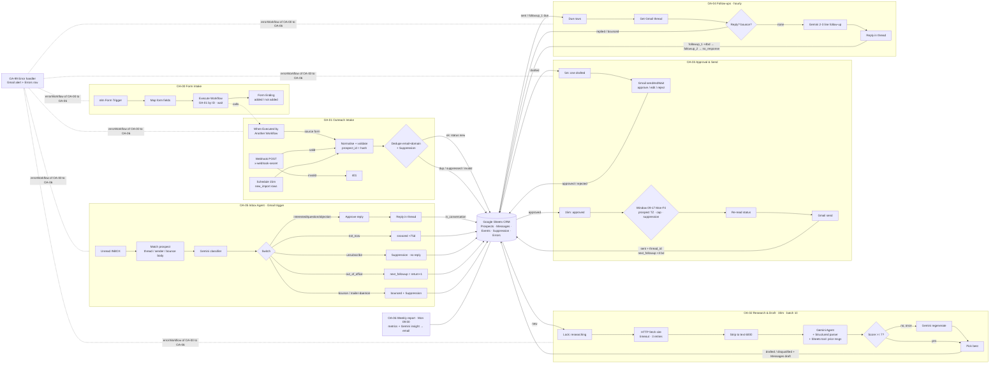

# OA (Outreach Agent): architecture

Eight n8n workflows share one Google Sheet. The **status column on Prospects is the only hand-off** between workflows (the one exception: OA-00 Form Intake calls OA-01 directly), so each workflow is small, independently schedulable, and safe to re-run.



## Status lifecycle

```
new_import ─OA-01─▶ new ─OA-02─▶ researching ─OA-02─▶ drafted ─OA-03─▶ pending_approval ─OA-03─▶ approved ─OA-03─▶ sent
   │                           │                                 │
   ├▶ duplicate_email/domain    ├▶ disqualified / research_failed  └▶ rejected
   ├▶ suppressed / invalid_email
sent ─OA-04─▶ followup_1 ─OA-04─▶ followup_2 ─OA-04─▶ no_response
any active ─OA-04/OA-05─▶ replied ─OA-05 approve─▶ in_conversation
           ─OA-05─▶ snoozed (recontact_at +75d) · unsubscribed · bounced
send errors ─▶ send_failed / followup_failed / reply_failed / needs_review (manual triage)
```

## Design decisions

| Decision | Why |
|---|---|
| **The sheet status is the queue** | Every workflow selects by status and writes the next status. There is no shared memory, and the only sub-workflow call is OA-00 → OA-01, so any workflow can be paused or re-run. |
| **Form split into its own workflow (OA-00)** | n8n (Form Trigger v2.2+) refuses to start a workflow whose Form Trigger can reach a **Respond to Webhook** node. OA-01 needs Respond nodes for its webhook API (202 / 401), so the form lives in OA-00, which calls OA-01 through **Execute Workflow → When Executed by Another Workflow** (accept all data) and shows the result on a **Form Ending** page. OA-01's Map Form Payload forces `_source = form`, so a caller can't target sheet rows. |
| **`prospect_id` = deterministic hash of the email** | Re-importing the same person always produces the same key. All updates match on `prospect_id`. |
| **Re-read before every mutate or send** | Each loop iteration re-reads the row and checks it still has the expected status. A double trigger or an overlapping execution can't double-send. OA-02 also "locks" a row as `researching` first. |
| **Approval decoupled from sending** | Approval can happen any time. Lane B only sends when the prospect's local time is 09–17 Mon–Fri, the daily cap isn't hit, and the address and domain aren't suppressed. |
| **One cap across all sends** | `DAILY_CAP` counts `sent` + `followup_sent` + `reply_sent` events today (DEFAULT_TIMEZONE). |
| **Suppression checked 3 times** | At intake, while planning the send, and again right before Gmail send. Unsubscribes never get a reply. |
| **Structured output and a code quality gate** | The parser enforces the JSON. A Code node re-scores against the style rules: 80–120 words, 3 paragraphs, no lists or labels, no buzzwords, mentions the video, signed. A low score gets exactly one regenerate, and the better draft is kept. |
| **Prompt-injection hygiene** | Website and email text is stripped of `{ }` (LangChain template braces) and clipped before it reaches Gemini. Classifier output is an enum, and an unsubscribe regex acts as a safety net. |
| **Every external node retries** | `retryOnFail`, 3 tries, a 2–5 s wait. HTTP fetch continues on failure. Gmail send errors go to an error output, which sets `*_failed` instead of crashing. |
| **Central error workflow** | OA-00 to OA-06 point to OA-99. You get a Gmail alert plus an Errors row with the node, message and execution link. |
| **No secrets in JSON** | The webhook secret comes from `$env.OUTREACH_WEBHOOK_SECRET` and fails closed. Credentials are attached after import. |

## Known limitations

- **Gmail sendAndWait waits per execution.** OA-03 requests one approval every 5 min. In OA-05, an approval pauses the remaining emails from the same poll until it's answered (or 24h passes).
- **Stuck locks.** If n8n crashes mid-run, a prospect can stay `researching` or `pending_approval`. Reset it manually.
- **Snoozed prospects** get `recontact_at` but aren't re-queued automatically. Filter on recontact_at in the sheet, or extend 04.
- **Matching** is by Gmail thread, then sender email. Replies from a different address are ignored and left unread.
- **Retry flags on AI sub-nodes** (model, parser, tool) are set but mostly cosmetic. Retries happen on the parent Agent and Chain nodes.
- **The Google Sheets tool** in OA-02 is n8n's generated `googleSheetsTool` node. It works in 1.x and 2.x; if your build lacks it, delete the tool (the agent still works).
- The send window uses the prospect's IANA timezone. A blank or invalid timezone falls back to DEFAULT_TIMEZONE.
