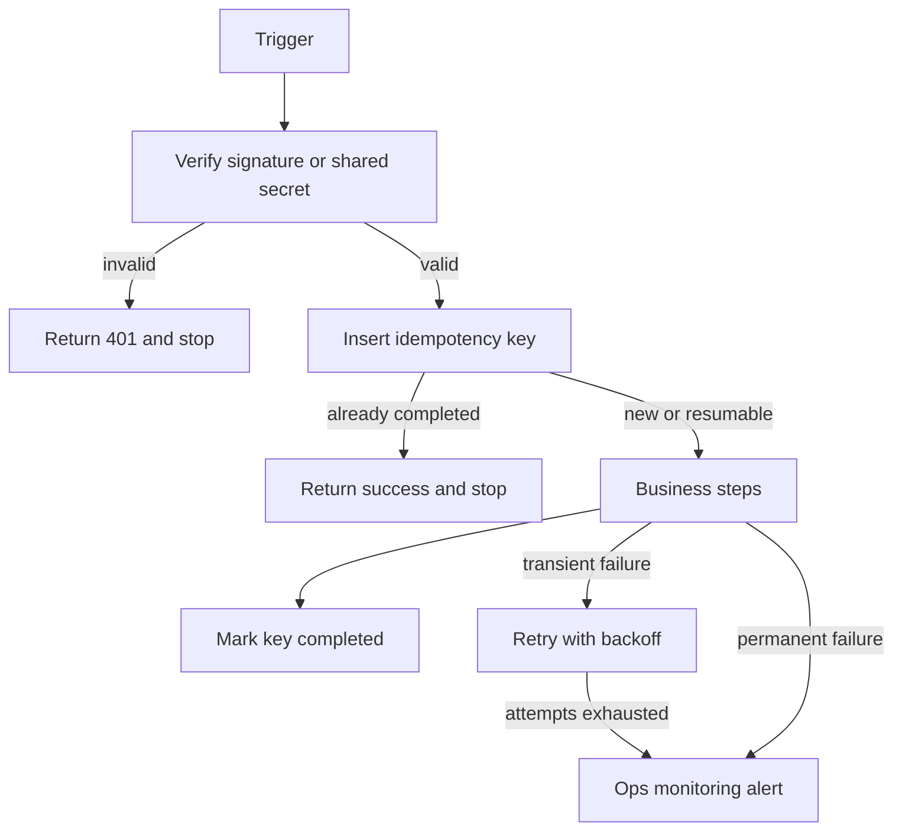

# NN — Workflow name

**Platform:** n8n or Make
**Status:** 🚧 In progress

Copy this file to `workflows/NN-short-name/README.md`. After the copy, point the standards links at `../../docs/engineering-standards.md`. The links in this template are correct for `templates/`.

Design spec only. The workflow export is not in this folder yet. The test checklist has not been run.

Standards: [../docs/engineering-standards.md](../docs/engineering-standards.md)

## Business problem

Who is blocked, what they do by hand today, and what the operator should see when the workflow has done its job. Leave client names, volumes, and timings out unless the client has published them.

## Trigger

The event, the system that emits it, and the credential or secret used to accept it.

## Flow

1. Verify the request.
2. Insert or resume the idempotency key.
3. Do the business steps, in order. Name the system each step writes to.
4. Mark the key completed only after the side effect succeeds.
5. On exhausted or permanent failure, POST the ops event to workflow 12.

## Architecture

## Error handling and edge cases

List the cases that would double-write, notify the wrong person, or guess a missing field. For each case, state the specified behavior.

Retries, backoff, and the ops payload follow [the engineering standards](../docs/engineering-standards.md).

## Integrations and credentials

Secrets live in the platform credential store. The export holds credential names only.

| System | Credential name | Used for |
| --- | --- | --- |
| Example | `example_credential` | What this connection does |

### Config

| Variable | Purpose | Spec default |
| --- | --- | --- |
| `dry_run` | Skip customer-facing sends and write the intended payload to the log. | `true` |

## Test checklist

These boxes are the plan. They have not been executed. Also complete the shared checklist in [the engineering standards](../docs/engineering-standards.md).

- [ ] Happy-path fixture completes in `dry_run`.
- [ ] Duplicate delivery does not double-write.
- [ ] The workflow-specific edge case below behaves as written.

## Files

Not in this folder yet:

- Workflow export (n8n JSON, or a Make blueprint).
- Screenshot of the canvas.
- The fixture set captured during a real test run.

`sample-data/` holds fictional payloads for design review. They are not a completed test suite.

| Path | What it is |
| --- | --- |
| `sample-data/example.json` | Fictional input. |
