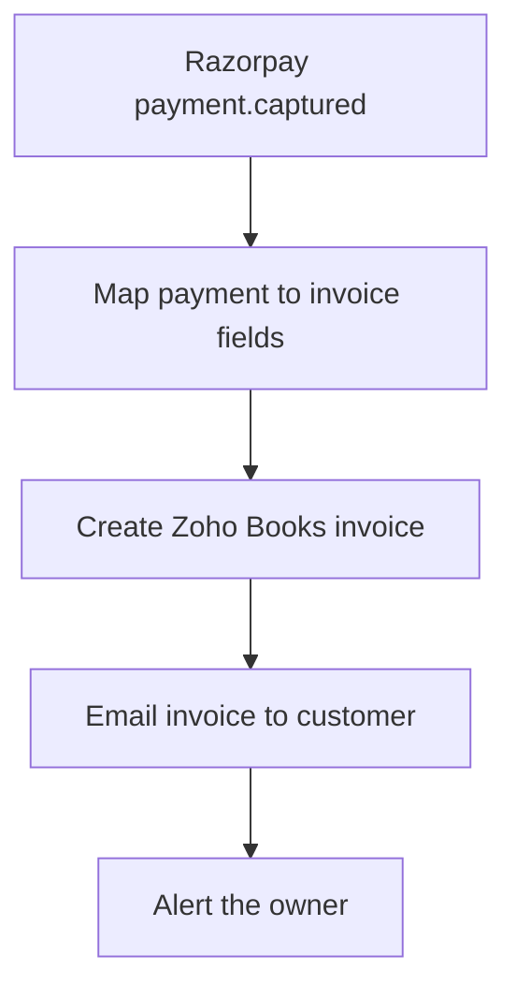

# 01 — Razorpay payment to Zoho Books invoice, email and owner alert

**Platform:** n8n
**Type:** single automation (plain number, no prefix)
**Status:** ✅ Built

I built and tested this as a basic n8n workflow. The canvas is named `01 · Razorpay → Zoho Books invoice → Email + owner alert`. When Razorpay captures a payment, the workflow creates an invoice in Zoho Books, emails it to the customer, and alerts the owner. I tested it with Razorpay in Test mode and a separate demo Zoho Books organisation, so no real payments or books were touched. The export and a canvas screenshot aren't in this folder yet. I'll add them next.

Standards: [../../docs/engineering-standards.md](../../docs/engineering-standards.md)

## For you

**Payment in, invoice out. Nobody retypes it.**

Every Razorpay payment still needs an invoice. On a busy day, someone forgets one or raises it late.

- Each payment becomes a Zoho Books invoice without anyone typing it in.
- The customer gets their invoice by email.
- You get an alert for every payment, so you know money came in and the invoice went out.

**Who it's for:** small businesses that take payments on Razorpay and keep books in Zoho Books.

**Tools:** Razorpay, Zoho Books, email, on n8n.

## Where this is used

A fuller production version of this flow runs at JobRays for its own payments and invoicing. It handles Razorpay payments and Zoho Books invoicing and bookkeeping, including international transactions. The build here is the basic core of that flow, so you can have invoices going out on the same day we set it up.

## Steps and skills

These are the steps in the basic build, and the skill each one shows.

| Step | What happens | Skills involved |
| --- | --- | --- |
| 1 | Razorpay sends `payment.captured` to an n8n webhook | Webhooks, Razorpay |
| 2 | Map the payment (customer, amount, description) to invoice fields | Data mapping |
| 3 | Create the invoice in Zoho Books | Zoho Books API, accounting automation |
| 4 | Email the invoice to the customer | Transactional email |
| 5 | Alert the owner that the payment came in and the invoice was sent | Notifications |

## Business problem

A customer pays through Razorpay. Then someone has to create the invoice in Zoho Books by hand and send it to the customer. This workflow does those steps as soon as the payment lands and lets the owner know.

## Flow

1. **Payment webhook.** Razorpay sends `payment.captured` to n8n.
2. **Map fields.** The customer, amount and item come from the payment.
3. **Create invoice.** Zoho Books creates the invoice.
4. **Email the customer.** The invoice is emailed to the payment email.
5. **Owner alert.** The owner gets a message with the payment and invoice details.

Errors go to `Shared · Error Alert`, the error workflow my single n8n automations use (see the [engineering standards](../../docs/engineering-standards.md#central-error-workflow)).

No Razorpay secret, Zoho organisation ID or email address is stored in this repo.

## Architecture

## Production upgrade (planned)

A fuller production version, like the one at JobRays, adds these on top of the core flow:

- Webhook signature verification, so only genuine Razorpay calls are processed.
- An idempotency key per payment, so a Razorpay redelivery never creates a second invoice.
- Config-driven tax (for example GST splits) that your accountant confirms.
- Recording the payment against the invoice, plus retries with backoff on temporary errors.

## Test checklist

I run these before anything goes live.

- [ ] A Razorpay Test-mode payment (shaped like `sample-data/payment-captured.json`) creates one invoice in the demo Zoho Books organisation.
- [ ] The customer email arrives with the invoice.
- [ ] The owner alert arrives with the payment and invoice details.
- [ ] A forced Zoho error triggers `Shared · Error Alert`.

## Files

Not in this folder yet:

- n8n workflow export.
- Screenshot of the canvas.

`sample-data/` holds a fictional Razorpay body. It isn't a client payment.

| Path | What it is |
| --- | --- |
| `sample-data/payment-captured.json` | Fictional `payment.captured` body. |
