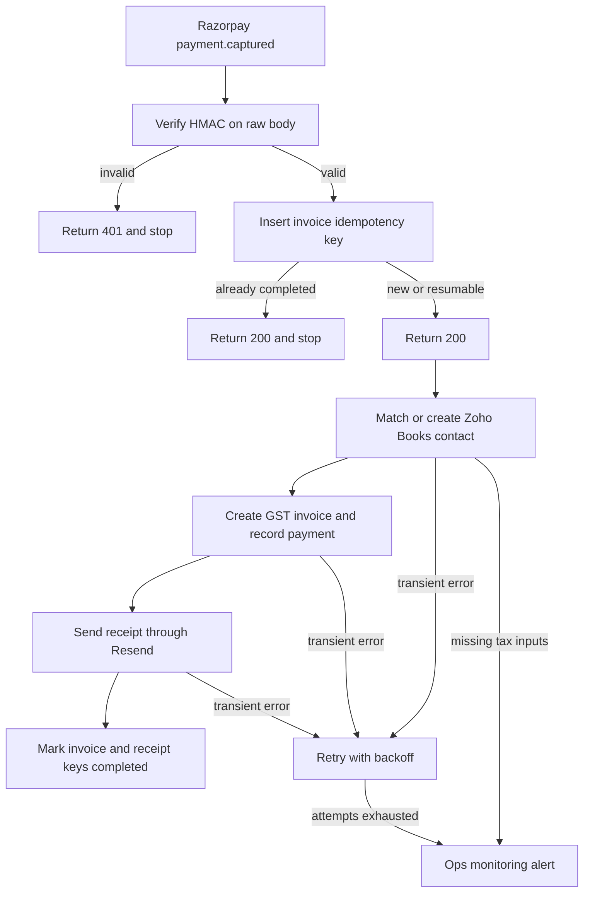

# 01 — Razorpay payment to Zoho Books GST invoice and Resend receipt

**Platform:** n8n
**Status:** 🚧 In progress

The design is documented here. I add the working export and a demo video as soon as this workflow is built and tested.

Standards: [../../docs/engineering-standards.md](../../docs/engineering-standards.md)

## For you

**Payment in, invoice out. Nobody touches a spreadsheet.**

Every Razorpay payment still needs a GST invoice and a receipt, and on a busy day someone either forgets one or raises it twice.

- Each captured payment becomes exactly one Zoho Books invoice and one receipt email.
- If Razorpay sends the same payment again, nothing duplicates.
- GST follows the rate and state your accountant sets, so the books stay clean at filing time.

**Who it's for:** businesses in India and the GCC that take payments on Razorpay and keep books in Zoho.

**Tools:** Razorpay, Zoho Books, Resend, on n8n.

## Business problem

A customer pays through Razorpay. Finance then creates a GST invoice in Zoho Books and sends a receipt. When Razorpay redelivers `payment.captured`, a manual process can create a second invoice or a second email.

One captured payment produces one Zoho Books invoice and one Resend receipt. A redelivery stops after the idempotency check. Tax rates and the business state come from config that the client's accountant confirms before go-live.

## Trigger

Razorpay sends `payment.captured` to an n8n webhook.

The verifier computes HMAC-SHA256 over the raw body with the webhook secret and compares it to `X-Razorpay-Signature`. Any other event name is acknowledged and ignored. A failed signature returns HTTP 401 and writes nothing.

The sample body is [`sample-data/payment-captured.json`](sample-data/payment-captured.json). The header value used in tests is the literal `mock_signature_not_valid`.

## Flow

1. Receive the webhook and verify the signature.
2. Respond with HTTP 200 only after the signature check passes and the idempotency insert has been attempted. Razorpay retries slow receivers, so the invoice work continues after the response.
3. Insert the invoice key `01-razorpay-zoho-books-invoicing:payment:{payment_id}:invoice`. If the row is already `completed`, stop. If it is `failed`, or `in_progress` and stale, resume.
4. Read the customer from the payment: `email`, `contact`, `notes.customer_name`, `notes.gstin`, `notes.place_of_supply`, and `notes.item_description`. Amounts are in paise.
5. Require `email`, `currency = INR`, a positive `amount`, and `place_of_supply`. If `place_of_supply` is missing, look up the customer state already stored in Zoho Books. If it is still missing, mark the key `failed` and alert. The run does not assume intra-state tax.
6. Find the Zoho Books contact by email. Create the contact when it is missing. When `notes.gstin` is present, store it on the contact and treat the invoice as B2B. When it is absent, treat the invoice as B2C.
7. Split tax from config. `amount_is_tax_inclusive` defaults to true, which matches a typical Razorpay capture. `gst_rate_percent` is config. The workflow does not choose a rate.
   - Place of supply equal to `business_state`: CGST and SGST, each half of the GST rate.
   - Otherwise: IGST for the full GST rate.
   - SAC/HSN comes from `notes.sac_hsn` when the checkout collected it, otherwise from `default_sac_hsn`. A missing code fails the run and alerts. The workflow does not invent a code.
8. Create the invoice in the configured Zoho Books organization and record a customer payment against it for the captured amount, using the Razorpay payment id as the payment reference. Razorpay's own fee stays off the customer invoice.
9. Insert a second key, `01-razorpay-zoho-books-invoicing:payment:{payment_id}:receipt`. Send one Resend email to the payment email with the customer name, amount, currency, payment id, invoice number, and the invoice link Zoho returns. Then mark the receipt key `completed`.
10. Mark the invoice key `completed` and store the Zoho invoice id in `result_ref`.

The fixture in this folder is ₹1,180.00 (`118000` paise), tax-inclusive at 18 percent, place of supply `UP`. With `business_state` set to `UP` for a test, the specified split is taxable value ₹1,000.00, CGST ₹90.00, and SGST ₹90.00. That arithmetic describes the fixture. It is not a client invoice.

## Architecture

## Error handling and edge cases

Shared retry, dedupe, and alert behavior is in the [engineering standards](../../docs/engineering-standards.md). Cases specific to this workflow:

| Case | Specified behavior |
| --- | --- |
| Razorpay redelivers the same `payment.id` | The completed invoice key stops the run. No second invoice and no second receipt. |
| Invoice was created and the receipt send failed | Resume only the receipt key. The Zoho payment reference remains the Razorpay payment id, so a repeated payment record is refused by that reference check. |
| `payment.authorized` or another event | Acknowledge and ignore. |
| Currency is not INR, or amount is 0 | Fail and alert. Do not create an invoice. |
| GSTIN is absent | B2C invoice, with the same tax split rules. |
| GSTIN is present and fails a 15-character format check | Fail and alert. The sample GSTIN is fictional and is only a format example. |
| Zoho already has an invoice whose reference is this payment id | Store that invoice id, skip create, and continue to the receipt step if the receipt key is not completed. |
| `amount_refunded` is greater than 0 on the capture payload | Fail and alert so a person can decide. The run does not invoice a payment that is already partly refunded. |
| Zoho or Resend returns 429 or 5xx | Retry with backoff, then alert. The idempotency row stays `failed` until a later run completes the step. |

## Integrations and credentials

| System | Credential name | Used for |
| --- | --- | --- |
| Razorpay | `razorpay_webhook` | Webhook secret for HMAC verification. |
| Zoho Books | `zoho_books_oauth` | Contacts, invoices, and customer payments. |
| Resend | `resend_api` | Receipt email. |
| Supabase | `supabase_service_role` | `processed_events` and `workflow_logs`. |
| Ops monitoring | `ops_webhook` | `X-Ops-Token` and the workflow 07 URL. |

### Config

| Variable | Purpose | Spec default |
| --- | --- | --- |
| `dry_run` | Create nothing in the live organization and send no email. Log the invoice payload that would have been sent. | `true` |
| `zoho_organization_id` | Target Zoho Books organization. | Client test organization |
| `business_state` | State code used for CGST/SGST versus IGST. Confirmed by the client. | Unset, which fails closed |
| `gst_rate_percent` | GST rate the accountant confirms. | Unset, which fails closed |
| `amount_is_tax_inclusive` | Whether the captured amount includes GST. | `true` |
| `default_sac_hsn` | SAC/HSN used when the payment notes omit one. | Unset, which fails closed |
| `from_address` | Verified Resend sender. | Client domain |
| `idempotency_stale_minutes` | When an `in_progress` row may be resumed. | `15` |

## Test checklist

I run these before anything goes live.

- [ ] The fixture with a bad signature returns 401 and creates no contact, invoice, or email.
- [ ] The fixture in `dry_run`, with `business_state` UP and `gst_rate_percent` 18, logs taxable value 100000 paise, CGST 9000, and SGST 9000.
- [ ] The same fixture with place of supply `MH` logs IGST 18000 and no CGST or SGST.
- [ ] A second delivery does not log a second invoice create.
- [ ] A receipt failure after a successful invoice resumes at the receipt step only.
- [ ] A payment with an empty `place_of_supply` and no Zoho state alerts and creates no invoice.
- [ ] A non-INR currency alerts and creates no invoice.

## Files

Not in this folder yet:

- n8n workflow export.
- Screenshot of the canvas.
- The fixture set captured during a real test run.

`sample-data/` holds a fictional Razorpay body for design review. It is not a payment from a client and it is not a completed test suite.

| Path | What it is |
| --- | --- |
| `sample-data/payment-captured.json` | Fictional `payment.captured` body. Pair it with header `X-Razorpay-Signature: mock_signature_not_valid`. |
