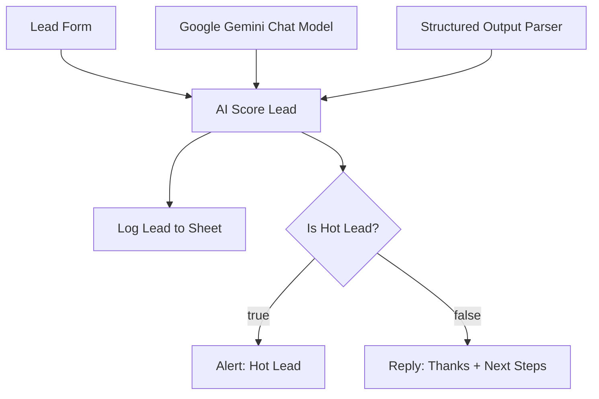

# 02 — AI lead qualification to Sheet and hot-lead alert

**Platform:** n8n
**Type:** single automation (plain number, no prefix)
**Status:** ✅ Built (v1)

Built in n8n. The canvas is named `02 · AI lead qualification → Sheet + hot-lead alert`. A form submission is scored, logged to Google Sheets, and emailed down one of two branches. The n8n export is not in this folder yet. This folder does not include a saved model response.

Screenshot: [`screenshots/canvas.png`](screenshots/canvas.png).
Exports: coming soon.

The folder slug stays `02-ai-email-triage-crm` so existing links keep working. The name comes from an earlier plan. What's built is the basic AI lead qualification flow described here: form → AI score → Sheet → hot-lead alert or thank-you. It doesn't triage email or write to a CRM.

Standards: [../../docs/engineering-standards.md](../../docs/engineering-standards.md)

## For you

**A form lead is scored, logged, and answered the same day.**

Leads fill in a form and then wait, because someone still has to decide who is worth a call.

- Every submission is scored and appended to a Google Sheet.
- A hot lead emails the owner or sales.
- Any other lead gets a thank-you and the next steps.

**Who it's for:** small teams who take leads on a form and live in Gmail and Google Sheets.

**Tools:** n8n Form, Google Gemini, Google Sheets, Gmail, on n8n.

This v1 does not use OpenAI, HubSpot, or Slack.

## Where this is used

A scenario: a coaching or consulting business that takes enquiries on its website form. I'd set this up so the owner hears about a hot lead the moment the form is submitted, and every other lead gets a thank-you with next steps straight away instead of waiting for a reply.

## Steps and skills

These are the steps I built, and the skill each one shows. The full flow and edge cases are below.

| Step | What happens | Skills involved |
| --- | --- | --- |
| 1 | **Lead Form** (n8n Form Trigger) takes the submission | n8n forms |
| 2 | **AI Score Lead**: a Gemini chat model with a Structured Output Parser returns a score and a qualification as JSON | AI scoring, structured output, prompt design |
| 3 | **Log Lead to Sheet** appends the lead to Google Sheets | Google Sheets integration |
| 4 | **Is Hot Lead?** (IF) picks the branch | Routing logic |
| 5 | **Alert: Hot Lead** emails the owner, or **Reply: Thanks + Next Steps** emails the lead | Gmail automation |

## Business problem

A form lead has to be read, judged, copied into a sheet, and answered by hand. Hot ones wait in the same pile as everyone else.

This workflow scores the submission, appends it to Google Sheets, and sends one Gmail message: an alert to the owner or sales when the lead is hot, or a thank-you with next steps to the lead when it is not.

## Trigger

n8n Form Trigger, on the node named Lead Form. The form is n8n's own form. This v1 does not take email or an external webhook.

The sample is [`sample-data/lead-form.json`](sample-data/lead-form.json). It is a fictional submission. The field names in that file are illustrative. They are not a copy of the live form.

## Flow

This is the v1 build: simple and working.

1. **Lead Form.** The n8n Form Trigger receives the submission.
2. **AI Score Lead.** An AI agent / LLM chain scores the lead. The chat model is Google Gemini Chat Model. A Structured Output Parser returns the score and the qualification as structured JSON. This README does not list the JSON keys, and this folder does not contain a saved model response.
3. In parallel from that score:
   - **Log Lead to Sheet.** Google Sheets appends the lead.
   - **Is Hot Lead?** An IF node picks the email.
4. **True:** **Alert: Hot Lead.** Gmail sends a message to the owner or sales.
5. **False:** **Reply: Thanks + Next Steps.** Gmail sends a message to the lead.

A hot lead does not also get the thank-you in this version. That reply is the false branch only.

No sheet id, Gmail address, or Gemini key is stored in this repo.

## Architecture

## v2 production upgrade (planned)

v1 does not do these yet.

- Multi-channel intake: the same score step can start from the form, from email, or from a signed webhook.
- Dedup by email, so the same address is not scored and emailed twice.
- An error workflow, with retries and an alert when Gemini, Sheets, or Gmail fails.
- CRM sync to HubSpot, and a Slack alert as an option next to the Gmail alert.
- Hot leads also get an instant reply, not only the owner alert.
- A person reviews borderline scores before the email is sent.
- An outcome log: the score, the path taken (hot alert or thank-you), and the response time. This repo will not invent those counts.

## Files

In this folder: [`screenshots/canvas.png`](screenshots/canvas.png), a screenshot of the live build.

Exports: coming soon.

Not in this folder yet:

- n8n workflow export.
- A saved Gemini response.

`sample-data/` holds one fictional form submission. It is not a client lead.

| Path | What it is |
| --- | --- |
| `sample-data/lead-form.json` | Fictional Lead Form submission. Field names are illustrative. |
