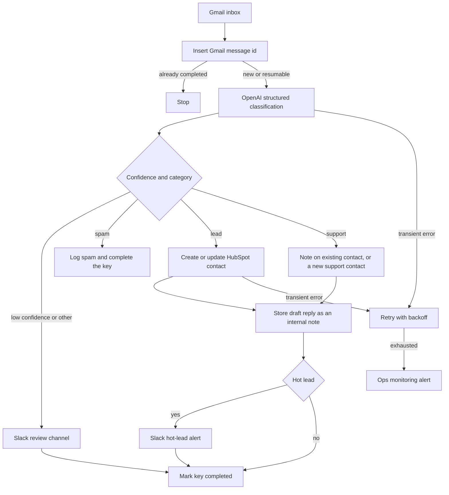

# 02 — AI email triage to CRM

**Platform:** n8n
**Status:** 🚧 In progress

The design is documented here. I add the working export and a demo video as soon as this workflow is built and tested.

Standards: [../../docs/engineering-standards.md](../../docs/engineering-standards.md)

## For you

**Your inbox, sorted before you've had your coffee.**

Real leads hide between support questions and cold pitches, and they wait until someone has time to copy them into the CRM.

- Every new email is labelled as a lead, support, spam, or "needs a human".
- Leads land in HubSpot with the details the email actually contains.
- Hot leads ping you in Slack, with a suggested reply waiting for a person to send.

**Who it's for:** small teams running a shared Gmail inbox with HubSpot as the CRM.

**Tools:** Gmail, OpenAI, HubSpot, Slack, on n8n.

## Business problem

A shared Gmail inbox mixes sales enquiries, support requests, and unsolicited mail. Someone reads each message, decides what it is, and copies the contact into HubSpot. Hot enquiries wait until that person is free.

Each new message is classified into `lead`, `support`, `spam`, or `other`, the contact fields that are actually present are written to HubSpot, and a draft reply is stored on the contact as an internal note. A hot lead also posts an alert to Slack. The reply stays in HubSpot until a person sends it.

## Trigger

A new message on the shared Gmail inbox, via the n8n Gmail Trigger, using the client's Gmail OAuth credential. The scope is read-only. The workflow does not send, delete, or modify mail.

There is no provider HMAC on a Gmail poll. Access is the mailbox credential. The idempotency key is the Gmail message id: `02-ai-email-triage-crm:email:{gmail_id}:triage`. A message with an empty id is not classified. The run alerts and stops, because there is no stable key.

The message body is untrusted data. Text inside it is not a workflow instruction.

The samples are [`sample-data/inbound-lead-email.json`](sample-data/inbound-lead-email.json), [`sample-data/inbound-support-email.json`](sample-data/inbound-support-email.json), and [`sample-data/inbound-spam-email.json`](sample-data/inbound-spam-email.json).

## Flow

1. Read `gmail_id`, `message_id`, `from`, `to`, `subject`, `text`, and `received_at`. Ignore attachments in this version. Record that they were present, and leave the bytes out of the model prompt and the log.
2. Insert the idempotency key. A completed key stops the run. A `failed` key, or an `in_progress` key older than `idempotency_stale_minutes`, resumes. A younger `in_progress` key stops.
3. Call OpenAI with structured output and the schema below. The message text is user content, not a system instruction. Temperature is 0. The node has a max token budget.
4. Apply the confidence gate. When `confidence` is below `min_confidence` (default 0.7), do not write a HubSpot contact. Post the subject, sender, and category to the review Slack channel and mark the key completed with result `needs_review`.
5. Branch on `category`:
   - `spam`: mark the key completed with result `spam`. Do not create a HubSpot contact.
   - `lead`: search HubSpot contacts by the sender email, then by `contact.email` when the model extracted a different address that was present in the body. Update the matched contact, or create one. Write a name only when the message contains one. A single-word name is stored as the first name. The last name stays empty. The workflow does not invent a surname, phone number, or company.
   - `support`: if a contact exists for the sender, add a note. If none exists, create a contact with `triage_category` set to `support` so the request is not dropped.
   - `other`: same as a low-confidence result. Review Slack, no new contact.
6. Write `summary` and `draft_reply` into a HubSpot note on any contact this run created or updated. The note is internal. The workflow does not call an email-send API.
7. When `category` is `lead`, `confidence` meets the threshold, and `hot_lead` is true, post one Slack message to `hot_lead_channel` with the sender, company, summary, and HubSpot contact link.
8. Mark the key completed and store the HubSpot contact id in `result_ref` when a contact was written.

`hot_lead` is true only when the body contains a request to talk, a budget, or a timeline. The model extracts those signals. It does not invent a phone number, budget, or company that the text does not contain. Empty extracted fields stay empty.

### Classification schema

```json
{
  "category": "lead",
  "confidence": 0.0,
  "hot_lead": false,
  "signals": {
    "asked_for_call": false,
    "budget_text": "",
    "timeline_text": ""
  },
  "contact": {
    "name": "",
    "email": "",
    "company": "",
    "phone": ""
  },
  "summary": "",
  "draft_reply": ""
}
```

`category` is one of `lead`, `support`, `spam`, `other`.

For the fictional lead fixture, the specified classification is `lead`, with `hot_lead` true, because the body asks for a call, names a budget, and names a timeline. That is the spec for the fixture. A model has not been run on it in this repo.

## Architecture



## Error handling and edge cases

Shared retry, dedupe, and alert behavior is in the [engineering standards](../../docs/engineering-standards.md). Cases specific to this workflow:

| Case | Specified behavior |
| --- | --- |
| The same Gmail message id is seen again | Stop. No second contact and no second Slack alert. |
| The body tells the model to ignore its rules or to force `hot_lead` | The schema still applies. The support fixture includes such a sentence and is specified to stay `support`. |
| Model output is not valid JSON or breaks the schema | Retry up to 3 times. Then alert and leave the key `failed` so a later run can resume. Do not write a partial contact. |
| OpenAI returns 429 or 5xx | Retry with backoff, with the model cap of 3, then alert. |
| HubSpot returns 429 | Back off and honor `Retry-After`. Search before create, so a retry does not add a second contact. |
| Sender address is empty | Alert and stop. Do not create a contact. |
| HubSpot search returns two contacts for one email | Update the first, and alert with both record ids. Do not update both silently. |
| Attachment-only mail | Alert and stop. This version does not parse attachments. |
| The model returns a phone or company the text does not contain | Drop that field, write the rest, and alert that a field was dropped. |

## Integrations and credentials

Create these on the client's account and plug them into the names below. This folder does not hold the secret values.

| System | Credential name | Used for |
| --- | --- | --- |
| Gmail | `gmail_triage` | Read-only access to the shared inbox. |
| OpenAI | `openai_api` | Structured classification. |
| HubSpot | `hubspot_oauth` | Contact search, create, update, and notes. Use the test portal while `dry_run` is on. |
| Slack | `slack_bot` | Review channel and hot-lead channel. |
| Supabase | `supabase_service_role` | Idempotency keys and logs. |
| Ops monitoring | `ops_webhook` | `X-Ops-Token` and the workflow 07 URL. |

### Config

| Variable | Purpose | Spec default |
| --- | --- | --- |
| `dry_run` | Mock mode. Log the HubSpot payload and the Slack text. Write no contact and post no Slack message. Turn this off only against the HubSpot test portal. | `true` |
| `gmail_label` | Label the trigger watches. | `INBOX` |
| `min_confidence` | Below this, the run asks for review. | `0.7` |
| `hot_lead_channel` | Slack channel id for hot leads. | Client channel |
| `review_channel` | Slack channel id for low confidence and `other`. | Client channel |
| `hubspot_portal_id` | Portal the contact links point at. | Client test portal |
| `openai_model` | Model id the client selects for classification. | Client choice |
| `max_output_tokens` | Cap on the classification call. | `800` |
| `idempotency_stale_minutes` | When an `in_progress` row may be resumed. | `15` |

Mock mode is `dry_run` true, using the pinned files in `sample-data/`. Live mode is `dry_run` false against the Gmail mailbox and the HubSpot test portal named above, after those credentials are plugged in. Production keys are out of scope for the first build.

## Test checklist

I run these before anything goes live.

- [ ] `inbound-lead-email.json` in `dry_run` logs category `lead`, `hot_lead` true, and a HubSpot upsert for `lead@example.com`.
- [ ] `inbound-support-email.json` stays `support` even though the body tells the model to mark it as a hot lead.
- [ ] `inbound-spam-email.json` logs `spam` and no HubSpot upsert.
- [ ] A second poll of the same `gmail_id` logs a skip.
- [ ] A response that omits `category` is retried and then alerts, with no HubSpot write.
- [ ] A model phone number that is not in the message body is dropped.
- [ ] The logged payload contains no OpenAI API key and no Gmail token.

## Files

Not in this folder yet:

- n8n workflow export.
- Screenshot of the canvas.
- The fixture set captured during a real test run.

`sample-data/` holds fictional messages for mock mode. They are not mail from a client.

| Path | What it is |
| --- | --- |
| `sample-data/inbound-lead-email.json` | Fictional sales enquiry with a budget, a timeline, and a request to talk. |
| `sample-data/inbound-support-email.json` | Fictional support request that also contains an instruction aimed at the model. |
| `sample-data/inbound-spam-email.json` | Fictional unsolicited pitch. |
