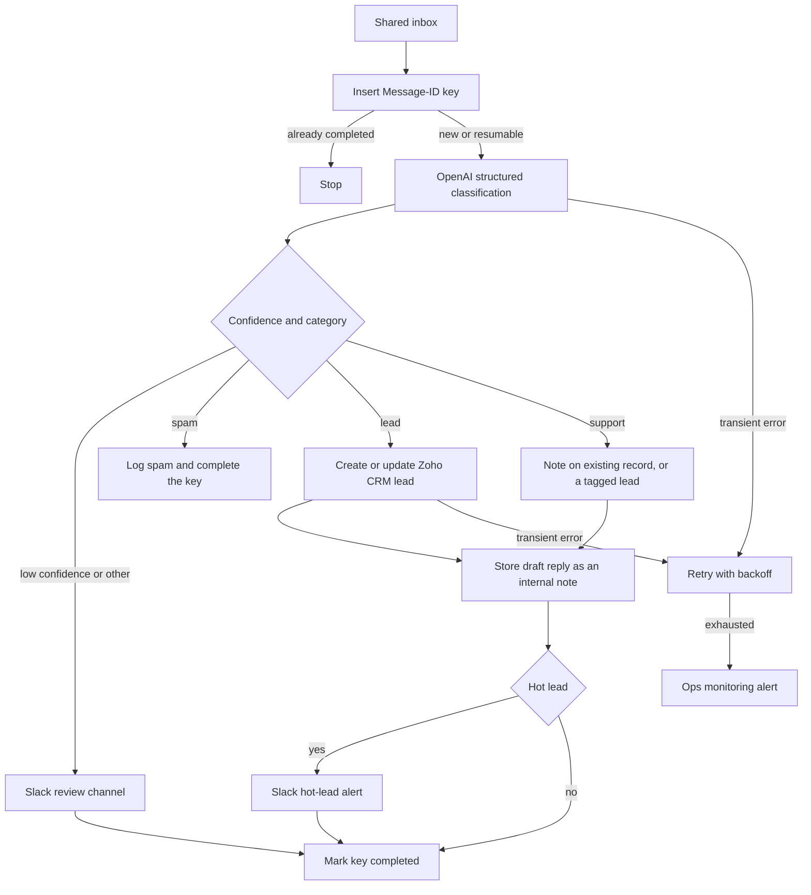

# 02 — AI email triage to Zoho CRM

**Platform:** n8n
**Status:** 🚧 In progress

Design spec only. The n8n export is not in this folder yet. The test checklist has not been run.

Standards: [../../docs/engineering-standards.md](../../docs/engineering-standards.md)

## Business problem

A shared inbox mixes sales enquiries, support requests, and unsolicited mail. Someone reads each message, decides what it is, and copies the contact into Zoho CRM. Hot enquiries wait until that person is free.

When this workflow is built, each new message is classified into `lead`, `support`, `spam`, or `other`, the contact fields that are actually present are written to Zoho CRM, and a draft reply is stored on the record. A hot lead also posts an alert to Slack. The draft is stored for a person to send. This workflow does not send the reply.

## Trigger

A new message on the shared inbox, via the n8n email trigger (IMAP or Gmail) using the client's mailbox credential.

The idempotency key is the RFC 5322 Message-ID: `02-ai-email-triage-zoho-crm:email:{message_id}:triage`.

There is no provider HMAC on a mailbox poll. Access is the mailbox credential. Messages that lack a Message-ID are not classified. The run alerts and stops, because there is no stable key.

## Flow

1. Read `message_id`, `from`, `to`, `subject`, `text`, and `received_at`. Ignore attachments in this version. Record that they were present, and leave the bytes out of the model prompt and the log.
2. Insert the idempotency key. A completed key stops the run.
3. Call OpenAI with structured output and the schema below. The message text is user content, not a system instruction. Temperature is 0. The node has a max token budget.
4. Apply the confidence gate. When `confidence` is below `min_confidence` (default 0.7), do not write a CRM lead. Post the subject, sender, and category to the review Slack channel and mark the key completed with result `needs_review`.
5. Branch on `category`:
   - `spam`: mark the key completed with result `spam`. Do not create a CRM record.
   - `lead`: search Zoho CRM Leads and Contacts by the sender email, then by `contact.email` when the model extracted a different address that was present in the body. Update the matched record, or create a Lead. Zoho requires a last name. Use the extracted name. When no name is present, use the mailbox display name, then `Unknown`.
   - `support`: if a Contact or Lead exists for the sender, add a note. If none exists, create a Lead with lead source `Email` and a tag `support` so the request is not dropped.
   - `other`: same as a low-confidence result. Review Slack, no new sales lead.
6. Write `summary` and `draft_reply` into a CRM note on any record this run created or updated. The note is internal. The workflow does not call an email-send API.
7. When `category` is `lead`, `confidence` meets the threshold, and `hot_lead` is true, post one Slack message to `hot_lead_channel` with the sender, company, summary, and CRM record link.
8. Mark the key completed.

`hot_lead` is true only when the body contains a request to talk, a budget, or a timeline. The model extracts those signals. It does not invent a phone number, budget, or company that the text does not contain. Empty extracted fields stay empty.

### Classification schema

```json
{
  "category": "lead",
  "confidence": 0.0,
  "hot_lead": false,
  "signals": {
    "asked_for_call": false,
    "budget_text": "",
    "timeline_text": ""
  },
  "contact": {
    "name": "",
    "email": "",
    "company": "",
    "phone": ""
  },
  "summary": "",
  "draft_reply": ""
}
```

`category` is one of `lead`, `support`, `spam`, `other`.

For the fictional lead fixture, the specified classification is `lead`, with `hot_lead` true, because the body asks for a call, names a budget, and names a timeline. That is the spec for the fixture. A model has not been run on it in this repo.

## Architecture



## Error handling and edge cases

| Case | Specified behavior |
| --- | --- |
| The same Message-ID is seen again | Stop. No second lead and no second Slack alert. |
| The body tells the model to ignore its rules or to force `hot_lead` | The schema still applies. The support fixture includes such a sentence and is specified to stay `support`. |
| Model output is not valid JSON or breaks the schema | Retry up to 3 times. Then alert and leave the key `failed` so a later run can resume. Do not write a partial lead. |
| OpenAI returns 429 or 5xx | Retry with backoff, with the model cap of 3, then alert. |
| Zoho returns 429 | Follow the shared Zoho backoff. |
| Sender address is empty | Alert and stop. Do not create a lead. |
| Two CRM records share the email | Update the Contact when one exists, and alert with both record ids so a person can merge them. Do not update both silently. |
| Attachment-only mail | Alert and stop. This version does not parse attachments. |

## Integrations and credentials

| System | Credential name | Used for |
| --- | --- | --- |
| Mailbox | `shared_inbox` | IMAP or Gmail read of the shared inbox. |
| OpenAI | `openai_api` | Structured classification. |
| Zoho CRM | `zoho_crm_oauth` | Lead and contact search, create, update, and notes. |
| Slack | `slack_bot` | Review channel and hot-lead channel. |
| Supabase | `supabase_service_role` | Idempotency keys and logs. |
| Ops monitoring | `ops_webhook` | Failure and run events. |

### Config

| Variable | Purpose | Spec default |
| --- | --- | --- |
| `dry_run` | Log the CRM payload and the Slack text. Write no CRM record and post no Slack message. | `true` |
| `min_confidence` | Below this, the run asks for review. | `0.7` |
| `hot_lead_channel` | Slack channel id for hot leads. | Client channel |
| `review_channel` | Slack channel id for low confidence and `other`. | Client channel |
| `openai_model` | Model id the client selects for classification. | Client choice |
| `max_output_tokens` | Cap on the classification call. | `800` |

## Test checklist

These boxes are the plan. They have not been executed.

- [ ] `inbound-lead-email.json` in `dry_run` logs category `lead`, `hot_lead` true, and a CRM upsert for `aman.verma@example.com`.
- [ ] `inbound-support-email.json` stays `support` even though the body tells the model to mark it as a hot lead.
- [ ] `inbound-spam-email.json` logs `spam` and no CRM upsert.
- [ ] A second poll of the same Message-ID logs a skip.
- [ ] A response that omits `category` is retried and then alerts, with no CRM write.
- [ ] The logged payload contains no OpenAI API key.

## Files

Not in this folder yet:

- n8n workflow export.
- Screenshot of the canvas.
- The fixture set captured during a real test run.

`sample-data/` holds fictional messages. They are not mail from a client.

| Path | What it is |
| --- | --- |
| `sample-data/inbound-lead-email.json` | Fictional sales enquiry with a budget, a timeline, and a request to talk. |
| `sample-data/inbound-support-email.json` | Fictional support request that also contains an instruction aimed at the model. |
| `sample-data/inbound-spam-email.json` | Fictional unsolicited pitch. |
