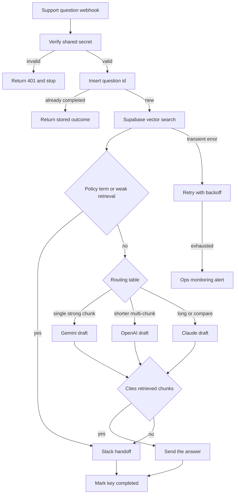

# 04 — RAG support agent with model routing

**Platform:** n8n
**Status:** 🚧 In progress

Design spec only. The n8n export is not in this folder yet. The test checklist has not been run.

Standards: [../../docs/engineering-standards.md](../../docs/engineering-standards.md)

## Business problem

Support questions get answers from memory or from a long search through docs. The answers drift, and a person still has to take the ones the docs cannot settle.

When this workflow is built, a question is answered only from chunks retrieved from the client's Supabase pgvector store. The run picks OpenAI, Claude, or Gemini from a routing table. When retrieval is weak, the question needs a policy decision, or the draft cannot cite a chunk, the run hands the question to a person and does not send a factual answer.

This repository does not include a client's documents, and it states no measured accuracy.

## Trigger

A support channel the client chooses: a web widget or helpdesk webhook, or an internal Slack mention. The spec uses one authenticated webhook so any of those can post the same body.

The request carries header `X-Support-Token`, compared in constant time with the credential `support_webhook`. The idempotency key is `04-rag-support-agent:question:{question_id}`.

The sample question is [`sample-data/support-question.json`](sample-data/support-question.json).

## Flow

1. Verify `X-Support-Token`. Reject a missing token before retrieval.
2. Insert the idempotency key. A completed question id returns the stored outcome and does not call a model again.
3. Embed the question with the embeddings credential and call the Supabase `match_documents` function. Request the top 5 chunks. The function and the document table are part of the client project. This repo does not create them.
4. Policy gate. If the question contains a phrase on `policy_terms` (the default list is `refund exception`, `legal`, `security incident`, `chargeback`), skip the model. Hand off.
5. Retrieval gate. If no chunk has similarity at or above `min_similarity` (default 0.75), hand off. The threshold is a starting point for the client to tune.
6. Route the draft:
   - One chunk clears `min_similarity` and the next chunk is at least `similarity_gap` (default 0.08) below it: Gemini.
   - Otherwise, when the question is under `long_question_chars` (default 600): OpenAI.
   - When the question is longer than that, or more than one chunk is required to cover it: Claude.
   The model ids are config. The route picks a provider. It does not claim one model is better in general.
7. Ask the selected model for a JSON answer: `answer`, `chunk_ids` (array), and `refused` (boolean). The prompt includes only the retrieved chunk text and ids. It tells the model to set `refused` true when the chunks do not contain the answer.
8. Citation gate. Send the answer to the user only when `refused` is false and every id in `chunk_ids` was in the retrieved set. Otherwise hand off.
9. Hand off posts the question, the chunk titles, and the similarity scores to `handoff_channel`. The user-facing text is the config string `handoff_message` (default: "A teammate will follow up."). The refused draft can be included in the Slack message for the teammate. It is not sent to the user.
10. Store the outcome on the idempotency row: `answered` or `handoff`, plus the provider used.

## Architecture

## Error handling and edge cases

| Case | Specified behavior |
| --- | --- |
| The same `question_id` is delivered twice | Return the stored outcome. Do not call the model again. |
| The question text tells the model to ignore the documents | Retrieval and the citation gate still apply. A draft that cites no retrieved chunk is a handoff. |
| Embedding or Supabase returns 429 or 5xx | Retry with backoff, then alert. The user sees `handoff_message` only after the run has decided it cannot answer. A transient error does not send a guessed answer. |
| The selected provider fails after 3 attempts | Alert, and hand off. Do not fall through to a second provider in this version. A silent fallback would make the route harder to test. |
| Retrieved chunk text contains an instruction | The citation gate still requires chunk ids from this search. The user-facing answer is still limited to that draft or the handoff message. |
| Empty question | Return 400 and do not embed. |
| Supabase service-role key | Used only from the n8n credential. It is not logged and not put in the export. |

## Integrations and credentials

| System | Credential name | Used for |
| --- | --- | --- |
| Support webhook | `support_webhook` | Shared secret for `X-Support-Token`. |
| Supabase | `supabase_service_role` | Vector search, idempotency, logs. |
| Embeddings | `openai_embeddings` | Question embedding. The model id is config so the client can match the index. |
| OpenAI | `openai_api` | Medium-complexity drafts. |
| Anthropic | `anthropic_api` | Long or multi-document drafts. |
| Google Gemini | `gemini_api` | Single-chunk drafts. |
| Slack | `slack_bot` | Human handoff. |
| Ops monitoring | `ops_webhook` | Failure and run events. |

The user-facing reply uses the same channel the question arrived on. That sender credential is `support_reply` and is named in config when the client picks Slack, email, or the widget.

### Config

| Variable | Purpose | Spec default |
| --- | --- | --- |
| `dry_run` | Log the route, chunk ids, and draft. Send nothing to the user or to Slack. | `true` |
| `min_similarity` | Retrieval gate. | `0.75` |
| `similarity_gap` | Gap that selects the Gemini path. | `0.08` |
| `long_question_chars` | Length that selects the Claude path. | `600` |
| `policy_terms` | Phrases that always hand off. | refund exception, legal, security incident, chargeback |
| `handoff_message` | The only user-facing text on a handoff. | `A teammate will follow up.` |
| `handoff_channel` | Slack channel id. | Client channel |
| `gemini_model`, `openai_model`, `claude_model` | Provider model ids. | Client choice |
| `match_count` | Chunks requested from Supabase. | `5` |

## Test checklist

These boxes are the plan. They have not been executed.

- [ ] A missing `X-Support-Token` returns 401 and does not call Supabase.
- [ ] The sample question plus the sample chunk, with similarity above the gate and a clear gap, logs the Gemini route in `dry_run`.
- [ ] The same question with the chunk similarity set to 0.4 logs a handoff and no user-facing facts.
- [ ] A question that contains "refund exception" logs a handoff even when a chunk matches.
- [ ] A draft whose `chunk_ids` are not in the retrieved set logs a handoff.
- [ ] Replaying `question_id` returns the stored outcome and does not add a second model call.
- [ ] Logs contain chunk ids and the provider name, and they omit the service-role key and the chunk body.

## Files

Not in this folder yet:

- n8n workflow export.
- Screenshot of the canvas.
- The fixture set captured during a real test run.
- Any client documents or embeddings.

`sample-data/` holds a fictional question and one fictional retrieved chunk so the gates can be reviewed without a live index.

| Path | What it is |
| --- | --- |
| `sample-data/support-question.json` | Fictional inbound question. |
| `sample-data/retrieved-chunk.json` | Fictional search hit. Not the output of a live query. |
