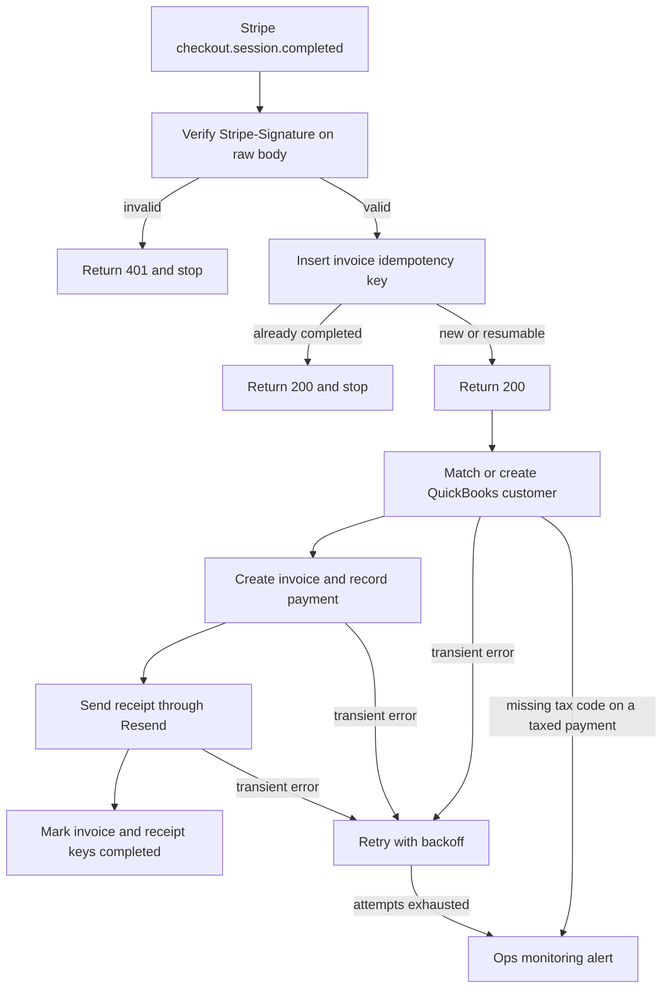

# 04 — Stripe payment to QuickBooks invoice and Resend receipt

**Platform:** n8n
**Status:** 🚧 In progress

The design is documented here. I add the working export and a demo video as soon as this workflow is built and tested.

Standards: [../../docs/engineering-standards.md](../../docs/engineering-standards.md)

## For you

**Stripe gets paid, QuickBooks gets the invoice, the customer gets a receipt.**
Finance shouldn't have to retype every sale, and they definitely shouldn't do it twice.
- Each paid Stripe checkout becomes one QuickBooks invoice and one receipt email.
- Repeat notifications from Stripe never create a second invoice or email.
- Sales tax uses the code your accountant confirms.
**Who it's for:** businesses selling through Stripe and keeping books in QuickBooks Online.
**Tools:** Stripe, QuickBooks Online, Resend, on n8n.

## Business problem

A customer pays through Stripe. Finance then creates an invoice in QuickBooks Online and sends a receipt. When Stripe redelivers `checkout.session.completed`, a manual process can create a second invoice or a second email.

One paid Checkout session produces one QuickBooks invoice and one Resend receipt. A redelivery stops after the idempotency check. Tax codes come from config that the client's accountant confirms before go-live.

## Trigger

Stripe sends `checkout.session.completed` to an n8n webhook.

The verifier reads `Stripe-Signature`, which carries a timestamp `t` and one or more `v1` signatures. The signed payload is `{t}.{raw body}`. The check is HMAC-SHA256 with the webhook signing secret, hex-encoded, compared in constant time to each `v1` value. A timestamp older than `stripe_tolerance_seconds` (default 300) is rejected. Re-serializing the JSON object changes the digest, so the verifier uses the raw body. A failed check returns HTTP 401 and writes nothing.

Any other event name is acknowledged and ignored. A session whose `payment_status` is not `paid` is acknowledged and ignored.

The sample body is [`sample-data/checkout-session-completed.json`](sample-data/checkout-session-completed.json). The header value used in tests is the literal `t=1760529602,v1=mock_signature_not_valid`.

## Flow

1. Receive the webhook and verify the signature on the raw body.
2. Respond with HTTP 200 only after the signature check passes and the idempotency insert has been attempted. Stripe retries slow receivers, so the invoice work continues after the response.
3. Insert the invoice key `04-stripe-quickbooks-invoicing:payment:{payment_intent}:invoice`. If the row is already `completed`, stop. If it is `failed`, or `in_progress` and older than `idempotency_stale_minutes`, resume. A younger `in_progress` row stops.
4. Read `customer_details.email`, `customer_details.name`, `amount_total`, `total_details.amount_tax`, `currency`, and `payment_intent`. Amounts are in the smallest currency unit.
5. Require an email, a positive `amount_total`, a `payment_intent`, and a currency on `currency_allowlist`. The default allowlist is `usd`. If any of those are missing, mark the key `failed` and alert. The run does not invent an email or a currency.
6. When `amount_tax` is greater than 0 and `qbo_tax_code_id` is unset, fail and alert. The workflow does not choose a tax rate. When `amount_tax` is 0, the invoice is created without a tax code.
7. Find the QuickBooks customer by email in `qbo_realm_id`. Create the customer when it is missing. The display name is `customer_details.name` when that field is present, otherwise the email.
8. QuickBooks `DocNumber` holds at most 21 characters. Build `short_ref` from the first 21 characters of the payment intent id. Query invoices with that `DocNumber`. When one exists and its `PrivateNote` equals the full payment intent id, store that invoice id and skip create. When one exists and the `PrivateNote` is different, fail and alert. Otherwise create the invoice using `qbo_item_id` and the description in `metadata.item_description`, set `DocNumber` to `short_ref`, and set `PrivateNote` to the full payment intent id. Then record a payment whose `PrivateNote` is the same id. Stripe's fee stays off the customer invoice.
9. Insert a second key, `04-stripe-quickbooks-invoicing:payment:{payment_intent}:receipt`. Send one Resend email to the customer email with the name, amount, currency, payment intent id, and the QuickBooks document number. Include a link only when QuickBooks returned one. Then mark the receipt key `completed`.
10. Mark the invoice key `completed` and store the QuickBooks invoice id in `result_ref`.

The fixture is 100.00 USD (`10000` cents) with no tax. That arithmetic describes the fixture. It is not a client invoice.

## Architecture

## Error handling and edge cases

| Case | Specified behavior |
| --- | --- |
| Stripe redelivers the same `payment_intent` | The completed invoice key stops the run. No second invoice and no second receipt. |
| Invoice was created and the receipt send failed | Resume only the receipt key. The QuickBooks invoice `DocNumber` remains `short_ref` and the `PrivateNote` remains the payment intent id, so a repeated invoice is refused by that lookup. |
| Another event name, or `payment_status` is not `paid` | Acknowledge and ignore. |
| `payment_intent` is null | Fail and alert. Do not invoice a session that has not produced a payment. |
| Currency is not on the allowlist, or amount is 0 | Fail and alert. Do not create an invoice. |
| `amount_tax` is greater than 0 and `qbo_tax_code_id` is unset | Fail and alert. Do not guess a rate. |
| QuickBooks already has an invoice whose `DocNumber` is `short_ref` and whose `PrivateNote` is this payment intent | Store that invoice id, skip create, and continue to the receipt step if the receipt key is not completed. |
| The session reports a refund amount greater than 0 | Fail and alert so a person can decide. The run does not invoice a payment that is already partly refunded. |
| QuickBooks or Resend returns 429 or 5xx | Retry with backoff, then alert. The idempotency row stays `failed` until a later run completes the step. |
| Two QuickBooks customers share the email | Alert with both ids and do not pick one. |

## Integrations and credentials

Create these on the client's test-mode Stripe account, QuickBooks sandbox company, and Resend sandbox sender. Plug them into the names below. This folder does not hold the secret values.

| System | Credential name | Used for |
| --- | --- | --- |
| Stripe | `stripe_webhook` | Webhook signing secret for `Stripe-Signature`. Test-mode secret while `dry_run` is on. |
| QuickBooks Online | `quickbooks_oauth` | Customers, invoices, and payments in the sandbox company. |
| Resend | `resend_api` | Receipt email. |
| Supabase | `supabase_service_role` | `processed_events` and `workflow_logs`. |
| Ops monitoring | `ops_webhook` | `X-Ops-Token` and the workflow 07 URL. |

### Config

| Variable | Purpose | Spec default |
| --- | --- | --- |
| `dry_run` | Mock mode. Create nothing in QuickBooks and send no email. Log the invoice payload that would have been sent. | `true` |
| `qbo_realm_id` | QuickBooks company. Use the sandbox company until the client says otherwise. | Client sandbox company |
| `qbo_item_id` | Item the invoice line uses. | Unset, which fails closed |
| `qbo_tax_code_id` | Tax code the accountant confirms. Required only when `amount_tax` is greater than 0. | Unset |
| `currency_allowlist` | Currencies the run will invoice. | `usd` |
| `stripe_tolerance_seconds` | Maximum age of the Stripe signature timestamp. | `300` |
| `from_address` | Verified Resend sender. | Client domain |
| `idempotency_stale_minutes` | When an `in_progress` row may be resumed. | `15` |

Mock mode is `dry_run` true, using the pinned file in `sample-data/`. Live mode is `dry_run` false against the Stripe test-mode webhook and the QuickBooks sandbox company, after those credentials are plugged in. Production keys are out of scope for the first build.

## Test checklist

I run these before anything goes live.

- [ ] The fixture with a bad `Stripe-Signature` returns 401 and creates no customer, invoice, or email.
- [ ] The fixture in `dry_run`, with a sandbox realm and an item id, logs one invoice for 10000 cents, currency `usd`, `DocNumber` `pi_mock_0001`, and `PrivateNote` `pi_mock_0001`.
- [ ] A copy of the fixture with `amount_tax` set to 1800 and no `qbo_tax_code_id` logs an alert and no invoice.
- [ ] A second delivery of the same `payment_intent` does not log a second invoice create.
- [ ] A receipt failure after a successful invoice resumes at the receipt step only.
- [ ] A session with no email alerts and creates no invoice.
- [ ] A currency of `inr` alerts and creates no invoice while the allowlist is `usd`.
- [ ] The logged payload contains no Stripe secret and no QuickBooks token.

## Files

Not in this folder yet:

- n8n workflow export.
- Screenshot of the canvas.
- The fixture set captured during a real test run.

`sample-data/` holds a fictional Stripe event for mock mode. It is not a payment from a client and it is not a completed test suite.

| Path | What it is |
| --- | --- |
| `sample-data/checkout-session-completed.json` | Fictional `checkout.session.completed` body. Pair it with header `Stripe-Signature: t=1760529602,v1=mock_signature_not_valid`. |
