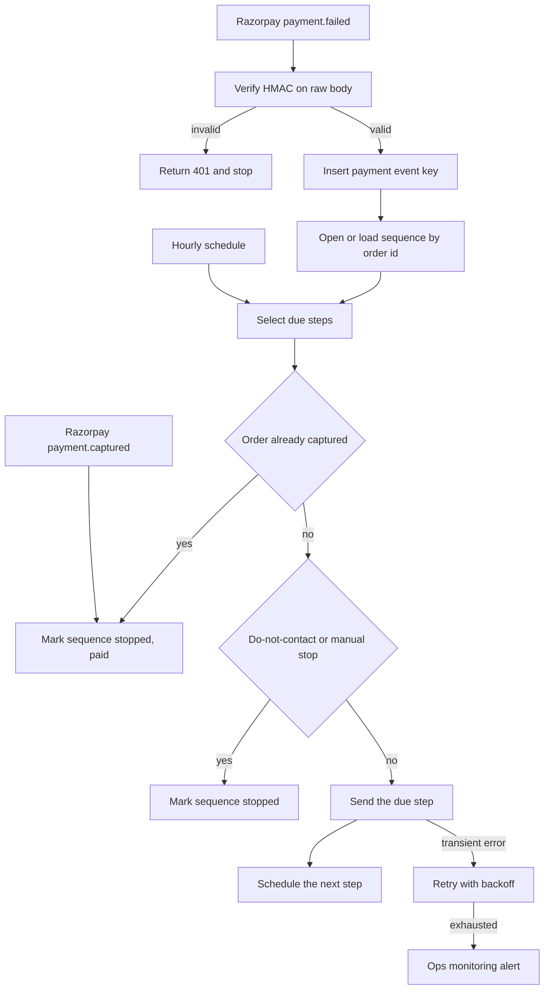

# 05 — Failed-payment recovery

**Platform:** n8n
**Status:** 🚧 In progress

Design spec only. The n8n export is not in this folder yet. The test checklist has not been run.

Standards: [../../docs/engineering-standards.md](../../docs/engineering-standards.md)

## Business problem

A Razorpay payment fails and the customer hears nothing, or hears from three tools that do not know about each other. Someone has to remember who already paid before sending another reminder.

When this workflow is built, `payment.failed` opens one recovery sequence for the order: a Resend email, a later email, a WhatsApp template nudge, and a Zoho CRM task. Every step checks whether the order has since been paid. A paid order sends nothing further.

The delays below are the spec defaults. They are not a claim about recovery rates.

## Trigger

Two entry points.

1. Razorpay webhook `payment.failed`, verified the same way as [workflow 01](../01-razorpay-zoho-books-invoicing/): HMAC-SHA256 of the raw body against `X-Razorpay-Signature`.
2. An n8n schedule that wakes once an hour and sends any step whose `due_at` has passed.

`payment.captured` for an order that has an open sequence is a third event on the same webhook. It marks the sequence `stopped` with reason `paid`.

The sample failure is [`sample-data/payment-failed.json`](sample-data/payment-failed.json).

## Flow

1. Verify the signature. Ignore events other than `payment.failed` and `payment.captured`.
2. For `payment.failed`, the event key is `05-failed-payment-recovery:payment:{payment_id}:event`. A duplicate event stops. The sequence key is the order id: `05-failed-payment-recovery:order:{order_id}:sequence`. Many failed payment ids can belong to one order. They share one sequence.
3. If the sequence is `stopped` or `completed`, stop.
4. If no sequence exists, create one with status `active` and schedule step `email_1` at `due_at = now`. Store `email`, `contact`, `customer_name`, `amount`, and `currency` from the payload.
5. Open or update a Zoho CRM lead or contact matched on email, and create one CRM task on step `crm_task` only. The task owner is `crm_owner_id`.
6. The hourly runner selects `active` sequences with a due step.
7. Before each send, fetch the Razorpay order. If any payment on the order is `captured`, or workflow 01 has a completed invoice key for a payment on that order, mark the sequence `stopped` / `paid` and send nothing.
8. Also stop when the CRM contact is flagged do-not-contact, or when the sequence was stopped by a person (`stopped` / `manual`).
9. Steps, in order. Each step has its own idempotency key `05-failed-payment-recovery:order:{order_id}:{step}` so a retry does not send that step twice.

| Step | When | Action |
| --- | --- | --- |
| `email_1` | Immediately | Resend email with the amount, currency, and `pay_link`. |
| `email_2` | 2 days after `email_1` was sent | Second Resend email, only if still unpaid. |
| `whatsapp_1` | 5 days after `email_1` was sent | WhatsApp template named in `whatsapp_template_name`. |
| `crm_task` | Same time as `whatsapp_1` | One Zoho CRM task: follow up on the failed payment. |

10. After `crm_task` is sent, mark the sequence `completed`. A later `payment.captured` still moves a completed sequence to `stopped` / `paid` so reports can tell the two endings apart. No further messages are sent either way.

`pay_link` comes from the Razorpay payment link or order short URL when the payload has one. When it does not, the email omits the link and the run alerts once, and the sequence still records the failure so a person can follow up. The workflow does not invent a URL.

## Architecture

## Error handling and edge cases

| Case | Specified behavior |
| --- | --- |
| Several `payment.failed` events for one order | One sequence. Later events update `last_error_description` and do not restart the delays. |
| `payment.captured` arrives after email 1 | The sequence stops. Email 2, WhatsApp, and the CRM task are not sent. The CRM task is cancelled when it was already created. |
| Email 1 is still retrying when the schedule wakes | The step key is `in_progress`, so the runner leaves it. It does not send email 2. |
| WhatsApp has no usable phone | Skip `whatsapp_1`, record the skip, and still create the CRM task. |
| Resend or Razorpay returns 429 | Shared backoff. The step stays unsent until it succeeds or the attempts are exhausted. |
| The customer pays by a method that never emits `payment.captured` to this webhook | The hourly runner's order fetch is the check that does not depend on the webhook. |
| Amount or email missing on the failure payload | Create no sequence. Alert with the payment id. |

## Integrations and credentials

| System | Credential name | Used for |
| --- | --- | --- |
| Razorpay | `razorpay_webhook` | Signature check. |
| Razorpay API | `razorpay_api` | Order fetch before each send. Key id and secret stay in n8n. |
| Resend | `resend_api` | The two dunning emails. |
| WhatsApp Cloud API | `whatsapp_cloud` | Template nudge. |
| Zoho CRM | `zoho_crm_oauth` | Contact match and the follow-up task. |
| Supabase | `supabase_service_role` | Sequence rows, step keys, logs. |
| Ops monitoring | `ops_webhook` | Failure and run events. |

### Config

| Variable | Purpose | Spec default |
| --- | --- | --- |
| `dry_run` | Log each step payload. Send no email, WhatsApp message, or CRM task. | `true` |
| `email_2_delay_hours` | Delay after email 1. | `48` |
| `whatsapp_delay_hours` | Delay after email 1. | `120` |
| `whatsapp_template_name` | Pre-approved template. | Unset, which skips WhatsApp and alerts |
| `from_address` | Verified Resend sender. | Client domain |
| `crm_owner_id` | Zoho user who owns the task. | Client user |
| `schedule_cron` | How often due steps are checked. | `0 * * * *` |

## Test checklist

These boxes are the plan. They have not been executed.

- [ ] A bad signature on `payment-failed.json` creates no sequence.
- [ ] The fixture in `dry_run` logs one sequence for `order_Mock0001` and step `email_1`.
- [ ] A second `payment.failed` with a new payment id and the same order id does not reset the schedule.
- [ ] A `payment.captured` fixture for that order, after email 1 is logged, leaves email 2 unsent.
- [ ] Two passes of the runner do not log email 1 twice.
- [ ] A missing email on the payload alerts and creates no sequence.
- [ ] Do-not-contact on the CRM contact skips every unsent step.

## Files

Not in this folder yet:

- n8n workflow export.
- Screenshot of the canvas.
- The fixture set captured during a real test run.

`sample-data/` holds a fictional `payment.failed` body.

| Path | What it is |
| --- | --- |
| `sample-data/payment-failed.json` | Fictional Razorpay failure. Pair it with header `X-Razorpay-Signature: mock_signature_not_valid`. |
