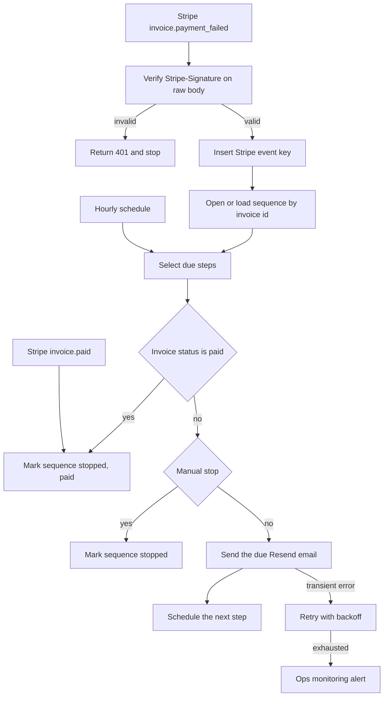

# 05 — Failed-payment recovery

**Platform:** n8n
**Status:** 🚧 In progress

Design spec only. The n8n export is not in this folder yet. The test checklist has not been run.

Standards: [../../docs/engineering-standards.md](../../docs/engineering-standards.md)

## Business problem

A Stripe invoice fails and the customer hears nothing, or hears from a campaign that does not know the invoice was paid an hour later. Someone has to remember who already paid before sending another reminder.

When this workflow is built, `invoice.payment_failed` opens one recovery sequence for that invoice: three Resend emails, and nothing else. Every step checks whether the invoice has since been paid. A paid invoice sends nothing further. This workflow does not create a new charge. Stripe's own retry continues on its own.

The delays below are the spec defaults. They are not a claim about recovery rates.

## Trigger

Two entry points.

1. Stripe webhooks `invoice.payment_failed` and `invoice.paid`, verified the same way as [workflow 04](../04-stripe-quickbooks-invoicing/): HMAC-SHA256 of `{timestamp}.{raw body}` against `Stripe-Signature`, with a timestamp tolerance of `stripe_tolerance_seconds`. A failed check returns HTTP 401 and writes nothing.
2. An n8n schedule that wakes once an hour and sends any step whose `due_at` has passed.

Any other event name is acknowledged and ignored.

The sample failure is [`sample-data/invoice-payment-failed.json`](sample-data/invoice-payment-failed.json). The sample paid event is [`sample-data/invoice-paid.json`](sample-data/invoice-paid.json). Pair either body with header `Stripe-Signature: t=1760526002,v1=mock_signature_not_valid`.

## Flow

1. Verify the signature. Ignore events other than `invoice.payment_failed` and `invoice.paid`.
2. The event key is `05-failed-payment-recovery:event:{event_id}`. A duplicate event id stops.
3. The sequence key is the invoice id: `05-failed-payment-recovery:invoice:{invoice_id}:sequence`. Many Stripe event ids can belong to one invoice. They share one sequence.
4. For `invoice.paid`, mark the sequence `stopped` with reason `paid` when one exists, and send nothing. If no sequence exists, record the event key and stop.
5. For `invoice.payment_failed`, if the sequence is `stopped` or `completed`, stop. If no sequence exists, create one with status `active` and schedule step `email_1` at `due_at = now`. Store `customer_email`, `customer_name`, `amount_due`, `currency`, `hosted_invoice_url`, and `attempt_count`. A later failure for the same invoice updates `attempt_count` and does not restart the delays.
6. Require `customer_email` and a positive `amount_due`. When the email is missing, create no sequence and alert with the invoice id.
7. The hourly runner selects `active` sequences with a due step.
8. Before each send, retrieve the Stripe invoice. If `status` is `paid`, or an `invoice.paid` event has already stopped the sequence, mark it `stopped` / `paid` and send nothing.
9. Also stop when the sequence was stopped by a person (`stopped` / `manual`).
10. Steps, in order. Each step has its own idempotency key `05-failed-payment-recovery:invoice:{invoice_id}:{step}` so a retry does not send that step twice.

| Step | When | Action |
| --- | --- | --- |
| `email_1` | Immediately | Resend email with the amount, currency, and `hosted_invoice_url` when one is present. |
| `email_2` | 3 days after `email_1` was sent | Second Resend email, only if the invoice is still unpaid. |
| `email_3` | 7 days after `email_1` was sent | Third Resend email, only if the invoice is still unpaid. |

11. After `email_3` is sent, mark the sequence `completed`. A later `invoice.paid` still moves a completed sequence to `stopped` / `paid` so reports can tell the two endings apart. No further messages are sent either way.

`hosted_invoice_url` comes from the Stripe invoice. When it is absent, the email omits the link and the run alerts once. The sequence still records the failure so a person can follow up. The workflow does not invent a URL and does not create a PaymentIntent.

## Architecture

## Error handling and edge cases

| Case | Specified behavior |
| --- | --- |
| Several `invoice.payment_failed` events for one invoice | One sequence. Later events update `attempt_count` and do not restart the delays. |
| `invoice.paid` arrives after email 1 | The sequence stops. Email 2 and email 3 are not sent. |
| Email 1 is still retrying when the schedule wakes | The step key is `in_progress`, so the runner leaves it. It does not send email 2. |
| The hosted invoice URL is empty | Send the email without a link, alert once, and keep the sequence. |
| Resend or Stripe returns 429 or 5xx | Shared backoff. The step stays unsent until it succeeds or the attempts are exhausted. |
| The customer pays by a method that never emits `invoice.paid` to this webhook | The hourly runner's invoice retrieve is the check that does not depend on the webhook. |
| Amount or email missing on the failure payload | Create no sequence. Alert with the invoice id. |
| A signature older than five minutes | HTTP 401. No sequence. |
| The run is asked to charge the card again | It does not. Recovery mail is the only side effect. |

## Integrations and credentials

Create these on the client's Stripe test-mode account and Resend sandbox sender. Plug them into the names below. This folder does not hold the secret values.

| System | Credential name | Used for |
| --- | --- | --- |
| Stripe webhook | `stripe_webhook` | Signature check. Test-mode signing secret. |
| Stripe API | `stripe_api` | Invoice retrieve before each send. The secret key stays in n8n. Use the test-mode key. |
| Resend | `resend_api` | The three dunning emails. |
| Supabase | `supabase_service_role` | Sequence rows, step keys, logs. |
| Ops monitoring | `ops_webhook` | `X-Ops-Token` and the workflow 07 URL. |

### Config

| Variable | Purpose | Spec default |
| --- | --- | --- |
| `dry_run` | Mock mode. Log each email payload. Send no email and retrieve the invoice from the pinned sample rather than the live API. | `true` |
| `email_2_delay_hours` | Delay after email 1. | `72` |
| `email_3_delay_hours` | Delay after email 1. | `168` |
| `from_address` | Verified Resend sender. | Client domain |
| `stripe_tolerance_seconds` | Maximum age of the Stripe signature timestamp. | `300` |
| `schedule_cron` | How often due steps are checked. | `0 * * * *` |
| `idempotency_stale_minutes` | When an `in_progress` step may be resumed. | `15` |

Mock mode is `dry_run` true, using the pinned files in `sample-data/`. Live mode is `dry_run` false against Stripe test mode, after the webhook secret and the test-mode API key are plugged in. Production keys are out of scope for the first build.

## Test checklist

These boxes are the plan. They have not been executed.

- [ ] A bad signature on `invoice-payment-failed.json` creates no sequence.
- [ ] The failure fixture in `dry_run` logs one sequence for `in_mock_0001` and step `email_1` to `buyer@example.com`.
- [ ] A second `invoice.payment_failed` with a new event id and the same invoice id does not reset the schedule.
- [ ] `invoice-paid.json` after email 1 is logged leaves email 2 unsent and marks the sequence `stopped` / `paid`.
- [ ] Two passes of the runner do not log email 1 twice.
- [ ] A missing email on the payload alerts and creates no sequence.
- [ ] The logged payload contains no Stripe secret.

## Files

Not in this folder yet:

- n8n workflow export.
- Screenshot of the canvas.
- The fixture set captured during a real test run.

`sample-data/` holds fictional Stripe events for mock mode.

| Path | What it is |
| --- | --- |
| `sample-data/invoice-payment-failed.json` | Fictional `invoice.payment_failed` body. |
| `sample-data/invoice-paid.json` | Fictional `invoice.paid` body for the same invoice, used to stop the sequence. |
