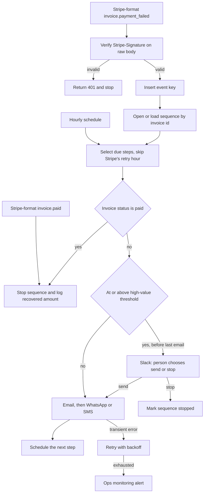

# 05 — Failed-payment recovery

**Platform:** n8n
**Type:** single automation (plain number, no prefix)
**Status:** 🗺️ Planned

This is a design spec. The workflow is not built yet. I add the working export and a demo video when it is built and tested.

Standards: [../../docs/engineering-standards.md](../../docs/engineering-standards.md)

## For you

**Get the payment back, then stop the moment it lands.**

A failed card needs more than a tag on a mailing list. A reminder that arrives after the customer has already paid is just noise.

- A failed payment opens one recovery sequence: a retry-aware schedule, then reminders on email and on WhatsApp or SMS.
- Each reminder can carry the card-update link Stripe already sent.
- A high-value account waits for a person before the last reminder.
- The moment the invoice is paid, the reminders stop and the recovered amount is logged.

**Who it's for:** businesses that bill through Stripe and cannot afford to lose a failed payment in a tag.

**Tools:** Stripe, Resend, WhatsApp or SMS, Slack, on n8n.

## Where this is used

A scenario: a membership or subscription business on Stripe, such as a gym or an online course. When a card fails, the customer gets a polite reminder with the card-update link right away, and the reminders stop the moment they pay.

## Steps and skills

These are the steps I designed, and the skill each one shows. The full flow and edge cases are below.

| Step | What happens | Skills involved |
| --- | --- | --- |
| 1 | Verify the Stripe `invoice.payment_failed` event | Webhook security |
| 2 | Open one recovery sequence per invoice | Idempotency, state tracking |
| 3 | Time reminders around Stripe's own retry schedule | Scheduling logic |
| 4 | Send email, then WhatsApp or SMS reminders with a card-update link | Multi-channel messaging |
| 5 | Escalate high-value accounts to a person in Slack | Human handoff |
| 6 | Stop on payment and log recovered invoices | Outcome logging |

## Business problem

On a failed payment, [workflow 13](../13-stripe-mailchimp-lifecycle/) only adds or updates a Mailchimp subscriber and applies the tag `payment-failed`. Successful payments are tagged there too (`high-value` at $500 or more, `paid-customer` under $500). It does not remind the customer, follow a retry schedule, send a card-update link, escalate a high-value account, or log recovered revenue.

This workflow is that deeper system. `invoice.payment_failed` opens one sequence for that invoice. Stripe keeps its own retry schedule. This workflow does not create a charge and does not create a PaymentIntent. It reads `attempt_count` and `next_payment_attempt` when they are present, and it does not send a reminder in the hour before Stripe is about to retry, so the customer does not get two asks at once.

Reminders go out on email (Resend) and on WhatsApp or SMS, whichever channel is in config. Every step checks whether the invoice has since been paid. A paid invoice sends nothing further. When the invoice is paid, the run writes a recovered-revenue row: invoice id, amount, currency, and which steps had already been sent. This repo does not add those rows up into a revenue figure.

The delays below are the defaults. Change them to match how you already follow up.

## Trigger

Two entry points, plus the test method.

1. Stripe-format webhooks `invoice.payment_failed` and `invoice.paid`, posted to a signed n8n webhook. The verifier reads `Stripe-Signature` the same way as [workflow 04](../04-stripe-quickbooks-invoicing/): HMAC-SHA256 of `{timestamp}.{raw body}`, compared in constant time, with a timestamp tolerance of `stripe_tolerance_seconds`. A failed check returns HTTP 401 and writes nothing. Signature verification is part of the design.
2. An n8n schedule that wakes once an hour and sends any step whose `due_at` has passed, unless that step is inside the quiet hour before `next_payment_attempt`.

This design is written for Stripe events, and it does not assume a live Stripe account is connected while it is being tested. Testing sends Stripe-format events to that signed webhook. That is the same approach as [workflow 13](../13-stripe-mailchimp-lifecycle/): Stripe-format payloads stand in until a real Stripe webhook can point at the endpoint. Workflow 13 stops at a Mailchimp tag. This workflow verifies the signature and runs recovery.

Any other event name is acknowledged and ignored.

The sample failure is [`sample-data/invoice-payment-failed.json`](sample-data/invoice-payment-failed.json). The sample paid event is [`sample-data/invoice-paid.json`](sample-data/invoice-paid.json). Pair either body with header `Stripe-Signature: t=1760526002,v1=mock_signature_not_valid`.

## Flow

1. Verify the signature. Ignore events other than `invoice.payment_failed` and `invoice.paid`.
2. The event key is `05-failed-payment-recovery:event:{event_id}`. A duplicate event id stops.
3. The sequence key is the invoice id: `05-failed-payment-recovery:invoice:{invoice_id}:sequence`. Many event ids can belong to one invoice. They share one sequence.
4. For `invoice.paid`, mark the sequence `stopped` with reason `paid` when one exists, write the recovered-revenue row, and send nothing. If no sequence exists, write `outcome: paid_without_sequence` and stop.
5. For `invoice.payment_failed`, if the sequence is `stopped` or `completed`, stop. If no sequence exists, create one with status `active` and schedule step `email_1` at `due_at = now`. Store `customer_email`, `customer_name`, `amount_due`, `currency`, `hosted_invoice_url`, `attempt_count`, and `next_payment_attempt` when it is present. A later failure for the same invoice updates `attempt_count` and does not restart the delays. On an invoice event the amount is `amount_due`, not `amount`.
6. Require `customer_email` and a positive `amount_due`. When the email is missing, create no sequence and alert with the invoice id.
7. The hourly runner selects `active` sequences with a due step. A step whose `due_at` falls in the hour before `next_payment_attempt` waits until the next run.
8. Before each send, retrieve the invoice. If `status` is `paid`, or an `invoice.paid` event has already stopped the sequence, mark it `stopped` / `paid`, write the recovered-revenue row, and send nothing.
9. Also stop when a person has stopped the sequence (`stopped` / `manual`).
10. Steps, in order. Each step has its own idempotency key `05-failed-payment-recovery:invoice:{invoice_id}:{step}` so a retry does not send that step twice.

| Step | When | Action |
| --- | --- | --- |
| `email_1` | Immediately, unless Stripe's next retry is inside the quiet hour | Resend email with the amount, currency, and `hosted_invoice_url` when one is present. That link is the card-update link. The workflow does not invent a URL. |
| `message_2` | 3 days after `email_1` was sent | WhatsApp if `channel` is `whatsapp`, otherwise SMS. Inside the 24 hour WhatsApp session window, send a session message. Outside it, send the approved template in `whatsapp_template_name`. Include the same card-update link when it is present. |
| `escalate` | Only when `amount_due` is at or above `high_value_threshold`, and before `email_3` | Slack message to `escalation_channel` with the invoice id, amount, and steps already sent. A person chooses send or stop. Nothing else goes to the customer until they choose. |
| `email_3` | 7 days after `email_1` was sent, or after the person chooses send | Final Resend email, only if the invoice is still unpaid. |

11. After `email_3` is sent, or after a person chooses stop, mark the sequence `completed` or `stopped` / `manual`. A later `invoice.paid` still moves it to `stopped` / `paid` and writes the recovered-revenue row, so a report can tell a recovered invoice from one that ran out of steps.

`high_value_threshold` is unset until the client sets it, in major units. While it is unset, `escalate` does not run and no account is treated as high-value. The workflow does not invent a cutoff.

`hosted_invoice_url` comes from the invoice payload. When it is absent, the message omits the link and the run alerts once. The sequence still continues so a person can follow up.

## Architecture

## Error handling and edge cases

Shared retry, dedupe, and alert behavior is in the [engineering standards](../../docs/engineering-standards.md). Cases specific to this workflow:

| Case | Specified behavior |
| --- | --- |
| Several `invoice.payment_failed` events for one invoice | One sequence. Later events update `attempt_count` and do not restart the delays. |
| `invoice.paid` arrives after email 1 | The sequence stops. Later reminders are not sent. A recovered-revenue row is written for that invoice. |
| The due time is inside the hour before `next_payment_attempt` | The runner waits. Stripe's retry and this reminder do not land together. |
| Email 1 is still retrying when the schedule wakes | The step key is `in_progress`, so the runner leaves it. It does not send the next step. |
| The hosted invoice URL is empty | Send without a link, alert once, and keep the sequence. Do not invent a URL. |
| Amount is at or above `high_value_threshold` | Slack escalation before `email_3`. No last email until a person chooses send. |
| `high_value_threshold` is unset | Do not escalate. Do not invent a cutoff. |
| Resend, WhatsApp, SMS, or Stripe returns 429 or 5xx | Shared backoff. The step stays unsent until it succeeds or the attempts are exhausted. Then alert workflow 07. |
| WhatsApp outside the 24 hour window and no template is set | Alert and do not send a free-form message. |
| The customer pays by a method that never emits `invoice.paid` to this webhook | The hourly invoice retrieve is the check that does not depend on the webhook. |
| Amount or email missing | Create no sequence. Alert with the invoice id. |
| A signature older than five minutes, or a bad signature | HTTP 401. No sequence. |
| The run is asked to charge the card again | It does not. Reminders, a card-update link, and a log row are the side effects. |
| Workflow 13 already tagged the contact | Irrelevant here. This workflow does not read or write Mailchimp. |

## Outcome log

Each finished step and each paid invoice writes one row: workflow, invoice id, step, outcome (`sent`, `skipped_paid`, `skipped_retry_window`, `escalated`, `stopped`, `recovered`), amount, currency, and `occurred_at`. Message bodies and signatures stay out of the row. The recovered row is how a later report can count what came back. This folder does not contain that count.

## Integrations and credentials

Create these in the client's account when the workflow is built. Plug them into the names below. This folder does not hold the secret values. Until a live Stripe account exists, tests use Stripe-format events against the signing secret stored as `stripe_webhook`.

| System | Credential name | Used for |
| --- | --- | --- |
| Stripe webhook | `stripe_webhook` | Signature check on the raw body. |
| Stripe API | `stripe_api` | Invoice retrieve before each send. The secret key stays in n8n. |
| Resend | `resend_api` | Reminder emails. |
| WhatsApp or SMS | `whatsapp_or_sms` | The second reminder. WhatsApp template outside the session window. |
| Slack | `slack_bot` | High-value escalation. |
| Supabase | `supabase_service_role` | Sequence rows, step keys, outcome log. |
| Ops monitoring | `ops_webhook` | `X-Ops-Token` and the workflow 07 URL. |

### Config

| Variable | Purpose | Spec default |
| --- | --- | --- |
| `dry_run` | Log each message payload and the recovered-revenue row. Send nothing and do not call a live Stripe API. | `true` |
| `channel` | `whatsapp` or `sms` for step `message_2`. | `whatsapp` |
| `email_2_delay_hours` | Delay after email 1 for the WhatsApp or SMS step. The config name stays so a client can find it. | `72` |
| `email_3_delay_hours` | Delay after email 1 for the last email. | `168` |
| `high_value_threshold` | Major-unit amount that requires a person before `email_3`. | Unset, which does not escalate |
| `escalation_channel` | Slack channel id for that approval. | Client channel |
| `whatsapp_template_name` | Template used outside the 24 hour window. | Unset, which alerts instead of sending |
| `from_address` | Verified Resend sender. | Client domain |
| `stripe_tolerance_seconds` | Maximum age of the Stripe signature timestamp. | `300` |
| `schedule_cron` | How often due steps are checked. | `0 * * * *` |
| `idempotency_stale_minutes` | When an `in_progress` step may be resumed. | `15` |

`dry_run` uses the pinned files in `sample-data/`. A live run uses the signed webhook and the credentials above. Production keys are out of scope for the first build.

## Test checklist

I run these before anything goes live.

- [ ] A bad signature on `invoice-payment-failed.json` creates no sequence.
- [ ] The failure fixture in `dry_run` logs one sequence for `in_mock_0001` and step `email_1` to `buyer@example.com`, with the example.com card-update link.
- [ ] A second `invoice.payment_failed` with a new event id and the same invoice id does not reset the schedule.
- [ ] A due step inside the hour before `next_payment_attempt` logs `skipped_retry_window`.
- [ ] `invoice-paid.json` after email 1 is logged leaves later steps unsent, marks the sequence `stopped` / `paid`, and logs a recovered row for that invoice.
- [ ] With `high_value_threshold` set below the fixture amount, the run logs a Slack escalation and does not log `email_3` until a person chooses send.
- [ ] With `high_value_threshold` unset, the run does not escalate.
- [ ] Two passes of the runner do not log email 1 twice.
- [ ] A missing email on the payload alerts and creates no sequence.
- [ ] The logged payload contains no Stripe secret.

## Files

Not in this folder yet:

- n8n workflow export.
- Screenshot of the canvas.
- The fixture set captured during a real test run.

`sample-data/` holds fictional Stripe-format events for review. They are not payments from a client.

| Path | What it is |
| --- | --- |
| `sample-data/invoice-payment-failed.json` | Fictional `invoice.payment_failed` body. The amount is in `amount_due`. |
| `sample-data/invoice-paid.json` | Fictional `invoice.paid` body for the same invoice, used to stop the sequence and log the recovery. |
