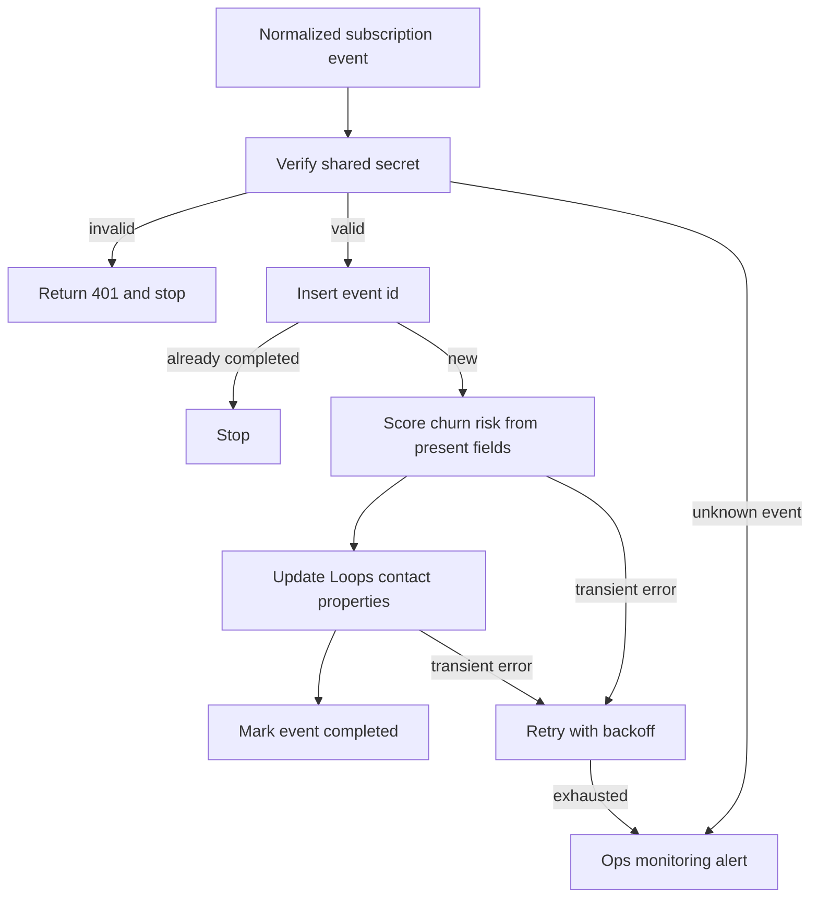

# 06 — Loops lifecycle engine

**Platform:** n8n
**Status:** 🚧 In progress

Design spec only. The n8n export is not in this folder yet. The test checklist has not been run.

Standards: [../../docs/engineering-standards.md](../../docs/engineering-standards.md)

## Business problem

Subscription events live in the billing tool. Lifecycle email lives in Loops. Someone updates contact properties by hand, or a campaign keeps writing to people who already recovered.

When this workflow is built, a billing event updates Loops contact properties, including a churn-risk label computed only from fields that are present on the event and the contact. Segments and campaigns stay defined in Loops, using those properties. The workflow does not keep a second copy of the segment rules, and it does not start a campaign by itself.

No churn model has been trained for this spec, and this repo states no accuracy.

## Trigger

A webhook for normalized subscription events. The client's billing tool (Razorpay Subscriptions, or another provider they use) is adapted into the shape of [`sample-data/subscription-charged.json`](sample-data/subscription-charged.json) and [`sample-data/subscription-cancelled.json`](sample-data/subscription-cancelled.json) before this workflow runs. The adapter is a separate, thin workflow per provider. This folder specifies the normalized contract so the Loops update stays stable when the billing tool changes.

The webhook requires header `X-Billing-Token`, compared in constant time with credential `billing_webhook`.

Accepted `event` values: `subscription.activated`, `subscription.charged`, `subscription.payment_failed`, `subscription.cancelled`.

The idempotency key is `06-loops-lifecycle-engine:event:{event_id}`.

## Flow

1. Verify the token. Reject unknown `event` values with HTTP 400 and an alert. Do not write to Loops.
2. Insert the event key. A completed event id stops.
3. Require `email` and `subscription_id`. A missing email alerts and stops.
4. Build the model input from the event fields only: `event`, `plan_status`, `paid_count`, `failed_payment_count`, `plan_changed_to`, and `cancel_at_period_end`. Omit any field the payload does not contain. Do not add usage or login data that the event does not carry.
5. Call the model with structured output:

```json
{
  "churn_risk": "unknown",
  "reason": ""
}
```

`churn_risk` is `low`, `medium`, `high`, or `unknown`. The instructions say: when the input is only a successful charge or activation, return `low`. When a cancellation or a failed payment is present, return `medium` or `high` and cite which field. When those fields are absent and the event is not a successful charge, return `unknown`. `unknown` is not treated as high.

6. Update the Loops contact with `PUT /api/v1/contacts/update`, identified by email. That endpoint creates the contact when none exists, so the workflow does not call the create endpoint first. The API key stays in the n8n credential. Properties sent:
   - `planStatus`
   - `lastSubscriptionEvent`
   - `failedPaymentCount` when present
   - `churnRisk`
   - `churnRiskReason` (the short `reason` string)
   - `sourceEventId`

   Loops requires each custom property to exist on the audience before the API will store it. Creating those properties is part of handover, in the client's Loops account.
7. Loops segments are configured in the Loops account on those properties. A segment the client builds there can require `churnRisk` equal to `high`. This workflow only sets properties. Creating the segment and the campaign is handover work in the client's Loops account, recorded in the config table as names, not as a second rule engine.
8. When `churn_risk` is `unknown`, still update `planStatus` and `lastSubscriptionEvent`, and set `churnRisk` to `unknown`. Do not place the contact into a cancellation campaign. Because the workflow does not enter campaigns directly, the Loops segment for that campaign must exclude `unknown`. The handover checklist calls that out.
9. Mark the event key completed with the Loops contact id in `result_ref`.

For the fictional `subscription.charged` fixture, the specified label is `low`, because the event is a successful charge and `failed_payment_count` is 0. For the fictional `subscription.cancelled` fixture, the specified label is `high`. Those labels are the spec for the fixtures. A model has not been run on them here.

## Architecture



## Error handling and edge cases

| Case | Specified behavior |
| --- | --- |
| The same `event_id` is redelivered | Stop. Loops is not updated again. |
| The model returns a label outside the four values | Retry up to 3 times, then alert, and do not write `churnRisk`. |
| The model returns `high` while the only field present is a successful charge | Treat the output as invalid and follow the retry path. The fixture spec for a clean charge is `low`. |
| The contact does not exist yet | `PUT /api/v1/contacts/update` creates it. The event key still blocks a second write for the same event. |
| Loops returns 400 | Stop and alert. A 400 here is a permanent error, usually a missing email or a property that has not been created in Loops. |
| Loops returns 429 | Shared backoff. |
| Email is malformed | Alert and stop. Do not call Loops. |
| `failed_payment_count` is missing on a failure event | Set `churnRisk` from the event name only, and say in `reason` that the count was absent. Do not invent a count. |

## Integrations and credentials

| System | Credential name | Used for |
| --- | --- | --- |
| Billing webhook | `billing_webhook` | Shared secret for `X-Billing-Token`. |
| OpenAI | `openai_api` | The four-way risk label. The provider is config. |
| Loops | `loops_api` | Contact create and update. The API key stays in n8n. |
| Supabase | `supabase_service_role` | Event keys and logs. |
| Ops monitoring | `ops_webhook` | Failure and run events. |

### Config

| Variable | Purpose | Spec default |
| --- | --- | --- |
| `dry_run` | Log the Loops property payload. Call no Loops API. | `true` |
| `risk_model` | Model id for the label. | Client choice |
| `loops_mailing_list_id` | List used when a contact must be created. | Client list |
| `high_risk_segment_name` | Documented name of the Loops segment the client maintains. The workflow does not create it. | Client name |
| `max_output_tokens` | Cap on the scoring call. | `200` |

## Test checklist

These boxes are the plan. They have not been executed.

- [ ] A missing token returns 401 and does not call Loops.
- [ ] `subscription-charged.json` in `dry_run` logs `churnRisk` `low` and `planStatus` `active`.
- [ ] `subscription-cancelled.json` logs `churnRisk` `high` and `planStatus` `cancelled`.
- [ ] Replaying the same `event_id` logs a skip.
- [ ] A payload with no email alerts and does not call Loops.
- [ ] An event value of `subscription.deleted_everything` returns 400.
- [ ] A model response of `high` for the charged fixture is rejected as invalid output.

## Files

Not in this folder yet:

- n8n workflow export.
- Screenshot of the canvas.
- The fixture set captured during a real test run.
- A provider-specific adapter. The normalized samples are the contract for this folder.

`sample-data/` holds fictional billing events.

| Path | What it is |
| --- | --- |
| `sample-data/subscription-charged.json` | Fictional successful renewal. |
| `sample-data/subscription-cancelled.json` | Fictional cancellation. |
