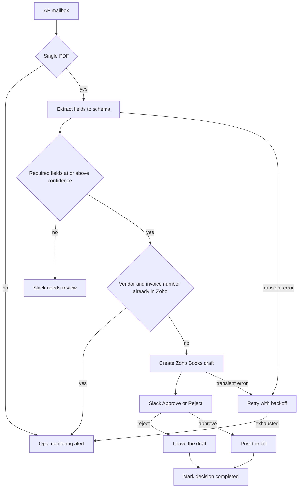

# 07 — Accounts-payable automation

**Platform:** n8n
**Status:** 🚧 In progress

Design spec only. The n8n export is not in this folder yet. The test checklist has not been run.

Standards: [../../docs/engineering-standards.md](../../docs/engineering-standards.md)

## Business problem

Vendor bills arrive as email attachments. Someone retypes the vendor, invoice number, date, tax, and total into Zoho Books. A duplicate PDF can become a second bill, and a posted bill is harder to undo than a draft.

When this workflow is built, a bill email becomes a Zoho Books draft only when the extracted fields clear a confidence bar and the vendor plus invoice number is new. A person approves it in Slack. The bill is posted only after that approval.

## Trigger

The n8n email trigger on the accounts-payable mailbox. One message with one PDF attachment starts a run. The idempotency key for the message is `07-accounts-payable-automation:email:{message_id}`. The business key, checked in Zoho, is vendor plus invoice number.

The sample mailbox payload is [`sample-data/inbound-bill-email.json`](sample-data/inbound-bill-email.json). The PDF bytes are not in the repo. Tests use the fictional extraction in [`sample-data/extracted-bill.json`](sample-data/extracted-bill.json) as the model-output fixture. That file is hand-written. It is not the result of a model run.

## Flow

1. Read the message. When there is no PDF, or there is more than one PDF, alert and stop. This version handles a single PDF.
2. Insert the message key. A completed message id stops.
3. Send the PDF text to the model with a fixed schema. If the file has no text layer, the run alerts and stops. OCR is a later addition, not part of this spec.
4. Required fields: `vendor_name`, `invoice_number`, `invoice_date`, `currency`, `subtotal`, `tax_total`, `grand_total`, and a `confidence` from 0 to 1 on each required field. Line items are included when the model can read them. A line the model cannot read is omitted, and `grand_total` still has to match the sum of the lines plus tax within 1 currency unit. When it does not match, the run does not create a bill.
5. When any required confidence is below `min_field_confidence` (default 0.8), post a Slack review message and stop before Zoho. The message key is completed with result `needs_review` so the same email is not extracted again. A person can start a manual bill.
6. Search Zoho Books bills by vendor name and invoice number. When a match exists, alert with the existing bill id and stop. Do not create a second draft.
7. Create a draft bill in the configured organization. Store the Zoho bill id on the message key. Status stays draft.
8. Post a Slack approval with the vendor, invoice number, date, grand total, currency, and bill id. Actions are Approve and Reject.
9. The Slack action payload is verified with Slack's signing secret. The action key is `07-accounts-payable-automation:bill:{zoho_bill_id}:decision`.
   - Reject: leave the draft, record the Slack user id, mark the decision key completed.
   - Approve: post the draft in Zoho Books, record the user id, mark the decision key completed.
10. A second click finds the decision key completed and posts a reply in the thread that the decision is already recorded. It does not post the bill again.

### Extraction schema

```json
{
  "vendor_name": "",
  "vendor_gstin": "",
  "invoice_number": "",
  "invoice_date": "",
  "currency": "INR",
  "subtotal": 0,
  "tax_total": 0,
  "grand_total": 0,
  "line_items": [
    {
      "description": "",
      "quantity": 1,
      "rate": 0,
      "tax_amount": 0
    }
  ],
  "field_confidence": {
    "vendor_name": 0.0,
    "invoice_number": 0.0,
    "invoice_date": 0.0,
    "grand_total": 0.0
  }
}
```

`vendor_gstin` may be empty. When it is present, it is stored on the Zoho vendor if the 15-character format check passes. The sample value is fictional.

## Architecture



## Error handling and edge cases

| Case | Specified behavior |
| --- | --- |
| The same email is polled twice | The message key stops the run. |
| The PDF text tells the model to set the total to zero | The arithmetic check still applies. A total that does not match the lines is not drafted. |
| Two vendors share a display name | Alert with the candidate vendor ids and do not pick one. |
| Slack approval arrives after the draft was deleted in Zoho | Alert and do not recreate the bill from the approval click. |
| Approve and Reject arrive close together | The decision key accepts the first completed action. The second gets the thread reply. |
| Zoho returns 429 | Shared backoff. A draft id that was returned is stored before the Slack message is sent. |
| Model output is invalid JSON | Retry up to 3 times, then alert. No draft. |

## Integrations and credentials

| System | Credential name | Used for |
| --- | --- | --- |
| Mailbox | `ap_inbox` | Read the accounts-payable mailbox. |
| OpenAI | `openai_api` | Extraction. The provider is config. |
| Zoho Books | `zoho_books_oauth` | Vendor search, draft bill, post. |
| Slack | `slack_bot` | Review and approval messages. Signing secret on the same app. |
| Supabase | `supabase_service_role` | Message keys, decision keys, logs. |
| Ops monitoring | `ops_webhook` | Failure and run events. |

### Config

| Variable | Purpose | Spec default |
| --- | --- | --- |
| `dry_run` | Log the draft payload and the Slack text. Create no bill and post no Slack message. | `true` |
| `zoho_organization_id` | Zoho Books organization. | Client test organization |
| `min_field_confidence` | Minimum confidence on each required field. | `0.8` |
| `approval_channel` | Slack channel id. | Client channel |
| `extraction_model` | Model id. | Client choice |
| `max_output_tokens` | Cap on the extraction call. | `1500` |

## Test checklist

These boxes are the plan. They have not been executed.

- [ ] `inbound-bill-email.json` with no attachment logs an alert and no Zoho call.
- [ ] `extracted-bill.json` in `dry_run` logs a draft for `Northwind Supplies` invoice `INV-2041` and an approval message.
- [ ] A second run with the same `message_id` logs a skip.
- [ ] A fixture whose `grand_total` does not equal subtotal plus tax logs no draft.
- [ ] A fixture with `invoice_number` confidence 0.4 logs a needs-review message and no draft.
- [ ] Two Approve actions on the same bill id log one post.
- [ ] A Reject action logs the draft left unposted.

## Files

Not in this folder yet:

- n8n workflow export.
- Screenshot of the canvas.
- The fixture set captured during a real test run.
- PDF bytes. The email sample points at a `mock://` path.

`sample-data/` holds fictional mailbox metadata and a hand-written extraction that matches the schema.

| Path | What it is |
| --- | --- |
| `sample-data/inbound-bill-email.json` | Fictional inbound bill email. |
| `sample-data/extracted-bill.json` | Hand-written extraction fixture. Not model output from a run. |
