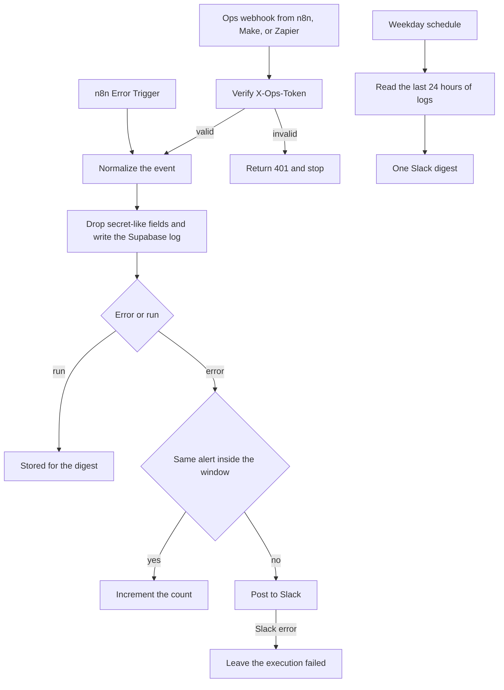

# 07 — Ops monitoring

**Platform:** n8n
**Status:** 🚧 In progress

The design is documented here. I add the working export and a demo video as soon as this workflow is built and tested.

Standards: [../../docs/engineering-standards.md](../../docs/engineering-standards.md)

## For you

**Hear about a broken workflow before your customer does.**

Automations fail quietly inside whichever tool ran them, and you usually find out from an annoyed customer.

- Every workflow reports failures to one Slack channel.
- A weekday digest shows what ran, what failed, and what's waiting on a person.
- One log holds the full history, so the morning check takes one place, not three.

**Who it's for:** anyone running more than a couple of automations who'd like to sleep well.

**Tools:** Slack, Supabase, on n8n (Make and Zapier workflows report here too).

## Business problem

Each workflow fails in its own execution log. The person who can fix it finds out when a customer complains. A morning check means opening n8n, Make, and Zapier separately.

This is the error workflow for the rest of the catalog. Failures post to one Slack channel. The run history stays in Supabase, which is also what the weekday digest reads. The sample digest uses made-up counts so you can see the layout. They are not results.

## Trigger

Three entry points.

1. **Error webhook.** Make scenarios, Zapier Zaps, and n8n workflows POST a normalized event. Header `X-Ops-Token` is required and is compared in constant time. A missing token returns HTTP 401 and writes no log row.
2. **n8n Error Trigger.** Each of the other n8n workflows sets this workflow as its Error Workflow, so a crash that never reaches the HTTP node is still caught. The Error Trigger payload is mapped into the same shape as the webhook. Make and Zapier have no equivalent, so they use the webhook.
3. **Schedule.** Weekdays at 09:00 in `digest_timezone`. The default timezone is `Asia/Kolkata`, which matches a Prayagraj working day. The client can change it.

This workflow's own n8n Error Workflow setting stays empty, so a failure here cannot call itself.

The sample error is [`sample-data/workflow-error.json`](sample-data/workflow-error.json). The sample digest input is [`sample-data/daily-digest-fixture.json`](sample-data/daily-digest-fixture.json).

## Flow

### Failure path

1. Verify `X-Ops-Token` on the webhook. The Error Trigger is internal and has no token. It is only reachable as another workflow's error workflow.
2. Map into the event shape below. Require `workflow`, `execution_id`, `correlation_id`, `error_code`, and `message`. Truncate `message` at 500 characters. Drop any field named like a secret (`authorization`, `token`, `password`, `secret`, `api_key`) if a caller included one.
3. Write the row to Supabase table `workflow_logs`.
4. Look for an alert already sent for the same `workflow`, `node`, and `error_code` in the last `alert_dedupe_minutes` (default 30). When one exists, increment its count and do not post again. Otherwise post to `alert_channel`.
5. The Slack text contains the workflow name, execution id, node, correlation id, error code, message, and time. It does not contain the incoming request body.
6. When Slack returns an error, leave the execution failed in n8n. The Supabase row remains if it was written. This workflow does not call itself.

### Digest path

1. Read `workflow_logs` for the previous 24 hours in `digest_timezone`.
2. Group by workflow. Count `ok`, `failed`, and `retry`. Count rows with outcome `skipped` and step `review` or `approval` as `waiting_for_approval`. A workflow that waits on a person writes one of those step names when it stops for review, approval, or handoff.
3. Post one Slack message to `alert_channel`.
4. When the window has no rows, the message says that no runs were recorded. A row of zeros for every workflow would look like a healthy quiet day when the logger was down, so that form is not used.
5. The sample file `daily-digest-fixture.json` is a stand-in for the query result. Because `fixture` is true, the rendered message starts with a line that the counts are a format sample, not a measurement.

### Run events

Workflows also POST `kind: run` when a step finishes. Those rows feed the digest. They do not page anyone. A `kind: run` event with `outcome: failed` is treated as an error, so a caller cannot hide a failure by picking the wrong kind.

```json
{
  "kind": "error",
  "workflow": "01-razorpay-zoho-books-invoicing",
  "execution_id": "exec_mock_0001",
  "node": "Zoho Books create invoice",
  "correlation_id": "pay_MockCaptured0001",
  "step": "invoice",
  "outcome": "failed",
  "error_code": "zoho_books_429",
  "message": "Zoho Books returned 429 after 5 attempts.",
  "occurred_at": "2026-10-15T10:00:00Z"
}
```

The idempotency key for an error event is `07-ops-monitoring:alert:{workflow}:{node}:{error_code}:{window_start}`. A repeat inside the window increments the count. It does not post a second Slack message. The log rows stay separate.

## Architecture



## Error handling and edge cases

| Case | Specified behavior |
| --- | --- |
| The same execution retries and reports the same error code | One Slack message inside the dedupe window, with a count. |
| Two different correlation ids fail on the same node with the same error code | They still collapse inside the window. The message count goes up. The log rows stay separate, so the ids are in Supabase even when Slack shows one line. |
| A caller puts an API key in `message` | The field list does not include a dedicated secret scanner for free text in this version. Callers are specified to send error codes, not headers. The test checklist includes a review of the sample message. |
| The log write fails | Retry with backoff. Do not send Slack before the log write succeeds, so the digest and the alert stay consistent. After retries, leave the execution failed. Do not call this workflow again. |
| Digest query fails | Alert through the failure path, with workflow `07-ops-monitoring` and error code `digest_query_failed`. That path can Slack. It does not schedule another digest and it does not call itself. |
| Slack is down | The Supabase row is the record. There is no second channel. |
| Empty log window | One message: no runs were recorded. |
| Token missing on the webhook | HTTP 401. No log row. |
| This workflow is set as its own Error Workflow | It must not be. The setting stays empty. |

## Integrations and credentials

Create these on the client's Slack workspace and Supabase project. Plug them into the names below. This folder does not hold the secret values.

| System | Credential name | Used for |
| --- | --- | --- |
| Ops webhook | `ops_webhook` | Shared secret for `X-Ops-Token`. The other workflows hold the same value under their own credential name `ops_webhook`. |
| Supabase | `supabase_service_role` | `workflow_logs` and alert-dedupe state. |
| Slack | `slack_bot` | Failure alerts and the digest. |

### Config

| Variable | Purpose | Spec default |
| --- | --- | --- |
| `dry_run` | Mock mode. Log the Slack text. Post nothing. | `true` |
| `alert_channel` | Slack channel id. | Client channel |
| `alert_dedupe_minutes` | Collapse window for identical failures. | `30` |
| `digest_cron` | When the digest runs. | `0 9 * * 1-5` |
| `digest_timezone` | Timezone for the cron and the 24 hour window. | `Asia/Kolkata` |

Mock mode is `dry_run` true, using the pinned files in `sample-data/`. Live mode is `dry_run` false against the client's Slack channel and Supabase project, after those credentials are plugged in. The tables are a design sketch. This repo does not create them.

## Test checklist

I run these before anything goes live.

- [ ] A missing token on `workflow-error.json` returns 401 and writes no log row.
- [ ] The error fixture in `dry_run` logs one Slack alert containing `pay_MockCaptured0001` and `zoho_books_429`.
- [ ] The same fixture a second time inside 30 minutes logs a count of 2 and no second Slack post.
- [ ] A fixture with an `authorization` field logs a row that does not contain that field.
- [ ] A stubbed Slack failure leaves the execution failed and does not call the ops webhook again.
- [ ] `daily-digest-fixture.json` logs one digest message that labels the numbers as a format fixture when `dry_run` renders it.
- [ ] An empty log window logs the "no runs were recorded" text.
- [ ] The logged alert contains no webhook token.

## Files

Not in this folder yet:

- n8n workflow export.
- Screenshot of the canvas.
- The fixture set captured during a real test run.

`sample-data/` holds a fictional error event and a fictional digest input. The numbers in the digest are there so the message format can be reviewed. They are not measured results.

| Path | What it is |
| --- | --- |
| `sample-data/workflow-error.json` | Fictional failure event from workflow 01. |
| `sample-data/daily-digest-fixture.json` | Fictional 24 hour rollup. Not a measurement. |
