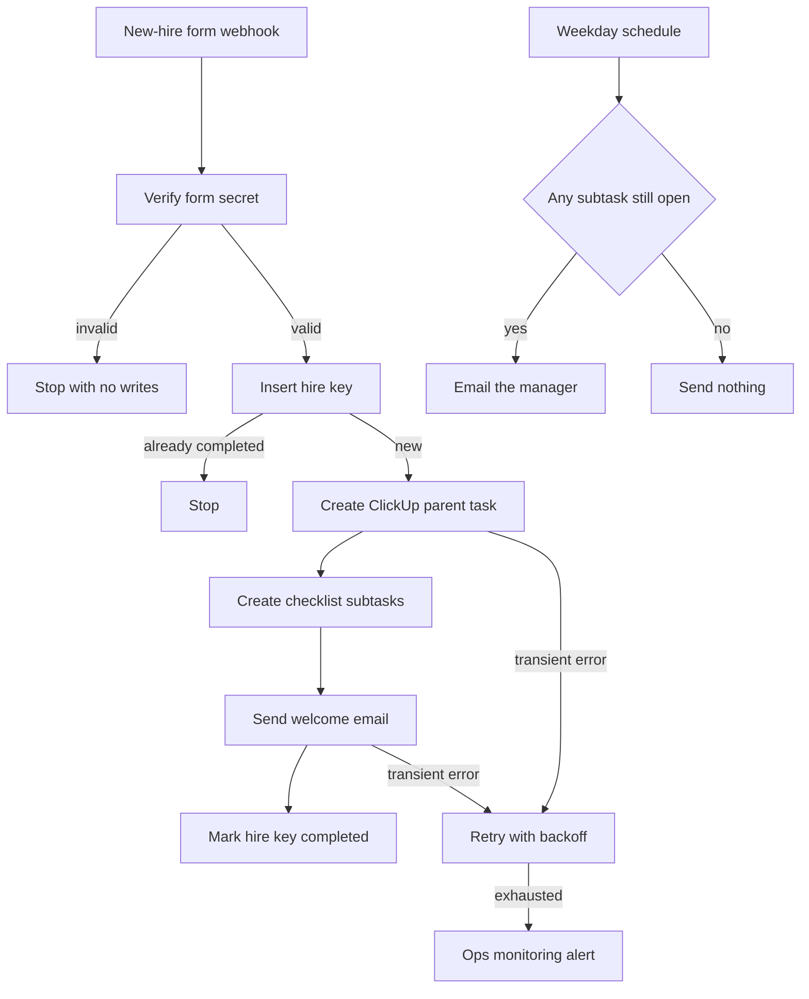

# 08 — HR onboarding

**Platform:** Make
**Status:** 🚧 In progress

Design spec only. The Make blueprint is not in this folder yet. The test checklist has not been run.

Standards: [../../docs/engineering-standards.md](../../docs/engineering-standards.md)

## Business problem

A new hire is confirmed in a form, and the manager, IT, and the new hire each keep a separate list. Welcome mail goes out late, and document requests are easy to miss.

When this workflow is built, a submitted new-hire form opens a fixed ClickUp checklist, sends one welcome email, and reminds the manager while any required task is still open. The checklist in this spec is a starting set the client edits before go-live.

Sample people in this folder are fictional. Live form submissions are not copied into this public repo.

## Trigger

A form webhook (the client's Google Form, Typeform, or similar) into a Make custom webhook.

The form tool's shared secret is required in header `X-Form-Token`. A missing token stops the scenario before ClickUp or email.

The idempotency key is `08-hr-onboarding:hire:{employee_email}`. A redelivery does not open a second task list.

The sample body is [`sample-data/new-hire-form.json`](sample-data/new-hire-form.json).

## Flow

1. Verify the token. Require `employee_name`, `employee_email`, `role`, `start_date`, and `manager_email`. A missing required field alerts and creates no tasks.
2. Insert the hire key in the Make data store. If it is already `completed`, stop.
3. Create a ClickUp parent task in `clickup_list_id`: `Onboarding — {employee_name}`, due on `start_date`. Description lists role, start date, and manager email. It does not include government ids, even if a future form asks for them. Those fields are out of scope for this workflow.
4. Create the subtasks below on that parent. Names are config so the client can rename them. Defaults:
   1. Create the email account
   2. Share the document checklist
   3. Schedule the manager introduction
   4. Confirm system access
5. Send one welcome email to `employee_email` from `from_address`, with the start date, the manager name, and the document list. The email body is a template the client approves at handover. The spec does not ship that copy as final.
6. Mark the hire key `completed` and store the ClickUp parent task id.
7. A second scheduled scenario runs each weekday morning. It loads hire keys that are `completed` and whose start date is within `reminder_window_days` (default 14). For each one, if any subtask is still open and the last reminder is older than `reminder_after_hours` (default 48), email the manager with the open task names. Record `last_reminder_at` on the data-store row so the same morning does not send two reminders.
8. When every subtask is closed, send no further reminder. The parent task can be closed by the same pass.

## Architecture

## Error handling and edge cases

| Case | Specified behavior |
| --- | --- |
| The form is submitted twice for the same email | The hire key stops the second run. No second parent task and no second welcome email. |
| ClickUp creates the parent and then fails on a subtask | Resume from the missing subtask names. Do not create a second parent. The parent id is stored as soon as ClickUp returns it. |
| Welcome email fails after tasks exist | Retry only the email. The hire key stays `in_progress` until the email succeeds. |
| Manager email is missing | Alert and create no tasks. |
| Start date is in the past | Still create the tasks, and send the first manager reminder on the next scheduled run if anything is open. |
| A subtask is renamed in ClickUp | The reminder matches on ClickUp task id, which was stored at create time, not on the current name. |
| The scheduled scenario overlaps itself | A data-store lock key `08-hr-onboarding:reminder-pass:{date}` allows one pass per day. |

## Integrations and credentials

| System | Credential name | Used for |
| --- | --- | --- |
| Form webhook | `hr_form_webhook` | Shared secret for `X-Form-Token`. |
| ClickUp | `clickup_oauth` | Parent task and subtasks. |
| Email | `hr_email` | Welcome email and manager reminders. Gmail, Outlook, or Resend, whichever the client connects. |
| Make data store | `processed_events` | Hire keys and reminder timestamps. |
| Ops monitoring | `ops_webhook` | Failure and run events to workflow 12. |

### Config

| Variable | Purpose | Spec default |
| --- | --- | --- |
| `dry_run` | Log the ClickUp payloads and the email text. Create no task and send no email. | `true` |
| `clickup_list_id` | List that receives onboarding tasks. | Client list |
| `clickup_space_id` | Space used to find the list. | Client space |
| `from_address` | Sender the client has verified on the email connection. | Client domain |
| `reminder_after_hours` | Minimum gap between manager reminders. | `48` |
| `reminder_window_days` | How long after the start date reminders continue. | `14` |
| `subtask_names` | Ordered checklist names. | The four defaults in the flow |

## Test checklist

These boxes are the plan. They have not been executed.

- [ ] A missing `X-Form-Token` writes no data-store row.
- [ ] `new-hire-form.json` in `dry_run` logs one parent task, four subtasks, and one welcome email to `riya.sen@example.com`.
- [ ] A second delivery of the same email logs a skip.
- [ ] A payload with no `manager_email` logs an alert and no ClickUp create.
- [ ] A simulated pass with two open subtasks logs one manager email, and a second pass on the same day logs none.
- [ ] A simulated pass with every subtask closed logs no reminder.

## Files

Not in this folder yet:

- Make blueprint.
- Screenshot of the scenario.
- The fixture set captured during a real test run.

`sample-data/` holds one fictional form submission. It is not an employee record.

| Path | What it is |
| --- | --- |
| `sample-data/new-hire-form.json` | Fictional new-hire submission. |
