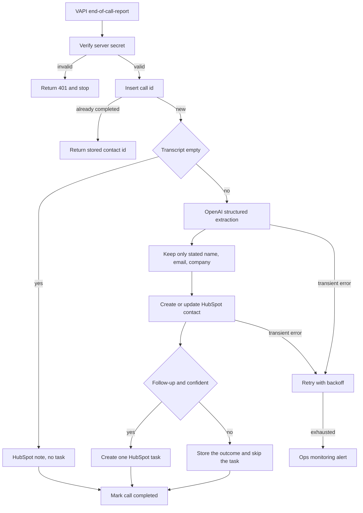

# 08 — Voice AI agent to CRM

**Platform:** n8n
**Status:** 🚧 In progress

The design is documented here. I add the working export and a demo video as soon as this workflow is built and tested.

Standards: [../../docs/engineering-standards.md](../../docs/engineering-standards.md)

## For you

**Your AI receptionist takes the call, and the CRM takes the notes.**

A great call is wasted if someone has to replay it and type the details in later.

- Each finished call becomes a HubSpot contact.
- If the caller asked for a next step, the right owner gets a task.
- Only details the caller actually gave are saved.

**Who it's for:** teams answering calls with a voice agent and managing their pipeline in HubSpot.

**Tools:** VAPI, OpenAI, HubSpot, on n8n.

## Business problem

A voice agent answers the phone, and the useful part of the call stays in a recording. Someone has to listen, then type the contact into HubSpot, and the follow-up depends on whether they remember.

A finished VAPI call becomes a HubSpot contact and, when the caller asked for a next step, one HubSpot task. The phone number comes from VAPI. The email comes from the transcript only when the caller states their own address. The workflow does not download the recording.

## Trigger

VAPI sends an `end-of-call-report` to an n8n webhook. The client sets a server secret on the assistant. The request carries that secret in `X-Vapi-Secret`, or in `Authorization: Bearer` when that is how the assistant is configured. The workflow accepts either header and compares it in constant time with credential `vapi_webhook`. A missing or wrong secret returns HTTP 401 and writes nothing.

Any message type other than `end-of-call-report` is acknowledged and ignored.

The transcript is untrusted. Text inside it is not a workflow instruction. The recording URL is not fetched and is not written to the log.

The idempotency key is `08-voice-ai-agent-crm:call:{call_id}`.

The sample is [`sample-data/end-of-call-report.json`](sample-data/end-of-call-report.json). Pair it with header `X-Vapi-Secret: mock_signature_not_valid`.

## Flow

1. Verify the secret. Ignore message types other than `end-of-call-report`.
2. Insert the call key. A completed call id returns the stored HubSpot contact id and does not call the model again. A `failed` key, or an `in_progress` key older than `idempotency_stale_minutes`, resumes.
3. Read `call.id`, `call.customer.number`, `endedReason`, and `transcript`. Require a call id. When the caller number and the transcript are both empty, alert and stop.
4. When the transcript is empty, do not call the model. If a caller number is present, create or update the HubSpot contact for that number with a note `No transcript`, set `voice_outcome` to `no_transcript`, and do not create a task.
5. Otherwise call OpenAI with structured output. The transcript is user content. Temperature is 0. The schema:

```json
{
  "name": "",
  "email": "",
  "company": "",
  "intent": "",
  "summary": "",
  "outcome": "follow_up",
  "confidence": 0.0
}
```

`outcome` is one of `follow_up`, `not_a_fit`, `already_customer`.

6. Keep an email only when the transcript contains that address in a sentence where the caller states it as their own. Drop any other address, including one that appears only inside an instruction to the model. Keep `company` and `name` only when the caller stated them. Empty fields stay empty. The phone number written to HubSpot is `call.customer.number`, not a number from the model.
7. When `confidence` is below `min_confidence` (default 0.7), or the output breaks the schema after 3 retries, set `voice_outcome` to `needs_review` and do not create a task. Still save the contact when a phone number or a kept email is present.
8. Search HubSpot contacts by phone, then by email if one was kept. Update the matched contact, or create one. Write a note with the summary, the intent, and the call id. Do not put the recording URL in the note.
9. When `outcome` is `follow_up` and confidence meets the threshold, create one HubSpot task for `hubspot_owner_id` with the intent as the subject, related to the contact. For `not_a_fit` and `already_customer`, set `voice_outcome` and create no task.
10. Mark the key completed and store the HubSpot contact id in `result_ref`.

For the fictional fixture, the specified extraction keeps `lead@example.com`, drops `admin@example.com`, sets `outcome` to `follow_up`, and uses the phone `+15555550100` from the call object. That is the spec for the fixture. A model has not been run on it in this repo.

## Architecture



## Error handling and edge cases

| Case | Specified behavior |
| --- | --- |
| The same `call.id` is delivered twice | Return the stored contact id. Do not call the model again and do not create a second task. |
| The transcript tells the model to use a different email | That address is dropped unless the caller also stated it as their own. The fixture's `admin@example.com` is dropped. |
| The model invents a phone number | Ignore it. The HubSpot phone is the VAPI caller id. |
| Model output is not valid JSON or uses an unknown `outcome` | Retry up to 3 times, then save a `needs_review` contact when a phone or email exists, and create no task. |
| OpenAI or HubSpot returns 429 or 5xx | Retry with backoff, then alert. The key stays `failed` until a later run completes. |
| HubSpot search returns two contacts | Update the phone match when one exists, and alert with both ids. Do not update both silently. |
| Caller number is missing and no email was kept | Alert and stop. Do not create a contact with no handle. |
| `recordingUrl` is present | Do not fetch it. Do not log it. Do not copy it to HubSpot. |
| A test call from the VAPI dashboard | Processed the same way. `dry_run` decides whether HubSpot is written. |

## Integrations and credentials

Create these on the client's VAPI assistant, OpenAI account, and HubSpot test portal. Plug them into the names below. This folder does not hold the secret values.

| System | Credential name | Used for |
| --- | --- | --- |
| VAPI | `vapi_webhook` | Server secret for `X-Vapi-Secret` or `Authorization: Bearer`. |
| OpenAI | `openai_api` | Structured extraction from the transcript. |
| HubSpot | `hubspot_oauth` | Contact search, create, update, notes, and tasks. Use the test portal while `dry_run` is on. |
| Supabase | `supabase_service_role` | Call keys and logs. |
| Ops monitoring | `ops_webhook` | `X-Ops-Token` and the workflow 07 URL. |

### Config

| Variable | Purpose | Spec default |
| --- | --- | --- |
| `dry_run` | Mock mode. Log the HubSpot contact and task payloads. Write no contact and no task. | `true` |
| `min_confidence` | Below this, the contact is saved as `needs_review` and no task is created. | `0.7` |
| `hubspot_owner_id` | Owner of the follow-up task. | Client user |
| `hubspot_portal_id` | Portal the contact links point at. | Client test portal |
| `openai_model` | Model id. | Client choice |
| `max_output_tokens` | Cap on the extraction call. | `800` |
| `idempotency_stale_minutes` | When an `in_progress` row may be resumed. | `15` |

Mock mode is `dry_run` true, using the pinned report in `sample-data/`. Live mode is `dry_run` false against the client's VAPI assistant and the HubSpot test portal, after those credentials are plugged in. Production keys are out of scope for the first build.

## Test checklist

I run these before anything goes live.

- [ ] A missing `X-Vapi-Secret` returns 401 and does not call OpenAI or HubSpot.
- [ ] `end-of-call-report.json` in `dry_run` logs a HubSpot upsert for phone `+15555550100` and email `lead@example.com`, and one follow-up task.
- [ ] The same run does not log `admin@example.com`.
- [ ] The same run does not log a fetch of `recordingUrl`.
- [ ] A second delivery of `call_mock_0001` logs a skip.
- [ ] A report with an empty transcript and a caller number logs `no_transcript` and no task.
- [ ] A report with no caller number and no stated email logs an alert and no contact.
- [ ] The logged payload contains no VAPI secret and no OpenAI key.

## Files

Not in this folder yet:

- n8n workflow export.
- Screenshot of the canvas.
- The fixture set captured during a real test run.

`sample-data/` holds one fictional end-of-call report for mock mode. It is not a recording from a client.

| Path | What it is |
| --- | --- |
| `sample-data/end-of-call-report.json` | Fictional VAPI `end-of-call-report`. Pair it with header `X-Vapi-Secret: mock_signature_not_valid`. |
