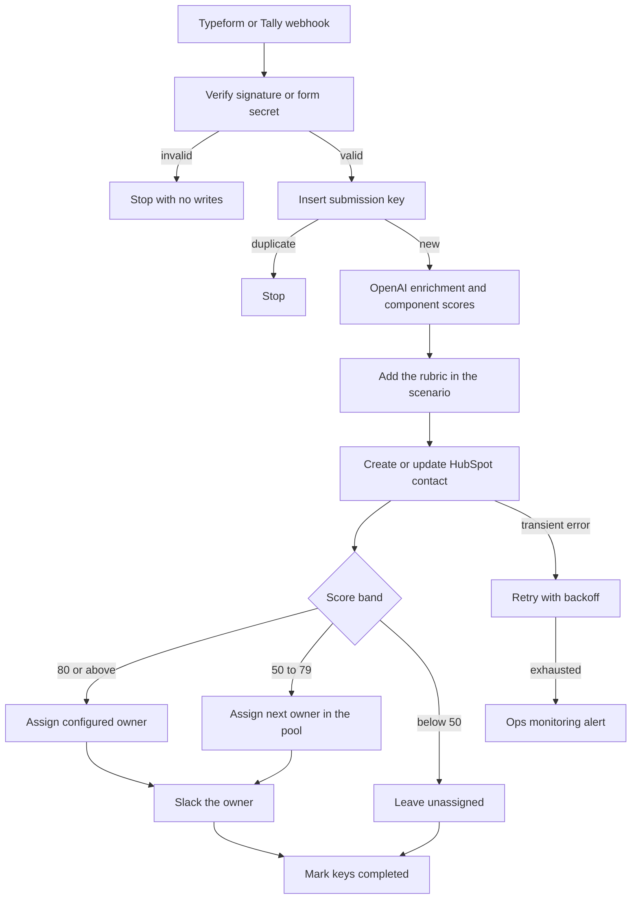

# 09 — Form lead to AI enrichment and scoring

**Platform:** Make
**Status:** 🚧 In progress

Design spec only. The Make blueprint is not in this folder yet. The test checklist has not been run.

Standards: [../../docs/engineering-standards.md](../../docs/engineering-standards.md)

## Business problem

Form leads sit in one list until someone looks up the company, decides who should own the lead, and sends that person a note. High-intent leads wait behind the rest.

When this workflow is built, a Typeform or Tally submission is enriched from the text the person actually wrote, scored with a written rubric, saved to HubSpot, and assigned to an owner only when the score clears the routing table. The owner is notified in Slack. Leads below the floor are saved and are not assigned.

## Trigger

One Make custom webhook accepts either source. The signature is checked on the raw body before the data store or HubSpot.

Typeform sends `Typeform-Signature`. The value is `sha256=` plus the base64 HMAC-SHA256 of the raw body, using the Typeform webhook secret in credential `typeform_webhook`. A failed check stops the scenario.

Tally.so sends the secret the client configured, in header `X-Form-Token`, compared in constant time with credential `tally_webhook`. A missing token stops the scenario. The scenario does not treat an unsigned Tally body as authentic.

Both sources are mapped into the shape of [`sample-data/form-lead.json`](sample-data/form-lead.json) after the check. The message text is untrusted. Text inside it is not a workflow instruction.

The idempotency key is `09-form-lead-enrichment:lead:{submission_id}`. A second key, `09-form-lead-enrichment:email:{email}`, records that this address has been seen. A repeat of the same submission id stops. Both keys live in the Make data store `processed_events`.

## Flow

1. Verify the source signature or token. Require `submission_id`, `name`, `email`, and `message`. `company` and `website` may be empty.
2. Insert the submission key. If it is already `completed`, stop. The round-robin counter does not move.
3. Call OpenAI with structured output. The form fields are user content. Temperature is 0. The model returns enrichment and the score components. It does not return a single opaque score.

```json
{
  "company": "",
  "industry": "",
  "country": "",
  "icp_fit": 0,
  "intent": 0,
  "completeness": 0,
  "notes": ""
}
```

Enrichment rules, checked again in the scenario:

- When the form already has `company`, keep the form value.
- When `company` is empty, the model may fill it only from a corporate email domain. Public mailbox domains (`gmail.com`, `outlook.com`, `yahoo.com`, `hotmail.com`) stay empty.
- `industry` and `country` stay empty when the message does not support them. The model does not invent a headcount.

4. The scenario adds the three components. It overwrites `completeness` with its own check, so a short message cannot keep a high completeness score.

| Component | Maximum | What earns the points |
| --- | --- | --- |
| `icp_fit` | 40 | Company and message match `icp_description`. Enrichment may support this. It cannot add points by itself when the message is empty. |
| `intent` | 40 | The message asks for a next step, names a problem, or names a timeframe. |
| `completeness` | 20 | Name, email, and a message of at least 20 characters are present. Company and website add nothing further in this version, because they are optional. |

A component above its maximum is clamped, and the run alerts. A negative number is treated as 0. When `icp_description` is unset, `icp_fit` is 0.

5. Search HubSpot contacts by email. Update the contact when one exists. Otherwise create one. Write the score, the component notes, `industry`, `country`, and `enriched` (true when any enrichment field was filled from the message or the domain).
6. Assign an owner from config:

| Score | Owner |
| --- | --- |
| 80 or above | `owner_high` |
| 50 to 79 | Round robin across `owner_pool` |
| Below 50 | No owner. The contact stays unassigned. |

7. Notify the assigned owner in Slack with the name, company, score, and the HubSpot link. A lead with no owner generates no Slack message.
8. Mark the submission key completed and store the HubSpot contact id. The email key is completed as well. Round robin state is a counter in the Make data store, incremented only when a lead is actually assigned to the pool.

For the fictional fixture, the message names a problem and a timeframe and asks for a walkthrough, and the company is already on the form. The specified enrichment does not replace `Example Studio`. A model has not been run on the fixture in this repo. The scenario still computes the numeric score from the rubric at test time.

## Architecture



## Error handling and edge cases

| Case | Specified behavior |
| --- | --- |
| The same `submission_id` is delivered twice | Stop. The round-robin counter does not move. |
| A new submission uses an email that already has a completed email key | Update the existing HubSpot contact and do not create a second one. Assign a new owner only when the contact has none. |
| The model returns a component above its maximum | Clamp to the maximum and alert, so one bad response cannot assign the high-touch owner by overflow. |
| The message tells the model to return 40 on every component | The completeness rules are still checked in the scenario. A message under 20 characters cannot keep a completeness score above 0. |
| The model fills a company from `gmail.com` | Drop it. Leave company empty. |
| `owner_high` is empty | Save the contact, skip assignment, and alert. |
| HubSpot returns 429 or 5xx | Back off, then alert. A completed HubSpot write is not repeated. |
| Typeform signature or Tally token is missing | Stop before the data store. |
| Logs | Store the submission id and the score. Do not store the webhook secret or the model key. |

## Integrations and credentials

Create these on the client's Typeform or Tally account, OpenAI account, HubSpot test portal, and Slack workspace. Plug them into the names below. This folder does not hold the secret values.

| System | Credential name | Used for |
| --- | --- | --- |
| Typeform | `typeform_webhook` | HMAC secret for `Typeform-Signature`. |
| Tally | `tally_webhook` | Shared secret for `X-Form-Token`. |
| OpenAI | `openai_api` | Enrichment fields and the three score components. |
| HubSpot | `hubspot_oauth` | Contact create or update, and the owner field. Use the test portal while `dry_run` is on. |
| Slack | `slack_bot` | Owner notification. |
| Make data store | `processed_events` | Submission keys and the round-robin counter. |
| Ops monitoring | `ops_webhook` | Failure and run events to workflow 07. |

### Config

| Variable | Purpose | Spec default |
| --- | --- | --- |
| `dry_run` | Mock mode. Log the HubSpot payload and the Slack text. Write no contact and send no message. | `true` |
| `source` | `typeform` or `tally`. The inactive source's secret is not required. | `typeform` |
| `icp_description` | Short description the score uses. The client writes this. | Unset, which scores `icp_fit` as 0 |
| `owner_high` | HubSpot owner id for scores of 80 and above. | Client user |
| `owner_pool` | HubSpot owner ids for the middle band. | Client users |
| `notify_channel` | Slack channel for the owner notification. | Client channel |
| `hubspot_portal_id` | Portal the contact links point at. | Client test portal |
| `score_model` | Model id. | Client choice |
| `max_output_tokens` | Cap on the scoring call. | `500` |

Mock mode is `dry_run` true, using the pinned file in `sample-data/`. Live mode is `dry_run` false against the client's form account and the HubSpot test portal, after those credentials are plugged in. Production keys are out of scope for the first build.

## Test checklist

These boxes are the plan. They have not been executed.

- [ ] A missing Typeform signature writes no data-store row.
- [ ] `form-lead.json` in `dry_run` logs a HubSpot upsert for `lead@example.com` and a score built from the three components.
- [ ] The logged company remains `Example Studio`.
- [ ] The same `submission_id` a second time logs a skip and the same round-robin counter.
- [ ] A fixture with a 5 character message logs completeness 0.
- [ ] A fixture whose email is `person@gmail.com` and whose company is empty logs an empty company.
- [ ] A score of 40 logs no owner and no Slack message.
- [ ] A score of 85 logs `owner_high`.
- [ ] The logged payload contains no form secret and no OpenAI key.

## Files

Not in this folder yet:

- Make blueprint.
- Screenshot of the scenario.
- The fixture set captured during a real test run.

`sample-data/` holds one fictional form lead for mock mode. The file is the mapped body. The signature check runs on the raw source body before this shape is used.

| Path | What it is |
| --- | --- |
| `sample-data/form-lead.json` | Fictional Typeform-mapped lead. Pair a raw Typeform body with header `Typeform-Signature: sha256=mock_signature_not_valid`. |
