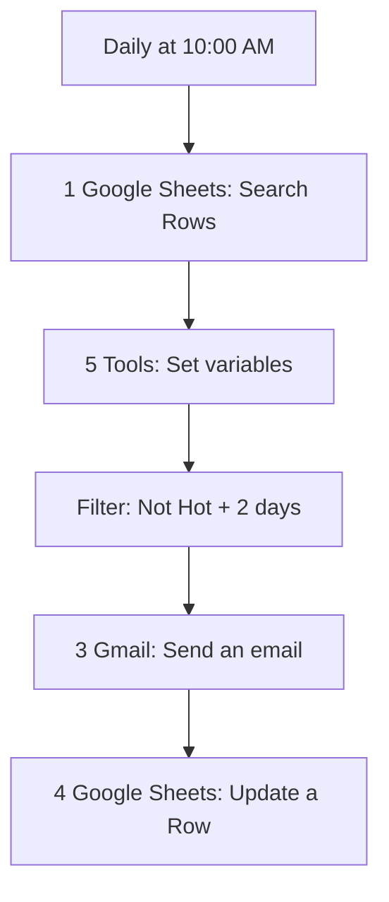

# 09 — Lead follow-up from a Google Sheets Lead Log

**Platform:** Make
**Status:** ✅ Built (v1)

Built in Make. The scenario is named `09 · Lead follow-up (Make)`. Once a day it reads the Lead Log, emails the leads that still need a follow-up, and writes the row back. The blueprint and the canvas screenshot are not in this folder yet.

Screenshots: coming soon.
Exports: coming soon.

The folder slug stays `09-form-lead-enrichment` so existing links keep working.

Standards: [../../docs/engineering-standards.md](../../docs/engineering-standards.md)

## For you

**The sheet tells you who still needs a follow-up, and the email goes out.**

Leads sit in a log until someone remembers who was written to, and when.

- Every morning at 10:00 the Lead Log is searched.
- A lead that is not marked hot, and that has gone at least 2 days since the last contact, gets a follow-up from Gmail.
- The row is updated with the status and the follow-up date.

**Who it's for:** small teams who already keep leads in Google Sheets.

**Tools:** Google Sheets, Gmail, on Make.

## Business problem

New leads are logged on a Google Sheets tab named Lead Log. Follow-up then depends on someone noticing the row. This scenario sends that follow-up and writes the status back to the same sheet.

The sheet id is not in this repo. A live scenario uses the client's own sheet.

## Flow

This is the v1 build: simple and working. The numbers below are the module numbers on the canvas.

1. **Schedule.** The scenario runs daily at 10:00 AM.
2. **(1) Google Sheets: Search Rows.** Reads the Lead Log.
3. **(5) Tools: Set variables.** Prepares values for the filter and the later modules. The variable names are not listed here.
4. **Filter: "Not Hot + 2 days..."** Keeps a row only when the lead is not marked hot and at least 2 days have passed since the last contact.
5. **(3) Gmail: Send an email.** Sends the follow-up.
6. **(4) Google Sheets: Update a Row.** Writes the status and the follow-up date back to that row.

The filter is what this version uses to skip hot leads and leads contacted in the last 2 days. It is not a stored idempotency key. There is no error-handler route, no reply check, and no AI copy in this version.

## Architecture

## v2 production upgrade (planned)

v1 does not do these yet.

- Dedup and an idempotency key, so a lead is never followed up twice inside a window.
- Error-handler routes, with retries and an alert when Sheets or Gmail fails.
- AI-personalised follow-up copy.
- A stop-on-reply check: search Gmail for a reply before sending.
- A capped follow-up sequence, so a lead is not emailed forever.
- An outcome log: counts of sent, replied, and booked. This repo will not invent those counts.

## Files

Screenshots: coming soon.
Exports: coming soon.

Not in this folder yet:

- Make blueprint.
- Screenshot of the scenario.

`sample-data/` holds one fictional Lead Log row so the idea can be reviewed. It is not an export from a live sheet and it is not a client lead.

| Path | What it is |
| --- | --- |
| `sample-data/lead-log-row.json` | Fictional Lead Log row. The fields are illustrative. They are not a claim about the live sheet's columns. |
