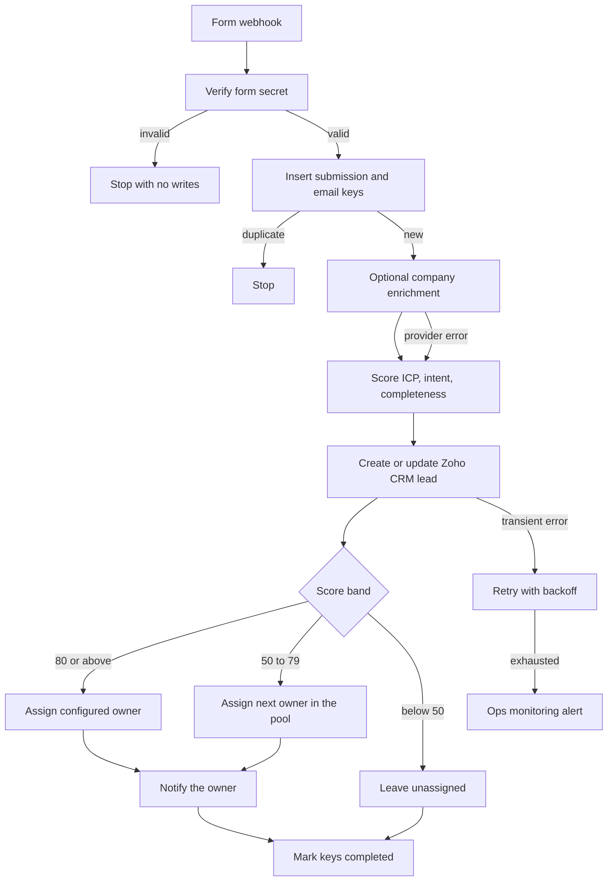

# 09 — Lead enrichment and routing

**Platform:** Make
**Status:** 🚧 In progress

Design spec only. The Make blueprint is not in this folder yet. The test checklist has not been run.

Standards: [../../docs/engineering-standards.md](../../docs/engineering-standards.md)

## Business problem

Form leads sit in one list until someone looks up the company, decides who should own the lead, and sends that person a note. High-intent leads wait behind the rest.

When this workflow is built, a form submission is enriched when the client has an enrichment API, scored with a written rubric, saved to Zoho CRM, and assigned to an owner only when the score clears the routing table. The owner is notified. Leads below the floor are saved and are not assigned.

## Trigger

The client's form webhook into a Make custom webhook, with header `X-Form-Token` checked against credential `lead_form_webhook`.

The idempotency key is `09-lead-enrichment-routing:lead:{email}`. When the form provides a `submission_id`, that id is a second key so two different people who somehow share a typo are not the only guard. Both keys must be new before a create. A repeat of the same submission id stops.

The sample is [`sample-data/form-lead.json`](sample-data/form-lead.json).

## Flow

1. Verify the token. Require `name`, `email`, and `message`. `company` and `website` may be empty.
2. Insert the submission key and the email key.
3. Enrichment is optional. When `enrichment_enabled` is true, call the client's enrichment HTTP API with the email and website. Map whatever the provider returns into `company_size`, `industry`, and `country`. When the call fails, times out, or the client has no provider, continue with those fields empty and set `enriched` false. Routing does not wait on enrichment beyond the normal retry cap.
4. Ask the model for a structured score. The model sees the form fields and the enrichment fields. It returns:

```json
{
  "icp_fit": 0,
  "intent": 0,
  "completeness": 0,
  "notes": ""
}
```

Each component is an integer from 0 to the maximum in the rubric. The scenario adds them. It does not accept a single opaque score from the model.

| Component | Maximum | What earns the points |
| --- | --- | --- |
| `icp_fit` | 40 | Company and message match `icp_description`. Enrichment may support this. It cannot add points by itself when the message is empty. |
| `intent` | 40 | The message asks for a next step, names a problem, or names a timeframe. |
| `completeness` | 20 | Name, email, and a message of at least 20 characters are present. Company and website add nothing further in this version, because they are optional. |

5. Search Zoho CRM by email. Update the lead or contact when one exists. Otherwise create a Lead. Write the score, the component notes, and `enriched` onto the record.
6. Assign an owner from config:

| Score | Owner |
| --- | --- |
| 80 or above | `owner_high` |
| 50 to 79 | Round robin across `owner_pool` |
| Below 50 | No owner. The lead stays in the nurture view. |

7. Notify the assigned owner in Slack, or by email when Slack is not connected. Include name, company, score, and the CRM link. A lead with no owner generates no notification.
8. Mark both keys completed. Store the CRM record id.

Round robin state is a counter in the Make data store, incremented only when a lead is actually assigned to the pool. A retry of the same submission does not increment it again, because the submission key is already completed.

## Architecture



## Error handling and edge cases

| Case | Specified behavior |
| --- | --- |
| The same `submission_id` is delivered twice | Stop. The round-robin counter does not move. |
| A new submission uses an email that already has a completed key | Update the existing CRM record and do not create a second lead. Assign a new owner only when the record has none. |
| Enrichment returns 429 or 5xx | Retry within the shared cap. After that, continue with `enriched` false. |
| The model returns a component above its maximum | Clamp to the maximum and alert, so one bad response cannot assign the high-touch owner by overflow. A negative number is treated as 0. |
| The message tells the model to return 40 on every component | The completeness rules are still checked in the scenario: a message under 20 characters cannot keep a completeness score above 0. |
| `owner_high` is empty | Save the lead, skip assignment, and alert. |
| Zoho finds both a Lead and a Contact | Update the Contact, and alert with both ids. |

## Integrations and credentials

| System | Credential name | Used for |
| --- | --- | --- |
| Form webhook | `lead_form_webhook` | Shared secret for `X-Form-Token`. |
| Enrichment API | `enrichment_api` | Optional company lookup. The client supplies the provider. |
| OpenAI | `openai_api` | Component scores. The provider is config. |
| Zoho CRM | `zoho_crm_oauth` | Lead create or update, owner field. |
| Slack | `slack_bot` | Owner notification. |
| Make data store | `processed_events` | Submission keys and the round-robin counter. |
| Ops monitoring | `ops_webhook` | Failure and run events to workflow 12. |

### Config

| Variable | Purpose | Spec default |
| --- | --- | --- |
| `dry_run` | Log the CRM payload and the notification. Write no CRM record and send no message. | `true` |
| `enrichment_enabled` | Call the enrichment API. | `false` |
| `icp_description` | Short description the score uses. The client writes this. | Unset, which scores `icp_fit` as 0 |
| `owner_high` | CRM user id for scores of 80 and above. | Client user |
| `owner_pool` | CRM user ids for the middle band. | Client users |
| `notify_channel` | Slack channel or owner DM mode. | Client channel |
| `score_model` | Model id. | Client choice |

## Test checklist

These boxes are the plan. They have not been executed.

- [ ] A missing token writes no data-store row.
- [ ] `form-lead.json` with enrichment disabled logs a CRM upsert for `neha.rao@example.com` and a score built from the three components.
- [ ] The same `submission_id` a second time logs a skip and the same round-robin counter.
- [ ] A fixture with a 5 character message logs completeness 0.
- [ ] A forced enrichment HTTP 503 logs `enriched` false and still logs a CRM upsert.
- [ ] A score of 40 logs no owner and no Slack message.
- [ ] A score of 85 logs `owner_high`.

## Files

Not in this folder yet:

- Make blueprint.
- Screenshot of the scenario.
- The fixture set captured during a real test run.

`sample-data/` holds one fictional form lead.

| Path | What it is |
| --- | --- |
| `sample-data/form-lead.json` | Fictional inbound lead. |
