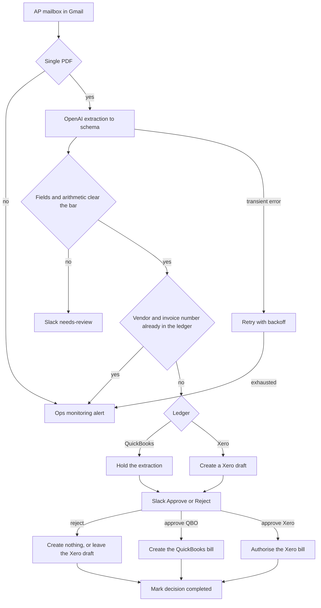

# 11 — Accounts payable with human approval

**Platform:** Make
**Status:** 🚧 In progress

The design is documented here. I add the working export and a demo video as soon as this workflow is built and tested.

Standards: [../../docs/engineering-standards.md](../../docs/engineering-standards.md)

## For you

**Vendor bills booked without retyping, and nothing posts without your yes.**

Supplier invoices arrive as PDFs, get retyped by hand, and occasionally get entered twice.

- Vendor, invoice number, date and total are read straight from the PDF.
- A person approves or rejects each bill in Slack with one click.
- Only approved bills go into QuickBooks or Xero, and payments stay in your hands.

**Who it's for:** finance teams receiving supplier invoices by email.

**Tools:** OpenAI, QuickBooks or Xero, Slack, on Make.

## Business problem

Vendor bills arrive as email attachments. Someone retypes the vendor, invoice number, date, tax, and total into QuickBooks or Xero. A duplicate PDF can become a second bill, and a bill that has already been approved is harder to undo than one that was never created.

A bill email is extracted with a fixed schema. A person approves it in Slack. QuickBooks receives the bill only after that approval. Xero can hold a draft first, because Xero has a draft state, and the draft is authorised only after the same approval. Approval records the bill. It does not send the payment.

## Trigger

The Make Gmail module watches the accounts-payable mailbox. Access is the client's Gmail OAuth connection. There is no HMAC on a mailbox watch. A message is accepted only when a recipient is `ap_inbox_address`.

One message with one PDF attachment starts a run. The idempotency key for the message is `11-accounts-payable-automation:email:{gmail_id}`, stored in the Make data store `processed_events`. The business key, checked in the ledger, is vendor display name plus invoice number.

The PDF text and the email body are untrusted. Text inside them is not a workflow instruction.

The sample mailbox payload is [`sample-data/inbound-bill-email.json`](sample-data/inbound-bill-email.json). The PDF bytes are not in the repo. Tests use the fictional extraction in [`sample-data/extracted-bill.json`](sample-data/extracted-bill.json) as the model-output fixture. That file is hand-written. It is not the result of a model run.

## Flow

1. Read the message. When there is no PDF, or there is more than one PDF, alert and stop. This version handles a single PDF.
2. Insert the message key. A completed message id stops.
3. Send the PDF text to OpenAI with the schema below. Temperature is 0. If the file has no text layer, the run alerts and stops. OCR is a later addition, not part of this spec.
4. Required fields: `vendor_name`, `invoice_number`, `invoice_date`, `currency`, `subtotal`, `tax_total`, `grand_total`, and a `confidence` from 0 to 1 on each required field. `vendor_tax_id` may be empty. Line items are included when the model can read them. A line the model cannot read is omitted. `grand_total` has to match the sum of the line rates plus `tax_total` within 1 currency unit. When it does not match, the run does not ask for approval and does not create a bill.
5. When any required confidence is below `min_field_confidence` (default 0.8), post a Slack review message and stop before the ledger. The message key is completed with result `needs_review` so the same email is not extracted again. A person can start a manual bill.
6. Search the ledger named in `ledger` by vendor display name and invoice number.
   - `quickbooks`: query Bills in `qbo_realm_id`.
   - `xero`: query bills in `xero_tenant_id`.
   When a match exists, alert with the existing bill id and stop. Do not create a second bill. When two vendors share the display name, alert with the candidate ids and do not pick one.
7. Ask for approval before the bill can be paid or authorised.
   - QuickBooks has no draft bill state. Store the extraction on the message key and do not create the bill yet.
   - Xero: create a DRAFT bill and store the Xero bill id on the message key.
8. Post a Slack approval with the vendor, invoice number, date, grand total, currency, and, for Xero, the draft id. Actions are Approve and Reject. The Slack action payload is verified with Slack's signing secret.
9. The decision key is `11-accounts-payable-automation:bill:{message_key}:decision`.
   - Reject, QuickBooks: create nothing. Record the Slack user id.
   - Reject, Xero: leave the draft. Record the Slack user id. Do not authorise it.
   - Approve, QuickBooks: create the Bill, then record the user id.
   - Approve, Xero: set the draft to AUTHORISED, then record the user id.
10. A second click finds the decision key completed and posts a reply in the thread that the decision is already recorded. It does not create or authorise the bill again.

### Extraction schema

```json
{
  "vendor_name": "",
  "vendor_tax_id": "",
  "invoice_number": "",
  "invoice_date": "",
  "currency": "USD",
  "subtotal": 0,
  "tax_total": 0,
  "grand_total": 0,
  "line_items": [
    {
      "description": "",
      "quantity": 1,
      "rate": 0,
      "tax_amount": 0
    }
  ],
  "field_confidence": {
    "vendor_name": 0.0,
    "invoice_number": 0.0,
    "invoice_date": 0.0,
    "grand_total": 0.0
  }
}
```

`vendor_tax_id` is stored on the vendor only when the client's ledger already has a tax-id field and the extracted value is non-empty. The sample leaves it empty. The workflow does not invent a tax id or a tax rate. When `tax_total` is greater than 0 and `tax_code_id` is unset, the run stops before approval and alerts.

The fictional extraction is vendor `Northwind Supplies`, invoice `INV-2041`, 100.00 plus 8.00 tax, grand total 108.00 USD. That arithmetic describes the fixture. It is not a vendor bill from a client.

## Architecture



## Error handling and edge cases

| Case | Specified behavior |
| --- | --- |
| The same email is seen twice | The message key stops the run. |
| The PDF text tells the model to set the total to zero | The arithmetic check still applies. A total that does not match the lines is not sent for approval and is not created. |
| Two vendors share a display name | Alert with the candidate vendor ids and do not pick one. |
| Slack approval arrives after someone deleted the Xero draft | Alert and do not recreate the bill from the approval click. |
| Approve and Reject arrive close together | The decision key accepts the first completed action. The second gets the thread reply. |
| QuickBooks or Xero returns 429 | Back off. A Xero draft id that was returned is stored before the Slack message is sent. |
| Model output is invalid JSON | Retry up to 3 times, then alert. No draft and no approval message. |
| `ledger` is neither `quickbooks` nor `xero` | Alert and stop. Do not guess the product. |
| The run is asked to pay the bill | It does not. Approval creates or authorises the bill only. |

## Integrations and credentials

Create these on the client's Gmail mailbox, OpenAI account, QuickBooks sandbox or Xero demo company, and Slack workspace. Plug in the ledger the client uses. This folder does not hold the secret values.

| System | Credential name | Used for |
| --- | --- | --- |
| Gmail | `gmail_ap` | Read the accounts-payable mailbox. |
| OpenAI | `openai_api` | Document extraction. |
| QuickBooks Online | `quickbooks_oauth` | Vendor search and bill create. Used when `ledger` is `quickbooks`. Sandbox company. |
| Xero | `xero_oauth` | Vendor search, draft bill, and authorise. Used when `ledger` is `xero`. Demo company. |
| Slack | `slack_bot` | Review and approval messages. Signing secret on the same app. |
| Make data store | `processed_events` | Message keys and decision keys. |
| Ops monitoring | `ops_webhook` | Failure and run events to workflow 07. |

### Config

| Variable | Purpose | Spec default |
| --- | --- | --- |
| `dry_run` | Mock mode. Log the bill payload and the Slack text. Create no bill and post no Slack message. | `true` |
| `ledger` | `quickbooks` or `xero`. | Unset, which fails closed |
| `qbo_realm_id` | QuickBooks sandbox company. | Client sandbox company |
| `xero_tenant_id` | Xero demo tenant. | Client demo tenant |
| `tax_code_id` | Tax code used when `tax_total` is greater than 0. | Unset, which fails closed for a taxed bill |
| `ap_inbox_address` | Mailbox the watch accepts. | Client mailbox |
| `min_field_confidence` | Minimum confidence on each required field. | `0.8` |
| `approval_channel` | Slack channel id. | Client channel |
| `extraction_model` | Model id. | Client choice |
| `max_output_tokens` | Cap on the extraction call. | `1500` |

Mock mode is `dry_run` true, using the pinned email and the hand-written extraction in `sample-data/`. Live mode is `dry_run` false against the QuickBooks sandbox company or the Xero demo company, after that credential is plugged in. Production companies are out of scope for the first build.

## Test checklist

I run these before anything goes live.

- [ ] `inbound-bill-email.json` with no attachment logs an alert and no ledger call.
- [ ] `extracted-bill.json` in `dry_run`, with `ledger` set to `quickbooks`, logs an approval message for `Northwind Supplies` invoice `INV-2041` and does not log a bill create before approval.
- [ ] The same fixture with `ledger` set to `xero` logs a draft create, then an approval message.
- [ ] A second run with the same `gmail_id` logs a skip.
- [ ] A fixture whose `grand_total` does not equal subtotal plus tax logs no approval and no bill.
- [ ] A fixture with `invoice_number` confidence 0.4 logs a needs-review message and no bill.
- [ ] A fixture with `tax_total` greater than 0 and no `tax_code_id` logs an alert and no approval.
- [ ] Two Approve actions on the same message log one create or one authorise.
- [ ] A Reject action logs no QuickBooks bill, or a Xero draft left unauthorised.
- [ ] The logged payload contains no ledger token.

## Files

Not in this folder yet:

- Make blueprint.
- Screenshot of the scenario.
- The fixture set captured during a real test run.
- PDF bytes. The email sample points at a `mock://` path.

`sample-data/` holds fictional mailbox metadata and a hand-written extraction that matches the schema.

| Path | What it is |
| --- | --- |
| `sample-data/inbound-bill-email.json` | Fictional inbound bill email. |
| `sample-data/extracted-bill.json` | Hand-written extraction fixture. Not model output from a run. |
