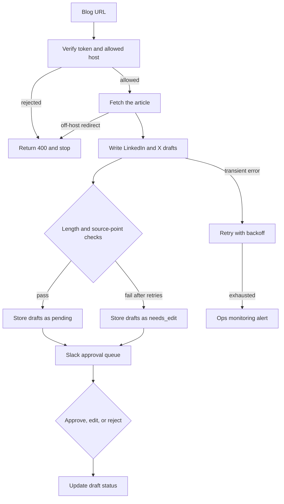

# 11 — Content repurposing agent

**Platform:** n8n
**Status:** 🚧 In progress

Design spec only. The n8n export is not in this folder yet. The test checklist has not been run.

Standards: [../../docs/engineering-standards.md](../../docs/engineering-standards.md)

## Business problem

A published article has to be rewritten by hand for LinkedIn and for X. Drafts get posted before anyone has read them, or they never get written.

When this workflow is built, a blog URL on the client's own domain becomes one LinkedIn draft and one X draft. Both wait in an approval queue. This version ends at the queue. Publishing to LinkedIn or X is a separate workflow, after the client has reviewed draft quality.

## Trigger

An authenticated webhook, or a Slack slash command that posts the same body. Header `X-Content-Token` is required.

The body is a single `url`. The host must be on `allowed_hosts`. Any other host is rejected with HTTP 400. The workflow is not an open fetcher.

The idempotency key is `11-content-repurposing-agent:url:{canonical_url}`. A second request on the same day returns the existing draft ids. A request on a later day is allowed through config `refresh_after_hours` (default 168), which creates a new draft pair and does not delete the old one.

The sample request is [`sample-data/repurpose-request.json`](sample-data/repurpose-request.json). Tests can skip the network and use [`sample-data/article.json`](sample-data/article.json) as the fetch result. The article is fictional.

## Flow

1. Verify the token. Parse the URL. Require `https`. Reject a host that is not on `allowed_hosts`.
2. Resolve the idempotency key from the canonical URL (lower-case host, no trailing slash, no query string).
3. Fetch the URL. Follow at most three redirects, and only when each redirect stays on `allowed_hosts`. Read the title and the article text. Drop script, style, and navigation regions.
4. When the extracted text is shorter than 200 characters, alert and stop. Do not draft from a title alone.
5. Call the model once for both drafts, with structured output:

```json
{
  "linkedin": "",
  "x": "",
  "source_points": ["", "", ""]
}
```

Constraints checked in the workflow after the model returns:

- `linkedin` is between 200 and 1,300 characters.
- `x` is at most 280 characters.
- `source_points` has three short phrases that appear in the article text, so a reviewer can see what the draft used.
- The drafts contain no claim of customer counts, revenue, or results unless that sentence is in the article.

A response that breaks a constraint is retried up to 3 times and then sent to the approval queue with status `needs_edit`, so a person can fix it. It is not published.

6. Store the drafts in Supabase table `content_drafts` (design sketch: `id`, `source_url`, `linkedin`, `x`, `status`, `created_at`). Status is `pending`.
7. Post one Slack message to `approval_channel` with the title, URL, both drafts, and the draft id. This version records Approve, Edit, and Reject as replies that update `status` in the table. Approve means a person accepted the wording. It does not call the LinkedIn or X APIs.
8. Mark the idempotency key completed with the draft id.

## Architecture



## Error handling and edge cases

| Case | Specified behavior |
| --- | --- |
| The URL host is not on the allowlist | HTTP 400. No fetch. |
| A redirect leaves the allowlist | Stop and alert. Do not draft from the other host. |
| The same URL is submitted twice inside `refresh_after_hours` | Return the existing draft id. Do not call the model again. |
| The page tells the model to invent a revenue figure | The source-point check still requires three phrases from the article. A revenue sentence that is not in the article keeps the draft at `needs_edit`. |
| Slack is down after the drafts are stored | Retry the Slack message. The drafts remain `pending`. Do not create a second row. |
| Fetch returns 429 or 5xx | Shared backoff, then alert. |
| The article is behind a login | The fetch will not see the body. The short-text rule alerts and stops. |

## Integrations and credentials

| System | Credential name | Used for |
| --- | --- | --- |
| Content webhook | `content_webhook` | Shared secret for `X-Content-Token`. |
| OpenAI | `openai_api` | Drafts. The provider is config. |
| Supabase | `supabase_service_role` | Draft rows, idempotency keys, logs. |
| Slack | `slack_bot` | Approval queue. |
| Ops monitoring | `ops_webhook` | Failure and run events. |

LinkedIn and X credentials are not part of this version, because this version does not publish.

### Config

| Variable | Purpose | Spec default |
| --- | --- | --- |
| `dry_run` | Log the drafts. Write no Supabase draft row and post no Slack message. | `true` |
| `allowed_hosts` | Hosts the fetcher may call. | Client domains |
| `approval_channel` | Slack channel id. | Client channel |
| `refresh_after_hours` | How long a URL returns the same draft id. | `168` |
| `draft_model` | Model id. | Client choice |
| `max_output_tokens` | Cap on the draft call. | `1200` |

## Test checklist

These boxes are the plan. They have not been executed.

- [ ] A URL on `https://example.net` logs HTTP 400 when the allowlist is `example.com`.
- [ ] `article.json` fed in as the fetch result, in `dry_run`, logs one LinkedIn draft, one X draft within 280 characters, and three source points taken from the article.
- [ ] A second request for the same URL inside the refresh window logs the same draft id and no second model call.
- [ ] A draft that mentions revenue the article does not contain is stored as `needs_edit` after retries, or the test stubs that failure directly.
- [ ] An Approve action updates status and does not call a social API.
- [ ] A redirect fixture whose next host is off the allowlist logs an alert and no draft.

## Files

Not in this folder yet:

- n8n workflow export.
- Screenshot of the canvas.
- The fixture set captured during a real test run.

`sample-data/` holds a fictional request and a fictional article. `example.com` is a reserved documentation domain.

| Path | What it is |
| --- | --- |
| `sample-data/repurpose-request.json` | Fictional URL request. |
| `sample-data/article.json` | Fictional article body used when a test skips the network. |
