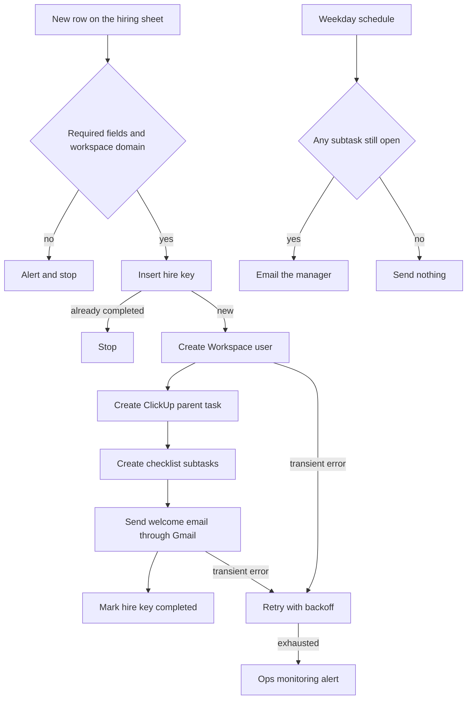

# 12 — HR onboarding

**Platform:** Make
**Status:** 🚧 In progress

Design spec only. The Make blueprint is not in this folder yet. The test checklist has not been run.

Standards: [../../docs/engineering-standards.md](../../docs/engineering-standards.md)

## Business problem

A new hire is confirmed on a form, and the manager, IT, and the new hire each keep a separate list. The Google Workspace account is created late, the welcome mail goes out late, and the checklist is easy to miss.

When this workflow is built, a new row on the hiring sheet creates the Workspace user, opens a fixed ClickUp checklist, sends one welcome email from Gmail, and reminds the manager while any required task is still open. The checklist in this spec is a starting set the client edits before go-live.

Sample people in this folder are fictional. `example.com` stands in for the client's Workspace domain. Live form submissions are not copied into this public repo.

## Trigger

A Google Form writes each response to a Google Sheet. The Make Google Sheets module watches that sheet for a new row. Access is the client's Google Workspace connection. There is no HMAC on a Sheets watch.

The scenario reads only `hr_sheet_id`. A row whose `employee_email` is not on `workspace_domain` alerts and creates nothing. The idempotency key is `12-hr-onboarding:hire:{employee_email}`, stored in the Make data store `processed_events`. A redelivery does not open a second account or a second task list.

The sample body is [`sample-data/new-hire-form.json`](sample-data/new-hire-form.json).

## Flow

1. Require `employee_name`, `employee_email`, `role`, `start_date`, and `manager_email`. A missing required field alerts and creates no user and no tasks.
2. Require `employee_email` to end with `@` plus `workspace_domain`. Any other domain alerts and stops. The scenario does not create a consumer Gmail account.
3. Insert the hire key. If it is already `completed`, stop.
4. Create the Google Workspace user with the Admin SDK.
   - `primaryEmail` is `employee_email`.
   - `changePasswordAtNextLogin` is true.
   - A temporary password is generated in the scenario and passed only to the Admin SDK.
   - The password is not written to the log, the ClickUp description, the welcome email, the ops alert, or this repository.
   - In `dry_run`, the scenario does not generate a password and does not call the Admin SDK. The log line is `workspace_user: would_create`.
   - When the user already exists, skip create, continue with ClickUp, and alert that the account was already there.
5. Create a ClickUp parent task in `clickup_list_id`: `Onboarding — {employee_name}`, due on `start_date`. The description lists role, start date, and manager email. It does not include government ids or the temporary password, even if a future form asks for them.
6. Create the subtasks below on that parent. Names are config so the client can rename them. Defaults:
   1. Confirm the Workspace account
   2. Share the document checklist
   3. Schedule the manager introduction
   4. Confirm system access
7. Send one welcome email to `employee_email` through Gmail, from `from_address`, with the start date, the manager name, and the document list. The email does not contain a password. The body is a template the client approves at handover. The spec does not ship that copy as final.
8. Mark the hire key `completed` and store the Workspace user id and the ClickUp parent task id.
9. A second scheduled scenario runs each weekday morning. It loads hire keys that are `completed` and whose start date is within `reminder_window_days` (default 14). For each one, if any subtask is still open and the last reminder is older than `reminder_after_hours` (default 48), email the manager through Gmail with the open task names. Record `last_reminder_at` on the data-store row so the same morning does not send two reminders.
10. When every subtask is closed, send no further reminder. The parent task can be closed by the same pass.

## Architecture

## Error handling and edge cases

| Case | Specified behavior |
| --- | --- |
| The form is submitted twice for the same email | The hire key stops the second run. No second user, no second parent task, and no second welcome email. |
| The email domain is not `workspace_domain` | Alert and create no user and no tasks. |
| Workspace returns that the user already exists | Skip user create, alert, and continue with ClickUp if the hire key is not completed. |
| ClickUp creates the parent and then fails on a subtask | Resume from the missing subtask names. Do not create a second parent. The parent id is stored as soon as ClickUp returns it. |
| Welcome email fails after the user and the tasks exist | Retry only the email. The hire key stays `in_progress` until the email succeeds. |
| Manager email is missing | Alert and create no user and no tasks. |
| Start date is in the past | Still create the user and the tasks, and send the first manager reminder on the next scheduled run if anything is open. |
| A subtask is renamed in ClickUp | The reminder matches on ClickUp task id, which was stored at create time, not on the current name. |
| The scheduled scenario overlaps itself | A data-store lock key `12-hr-onboarding:reminder-pass:{date}` allows one pass per day. |
| A module tries to log the temporary password | It must not. The password exists only in the Admin SDK request, and only when `dry_run` is false. |

## Integrations and credentials

Create these on the client's Google Workspace tenant and ClickUp workspace. The Admin SDK connection needs the directory scope that can insert a user, and only on the client's domain. Plug them into the names below. This folder does not hold the secret values.

| System | Credential name | Used for |
| --- | --- | --- |
| Google Sheets | `google_sheets` | Watch the hiring sheet. |
| Google Workspace Admin | `google_workspace_admin` | Create the user. |
| Gmail | `gmail_hr` | Welcome email and manager reminders, sent as `from_address`. |
| ClickUp | `clickup_oauth` | Parent task and subtasks. |
| Make data store | `processed_events` | Hire keys and reminder timestamps. |
| Ops monitoring | `ops_webhook` | Failure and run events to workflow 07. |

### Config

| Variable | Purpose | Spec default |
| --- | --- | --- |
| `dry_run` | Mock mode. Log `workspace_user: would_create`, the ClickUp payloads, and the email text. Create no user, create no task, send no email, and generate no password. | `true` |
| `hr_sheet_id` | The only sheet this scenario reads. | Client sheet |
| `workspace_domain` | Domain a new hire email must use. | Client domain |
| `clickup_list_id` | List that receives onboarding tasks. | Client list |
| `from_address` | HR mailbox on the client's domain. | Client mailbox |
| `reminder_after_hours` | Minimum gap between manager reminders. | `48` |
| `reminder_window_days` | How long after the start date reminders continue. | `14` |
| `subtask_names` | Ordered checklist names. | The four defaults in the flow |

Mock mode is `dry_run` true, using the pinned row in `sample-data/`. In that file, `example.com` stands in for `workspace_domain`. Live mode is `dry_run` false against the client's Workspace test user and a ClickUp list the client can delete, after those credentials are plugged in. Production user creation is out of scope for the first build.

## Test checklist

These boxes are the plan. They have not been executed.

- [ ] A row whose email is `person@gmail.com` logs an alert and no Workspace call when `workspace_domain` is `example.com`.
- [ ] `new-hire-form.json` in `dry_run` logs `workspace_user: would_create` for `hire@example.com`, one parent task, four subtasks, and one welcome email.
- [ ] The dry-run log contains no password.
- [ ] A second delivery of the same email logs a skip.
- [ ] A payload with no `manager_email` logs an alert and no Workspace create.
- [ ] A simulated pass with two open subtasks logs one manager email, and a second pass on the same day logs none.
- [ ] A simulated pass with every subtask closed logs no reminder.

## Files

Not in this folder yet:

- Make blueprint.
- Screenshot of the scenario.
- The fixture set captured during a real test run.

`sample-data/` holds one fictional form submission. It is not an employee record.

| Path | What it is |
| --- | --- |
| `sample-data/new-hire-form.json` | Fictional new-hire row. `example.com` stands in for the client's Workspace domain. |
