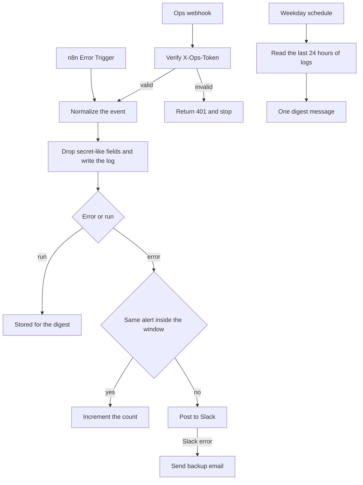

# 12 — Ops monitoring

**Platform:** n8n
**Status:** 🚧 In progress

Design spec only. The n8n export is not in this folder yet. The test checklist has not been run.

Standards: [../../docs/engineering-standards.md](../../docs/engineering-standards.md)

## Business problem

Each workflow fails in its own execution log. The person who can fix it finds out when a customer complains. A morning check means opening every tool.

When this workflow is built, it is the error workflow for the rest of the catalog. Failures post to one Slack channel and, if Slack fails, to one email. A weekday digest summarises runs, failures, retries, and items waiting for a person. The counts in the sample digest are fictional format data. They are not measurements from a running system.

## Trigger

Three entry points.

1. **Error webhook.** Make scenarios and n8n workflows POST a normalized event. Header `X-Ops-Token` is required.
2. **n8n Error Trigger.** Each of the other n8n workflows sets this workflow as its Error Workflow, so a crash that never reaches the HTTP node is still caught. The Error Trigger payload is mapped into the same shape as the webhook.
3. **Schedule.** Weekdays at 09:00 in `digest_timezone`. The default timezone is `Asia/Kolkata`, which matches a Prayagraj working day. The client can change it.

This workflow's own n8n Error Workflow setting stays empty, so a failure here cannot call itself.

## Flow

### Failure path

1. Verify `X-Ops-Token` on the webhook. The Error Trigger is internal and has no token. It is only reachable as another workflow's error workflow.
2. Map into the event shape below. Require `workflow`, `execution_id`, `correlation_id`, `error_code`, and `message`. Truncate `message` at 500 characters. Drop any field named like a secret (`authorization`, `token`, `password`, `secret`, `api_key`) if a caller included one.
3. Write the row to `workflow_logs`.
4. Look for an alert already sent for the same `workflow`, `node`, and `error_code` in the last `alert_dedupe_minutes` (default 30). When one exists, increment its count and do not post again. Otherwise post to `alert_channel`.
5. The Slack text contains the workflow name, execution id, node, correlation id, error code, message, and time. It does not contain the incoming request body.
6. When Slack returns an error, send the same text to `alert_email` through the email credential. When that also fails, leave the execution failed in n8n. There is no third call back into this workflow.

### Digest path

1. Read `workflow_logs` for the previous 24 hours in `digest_timezone`.
2. Group by workflow. Count `ok`, `failed`, and `retry`. Count rows with outcome `skipped` and step `review` or `approval` as `waiting_for_approval`. A workflow that waits on a person writes one of those step names when it stops for review, approval, or handoff.
3. Post one Slack message. When `digest_also_email` is true, send the same text to `alert_email`.
4. When the window has no rows, the message says that no runs were recorded. A row of zeros for every workflow would look like a healthy quiet day when the logger was down, so that form is not used.
5. The sample file `daily-digest-fixture.json` is a stand-in for the query result. Because `fixture` is true, the rendered message starts with a line that the counts are a format sample, not a measurement.

### Run events

Workflows also POST `kind: run` when a step finishes. Those rows feed the digest. They do not page anyone. A `kind: run` event with `outcome: failed` is treated as an error, so a caller cannot hide a failure by picking the wrong kind.

```json
{
  "kind": "error",
  "workflow": "01-razorpay-zoho-books-invoicing",
  "execution_id": "exec_mock_0001",
  "node": "Zoho Books create invoice",
  "correlation_id": "pay_MockCaptured0001",
  "step": "invoice",
  "outcome": "failed",
  "error_code": "zoho_books_429",
  "message": "Zoho Books returned 429 after 5 attempts.",
  "occurred_at": "2026-10-15T10:00:00Z"
}
```

## Architecture



## Error handling and edge cases

| Case | Specified behavior |
| --- | --- |
| The same execution retries and reports the same error code | One Slack message inside the dedupe window, with a count. |
| Two different correlation ids fail on the same node with the same error code | They still collapse inside the window. The message count goes up. The log rows stay separate, so the ids are in the log even when Slack shows one line. |
| A caller puts an API key in `message` | The field list does not include a dedicated secret scanner for free text in this version. Callers are specified to send error codes, not headers. The test checklist includes a review of the sample message. A later version can redact known key prefixes. |
| The log write fails | Retry with backoff. Do not send Slack before the log write succeeds, so the digest and the alert stay consistent. After retries, send the backup email that the logger is down, and include the correlation id. |
| Digest query fails | Alert through the failure path, with workflow `12-ops-monitoring` and error code `digest_query_failed`. That path can Slack and email. It does not schedule another digest. |
| Empty log window | One message: no runs were recorded. |
| Token missing on the webhook | HTTP 401. No log row. |

## Integrations and credentials

| System | Credential name | Used for |
| --- | --- | --- |
| Ops webhook | `ops_webhook` | Shared secret for `X-Ops-Token`. The other workflows hold the same value under their own credential name `ops_webhook`. |
| Supabase | `supabase_service_role` | `workflow_logs` and alert-dedupe state. |
| Slack | `slack_bot` | Failure alerts and the digest. |
| Email | `ops_email` | Backup alert and the optional digest copy. Resend, Gmail, or the client's mail connection. |

### Config

| Variable | Purpose | Spec default |
| --- | --- | --- |
| `dry_run` | Log the Slack and email text. Post nothing and send nothing. | `true` |
| `alert_channel` | Slack channel id. | Client channel |
| `alert_email` | Backup inbox. | Client inbox |
| `alert_dedupe_minutes` | Collapse window for identical failures. | `30` |
| `digest_cron` | When the digest runs. | `0 9 * * 1-5` |
| `digest_timezone` | Timezone for the cron and the 24 hour window. | `Asia/Kolkata` |
| `digest_also_email` | Send the digest to `alert_email` as well as Slack. | `true` |

## Test checklist

These boxes are the plan. They have not been executed.

- [ ] A missing token on `workflow-error.json` returns 401 and writes no log row.
- [ ] The error fixture in `dry_run` logs one Slack alert containing `pay_MockCaptured0001` and `zoho_books_429`.
- [ ] The same fixture a second time inside 30 minutes logs a count of 2 and no second Slack post.
- [ ] A fixture with an `authorization` field logs a row that does not contain that field.
- [ ] A stubbed Slack failure logs one backup email and no call back into the ops webhook.
- [ ] `daily-digest-fixture.json` logs one digest message that labels the numbers as a format fixture when `dry_run` renders it.
- [ ] An empty log window logs the "no runs were recorded" text.

## Files

Not in this folder yet:

- n8n workflow export.
- Screenshot of the canvas.
- The fixture set captured during a real test run.

`sample-data/` holds a fictional error event and a fictional digest input. The numbers in the digest are there so the message format can be reviewed. They are not measured results.

| Path | What it is |
| --- | --- |
| `sample-data/workflow-error.json` | Fictional failure event from workflow 01. |
| `sample-data/daily-digest-fixture.json` | Fictional 24 hour rollup. Not a measurement. |
