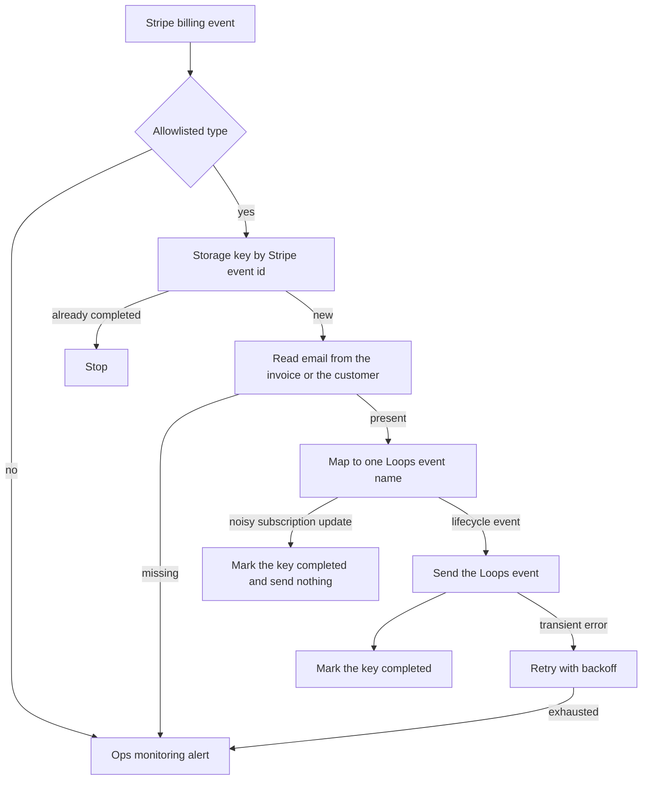

# 13 — Lifecycle email engine

**Platform:** Zapier
**Status:** 🚧 In progress

The design is documented here. I add the working export and a demo video as soon as this workflow is built and tested.

Standards: [../../docs/engineering-standards.md](../../docs/engineering-standards.md)

## For you

**The right email at the right moment, based on what customers actually do.**

A customer who just paid shouldn't get a "please come back" email, but that's what happens when lists are updated by hand.

- Stripe subscription events update the customer in Loops automatically.
- The matching journey starts: welcome, renewal, failed payment, or cancellation.
- Your email copy stays in Loops, where your team already edits it.

**Who it's for:** subscription businesses on Stripe that send lifecycle emails from Loops.

**Tools:** Stripe, Loops, on Zapier.

## Business problem

Subscription events live in Stripe. Lifecycle email lives in Loops. Someone updates contact properties by hand, or a campaign keeps writing to people who already paid.

A Stripe billing event updates the Loops contact and sends one Loops event. The email itself stays in the client's Loops account, on that event name. The email copy stays in Loops. This Zap only sets the event and the contact properties.

## Trigger

The Zapier Stripe connection delivers these event types:

- `invoice.paid`
- `invoice.payment_failed`
- `customer.subscription.updated`
- `customer.subscription.deleted`

If the connected Stripe app exposes those as separate triggers, build one Zap per event. Each Zap uses the mapping in this folder and the same Storage key shape. Any other event type stops before Loops.

The native Stripe trigger is authenticated by the client's Zapier connection. The signing secret stays in that connection. A manual rebuild that uses a Catch Hook instead must verify `Stripe-Signature` the same way as [workflow 04](../04-stripe-quickbooks-invoicing/) before any Storage write.

The idempotency key is `13-lifecycle-email-engine:event:{event_id}` in Storage by Zapier.

Samples: [`sample-data/invoice-paid.json`](sample-data/invoice-paid.json), [`sample-data/subscription-deleted.json`](sample-data/subscription-deleted.json), and the customer lookup [`sample-data/customer.json`](sample-data/customer.json).

## Flow

1. Accept an allowlisted Stripe event. Reject any other `type` with no Loops call, and POST an ops event.
2. Read Storage for the event id. When the value is `completed`, stop.
3. Write the key as `in_progress` before the Loops call. Storage by Zapier is not a lock. Two overlapping runs can both miss the key. The Loops write sets absolute properties, so a double delivery sends the same event name and the same properties. The client's Loops loop for that event is set to send once per contact where Loops allows it. That setting is handover work in the Loops account.
4. Resolve the email.
   - `invoice.paid` and `invoice.payment_failed` use `customer_email` on the invoice.
   - Subscription events do not carry an email. Retrieve the Stripe customer id and read `email` from that customer. The pinned lookup for the sample is `customer.json`.
   - A missing or malformed email alerts and stops. The Storage key is marked `failed`. Do not call Loops.
5. Map the event. The map is fixed. There is no model call.

| Stripe event | Loops `eventName` | `planStatus` |
| --- | --- | --- |
| `invoice.paid` and `billing_reason` is `subscription_create` | `subscription_started` | `active` |
| `invoice.paid` and `billing_reason` is `subscription_cycle` | `subscription_renewed` | `active` |
| `invoice.paid` with any other `billing_reason` | `invoice_paid` | `active` |
| `invoice.payment_failed` | `payment_failed` | `past_due` |
| `customer.subscription.updated` with `cancel_at_period_end` true | `subscription_canceling` | `canceling` |
| `customer.subscription.deleted` | `subscription_cancelled` | `cancelled` |

A `customer.subscription.updated` that is not a cancel-at-period-end change stops after the Storage key is marked `completed`. It does not send a Loops event. Those updates are too noisy to drive email.

6. Send the Loops event with `POST /api/v1/events/send`, identified by email. That call creates the contact when none exists. Properties sent:
   - `planStatus`
   - `lastSubscriptionEvent` (the Loops event name)
   - `subscriptionId` when the payload has one
   - `sourceEventId` (the Stripe event id)

   Loops requires each custom property to exist on the audience before the API will store it. Creating those properties, and the loops that listen for the event names, is handover work in the client's Loops account. `invoice_paid` has no loop unless the client adds one. The other event names are the ones that send mail.
7. Mark the Storage key `completed`.

For the fictional `invoice.paid` fixture, `billing_reason` is `subscription_cycle`, so the specified Loops event is `subscription_renewed` and `planStatus` is `active`. For the fictional deletion, the specified Loops event is `subscription_cancelled`. Those labels are the spec for the fixtures. Loops has not been called from this repo.

## Architecture

## Error handling and edge cases

| Case | Specified behavior |
| --- | --- |
| The same Stripe `event.id` is replayed | The Storage key stops the run. Loops is not called again. |
| Two runs pass the Storage check together | Both may call Loops with the same event name and the same properties. The Loops loop is configured to send once per contact. |
| The invoice has no `customer_email` | Alert and stop. Do not call Loops. |
| The customer lookup returns no email | Alert and stop. Do not invent an address. |
| Loops returns 400 | Stop and alert. A 400 here is a permanent error, usually a missing property in the Loops audience. Mark the key `failed`. |
| Loops or Stripe returns 429 | Back off, then alert. |
| `billing_reason` is `manual` on `invoice.paid` | Send `invoice_paid`, not `subscription_renewed`. |
| A subscription update that only changes the quantity | Mark the key completed. Send no Loops event. |
| The Zap is asked to write the email body | It does not. Copy lives in Loops. |

## Integrations and credentials

Create these on the client's Stripe test-mode account and Loops audience. Plug them into the Zapier connections below. This folder does not hold the secret values.

| System | Credential name | Used for |
| --- | --- | --- |
| Stripe | `stripe` | Event trigger, and the customer retrieve on subscription events. Test-mode key. |
| Loops | `loops_api` | `POST /api/v1/events/send`. The API key stays in the Zapier connection. |
| Storage by Zapier | `zapier_storage` | Event keys. |
| Ops monitoring | `ops_webhook` | `X-Ops-Token` and the workflow 07 URL. |

### Config

| Variable | Purpose | Spec default |
| --- | --- | --- |
| `dry_run` | Mock mode. Log the Loops body. Call no Loops API. | `true` |
| `loops_event_names` | The event names the client has created in Loops. | `subscription_started`, `subscription_renewed`, `invoice_paid`, `payment_failed`, `subscription_canceling`, `subscription_cancelled` |

Mock mode is `dry_run` true, using the pinned Stripe events in `sample-data/`. Live mode is `dry_run` false against Stripe test mode and the client's Loops audience, after those connections are plugged in. Production keys are out of scope for the first build.

## Test checklist

I run these before anything goes live.

- [ ] An event type of `customer.deleted` logs no Loops call.
- [ ] `invoice-paid.json` in `dry_run` logs Loops event `subscription_renewed`, `planStatus` `active`, and email `buyer@example.com`.
- [ ] A copy of that fixture with `billing_reason` set to `subscription_create` logs `subscription_started`.
- [ ] A copy with `billing_reason` set to `manual` logs `invoice_paid`.
- [ ] `subscription-deleted.json`, with `customer.json` as the lookup, logs `subscription_cancelled` for `buyer@example.com`.
- [ ] Replaying the same `event.id` logs a skip.
- [ ] A payload with no email alerts and does not call Loops.
- [ ] The logged body contains no Stripe secret and no Loops key.

## Files

Not in this folder yet:

- Shared Zap link or Zap template.
- Screenshot of the Zap.
- The fixture set captured during a real test run.

`sample-data/` holds fictional Stripe events for mock mode. There is no Zap JSON export in this folder.

| Path | What it is |
| --- | --- |
| `sample-data/invoice-paid.json` | Fictional renewal. `billing_reason` is `subscription_cycle`. |
| `sample-data/subscription-deleted.json` | Fictional cancellation. The email is not on this object. |
| `sample-data/customer.json` | Fictional customer lookup for `cus_mock_0001`. |
