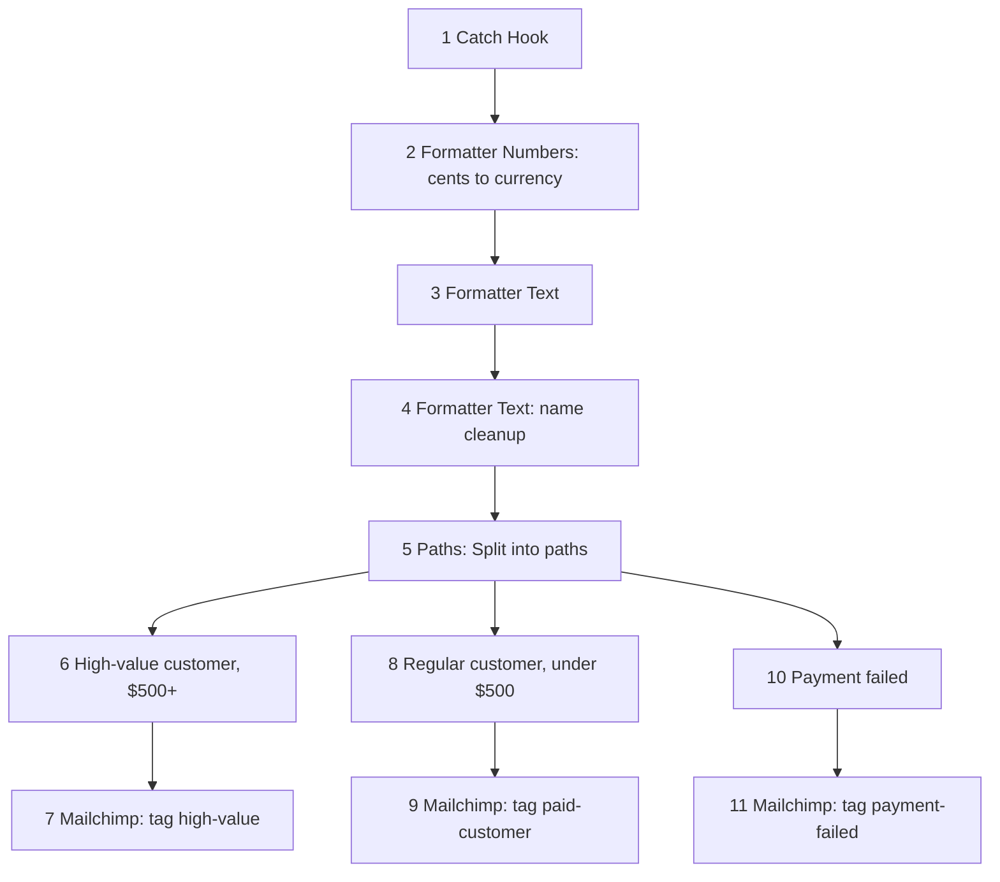

# 13 — Stripe-format payment events to Mailchimp tags

**Platform:** Zapier
**Status:** ✅ Built (v1)

Built in Zapier. A Stripe-format payment event hits a Catch Hook, is formatted, and goes down one of three paths to Mailchimp. The shared Zap link and a screenshot are not in this folder yet.

Screenshots: coming soon.
Exports: coming soon.

Standards: [../../docs/engineering-standards.md](../../docs/engineering-standards.md)

## For you

**One contact in Mailchimp, tagged from the payment, without a second copy of the same person.**

Someone still exports payments and pastes people into the audience, and the same customer shows up twice.

- $500 or more tags the subscriber `high-value`.
- Under $500 tags them `paid-customer`.
- A failed payment tags them `payment-failed` and stops there.

**Who it's for:** businesses that want Mailchimp to know who paid, who paid $500 or more, and whose payment failed.

**Tools:** Webhooks by Zapier, Formatter by Zapier, Mailchimp, on Zapier.

## Business problem

Payment events and the mailing list are two different places. A paid customer can sit on an old list, and a failed payment is easy to miss until someone notices.

This Zap adds or updates one Mailchimp subscriber from a Stripe-format payment event and applies the tag for the path that matched. Mailchimp add/update by email means a second event for the same address updates that contact. It does not create a duplicate.

This version does not remove a tag left by an earlier path. A customer who later fails, or who crosses $500, can still be wearing the previous tag.

This Zap only tags the contact. It does not send a dunning email, a WhatsApp or SMS reminder, a card-update link, or a recovered-revenue log. That deeper recovery system is [workflow 05](../05-failed-payment-recovery/), which is still a plan.

## Trigger

1. **Webhooks by Zapier: Catch Hook.** The hook URL in a live Zap is `<YOUR_WEBHOOK_URL>`. This repo does not contain a live hook URL.

The body is a Stripe-format event. The samples are:

- [`sample-data/charge-succeeded.json`](sample-data/charge-succeeded.json), 4900 cents ($49.00), under $500
- [`sample-data/charge-succeeded-high-value.json`](sample-data/charge-succeeded-high-value.json), 250000 cents ($2,500.00), $500 or more
- [`sample-data/payment-failed.json`](sample-data/payment-failed.json), an `invoice.payment_failed`

Stripe accounts are not available to me, so these events are simulated. I send Stripe-format test payloads to the Catch Hook. The ids are test ids and the addresses are `example.com`. Pointing a real Stripe webhook at the same hook works the same way: Stripe POSTs the event JSON, and the Zap reads that body. The samples are not signed Stripe deliveries. Catch Hook cannot verify `Stripe-Signature`. That check is a v2 item below, not part of this Zap.

## Flow

The step numbers are the ones on the Zap.

1. **Webhooks by Zapier: Catch Hook.** Receives the Stripe-format payload.
2. **Formatter by Zapier: Numbers.** Converts the amount from cents to a currency amount.
3. **Formatter by Zapier: Text.**
4. **Formatter by Zapier: Text.** Name and text cleanup, for example splitting the customer name into first and last name.
5. **Paths: Split into paths.** Three paths:
   - **High-value customer ($500+).** 6. Path conditions, then 7. Mailchimp: Add/Update Subscriber. Tag `high-value`.
   - **Regular customer (under $500).** 8. Path conditions, then 9. Mailchimp: Add/Update Subscriber. Tag `paid-customer`.
   - **Payment failed.** 10. Path conditions, then 11. Mailchimp: Add/Update Subscriber. Tag `payment-failed`.

$500 itself takes the high-value path (`$500+`). Under $500 takes the regular path. The paths are separate. A $500 payment is not also tagged `paid-customer` by the regular path.

Each Mailchimp step is Add/Update Subscriber, by email, in audience `<YOUR_MAILCHIMP_AUDIENCE_ID>`. This repo does not contain an audience id. One email address stays one subscriber.

The $49.00 and $2,500.00 figures are the fake samples above, so the two success paths can be told apart. They are not a client's payments.

`invoice.payment_failed` carries the amount in `amount_due`, not `amount`. This v1 does not claim that the Numbers step is mapped to `amount_due`. That mapping is a v2 item.

## Architecture

## v2 production upgrade (planned)

v1 does not do these yet.

- Stripe signature verification, through a small n8n or Code step, or a Cloudflare Worker, in front of the hook. Catch Hook cannot verify the signature itself.
- Idempotency on the Stripe event id, so a redelivery does not run the path twice.
- An error-handling path, with an alert when Mailchimp or a Formatter step fails.
- Mapping `amount_due` for `invoice.payment_failed`, because that event does not put the amount in `amount`.
- Removing the stale tag when a customer moves from one path to another.
- Triggering Mailchimp customer journeys from the tag, instead of stopping at the subscriber update.
- Outcome logging to a sheet: what was tagged, and when. This repo will not invent those counts.

## Files

Screenshots: coming soon.
Exports: coming soon.

Not in this folder yet:

- Shared Zap link or Zap template.
- Screenshot of the Zap.

`sample-data/` holds three fictional Stripe-format events. They are not payments from a client.

| Path | What it is |
| --- | --- |
| `sample-data/charge-succeeded.json` | Fictional `charge.succeeded`. 4900 cents, under $500, for the regular path. |
| `sample-data/charge-succeeded-high-value.json` | Fictional `charge.succeeded`. 250000 cents, $500 or more, for the high-value path. |
| `sample-data/payment-failed.json` | Fictional `invoice.payment_failed`. The amount is in `amount_due`. Mapping that field is a v2 item, not a claim about step 2. |
