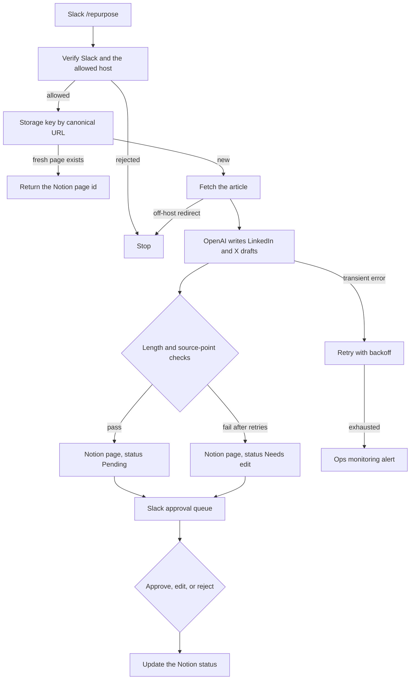

# 14 — Content repurposing

**Platform:** Zapier
**Status:** 🚧 In progress

The design is documented here. I add the working export and a demo video as soon as this workflow is built and tested.

Standards: [../../docs/engineering-standards.md](../../docs/engineering-standards.md)

## For you

**Publish once, get your LinkedIn and X drafts for free.**

Rewriting every article for LinkedIn and X takes hours, and auto-posting unreviewed drafts is risky.

- A link to your article becomes a LinkedIn draft and a short post for X.
- Both wait in Notion until you approve, edit or reject them in Slack.
- Nothing is published until you've read it.

**Who it's for:** founders and marketers who publish on their own site.

**Tools:** OpenAI, Notion, Slack, on Zapier.

## Business problem

A published article has to be rewritten by hand for LinkedIn and for X. Drafts get posted before anyone has read them, or they never get written.

A blog URL on the client's own domain becomes one LinkedIn draft and one X draft. Both are stored as a Notion page and wait in a Slack approval queue. Publishing is a later step, after you have read the draft. This workflow stops at Notion and Slack.

## Trigger

The Slack slash command `/repurpose`, delivered through the Zapier Slack connection. The command text is a single URL. Slack signs the request. The signing secret stays in the Slack connection.

A manual rebuild that uses a Catch Hook must verify `X-Slack-Signature` (version `v0`, HMAC-SHA256 of the raw body) before any fetch. A failed check stops the Zap.

The host must be on `allowed_hosts`. Any other host stops before the fetch. The Zap is not an open fetcher. The page text is untrusted. Text inside it is not a workflow instruction.

The idempotency key is `14-content-repurposing:url:{canonical_url}` in Storage by Zapier. A second request inside `refresh_after_hours` (default 168) returns the existing Notion page id. A later request creates a new page and does not delete the old one.

The sample request is [`sample-data/repurpose-request.json`](sample-data/repurpose-request.json). Tests can skip the network and use [`sample-data/article.json`](sample-data/article.json) as the fetch result. The article is fictional.

## Flow

1. Verify the Slack request. Parse the URL. Require `https`. Reject a host that is not on `allowed_hosts`.
2. Resolve the canonical URL (lower-case host, no trailing slash, no query string) and read the Storage key.
3. When the stored page id is younger than `refresh_after_hours`, return that id and stop. Do not call the model again.
4. Write the key as `in_progress`. Storage by Zapier is not a lock. Two overlapping runs can both miss the key. The second run still creates a second Notion page rather than overwriting the first. The Slack message names the page id so a person can discard the duplicate.
5. Fetch the URL. Follow at most three redirects, and only when each redirect stays on `allowed_hosts`. Read the title and the article text. Drop script, style, and navigation regions.
6. When the extracted text is shorter than 200 characters, alert and stop. Do not draft from a title alone. Mark the key `failed`.
7. Call OpenAI once for both drafts, with structured output. Temperature is 0.

```json
{
  "linkedin": "",
  "x": "",
  "source_points": ["", "", ""]
}
```

Constraints checked in the Zap after the model returns:

- `linkedin` is between 200 and 1,300 characters.
- `x` is at most 280 characters.
- `source_points` has three short phrases that appear in the article text, so a reviewer can see what the draft used.
- The drafts contain no claim of customer counts, revenue, or results unless that sentence is in the article.

A response that breaks a constraint is retried up to 3 times and then stored with status `Needs edit`. It is not published.

8. Create a page in the Notion database `notion_database_id`. Properties: title, source URL, LinkedIn draft, X draft, source points, and status. Status is `Pending` when the checks passed, and `Needs edit` when they did not.
9. Post one Slack message to `approval_channel` with the title, URL, both drafts, and the Notion page URL.
10. Approve, Edit, and Reject are Slack replies that update the Notion status to `Approved`, `Needs edit`, or `Rejected`. Approve means a person accepted the wording. It does not call the LinkedIn or X APIs.
11. Mark the Storage key `completed` with the Notion page id.

## Architecture



## Error handling and edge cases

| Case | Specified behavior |
| --- | --- |
| The URL host is not on the allowlist | Stop. No fetch. |
| A redirect leaves the allowlist | Stop and alert. Do not draft from the other host. |
| The same URL is submitted twice inside `refresh_after_hours` | Return the existing Notion page id. Do not call the model again. |
| Two runs pass the Storage check together | Two Notion pages may exist. Neither overwrites the other. Slack shows both page URLs. |
| The page tells the model to invent a revenue figure | The source-point check still requires three phrases from the article. A revenue sentence that is not in the article is stored as `Needs edit`. |
| Slack is down after the Notion page is stored | Retry the Slack message. The page stays `Pending`. Do not create a second page on that retry. The page id is already on the Storage key. |
| Fetch or OpenAI returns 429 or 5xx | Back off, then alert. |
| The article is behind a login | The fetch will not see the body. The short-text rule alerts and stops. |
| Approve is clicked | Update Notion to `Approved`. Do not call a social API. |
| Logs | Store the canonical URL and the Notion page id. Do not store the Slack signing secret or the article body. |

## Integrations and credentials

Create these on the client's Slack workspace, OpenAI account, and Notion workspace. Plug them into the Zapier connections below. This folder does not hold the secret values.

| System | Credential name | Used for |
| --- | --- | --- |
| Slack | `slack_bot` | The `/repurpose` command and the approval queue. |
| OpenAI | `openai_api` | LinkedIn and X drafts. |
| Notion | `notion_oauth` | Draft pages in the database named below. |
| Storage by Zapier | `zapier_storage` | URL keys. |
| Ops monitoring | `ops_webhook` | `X-Ops-Token` and the workflow 07 URL. |

LinkedIn and X connections are not part of this version, because this version does not publish.

### Config

| Variable | Purpose | Spec default |
| --- | --- | --- |
| `dry_run` | Mock mode. Log the drafts. Create no Notion page and post no Slack message. | `true` |
| `allowed_hosts` | Hosts the fetcher may call. | Client domains |
| `notion_database_id` | Database that receives draft pages. | Client database |
| `approval_channel` | Slack channel id. | Client channel |
| `refresh_after_hours` | How long a URL returns the same Notion page id. | `168` |
| `draft_model` | Model id. | Client choice |
| `max_output_tokens` | Cap on the draft call. | `1200` |

Mock mode is `dry_run` true. The fetch step can be skipped by feeding `article.json` in as the page body. Live mode is `dry_run` false against the client's Notion database and Slack channel, and only for hosts on `allowed_hosts`, after those connections are plugged in. Production publishing keys are not part of this folder.

## Test checklist

I run these before anything goes live.

- [ ] A URL on `https://example.net` stops when the allowlist is `example.com`.
- [ ] `article.json` fed in as the fetch result, in `dry_run`, logs one LinkedIn draft, one X draft within 280 characters, and three source points taken from the article.
- [ ] A second request for the same URL inside the refresh window logs the same Notion page id and no second model call.
- [ ] A draft that mentions revenue the article does not contain is stored as `Needs edit` after retries, or the test stubs that failure directly.
- [ ] An Approve action updates the Notion status and does not call a social API.
- [ ] A redirect fixture whose next host is off the allowlist logs an alert and no Notion page.
- [ ] The logged payload contains no OpenAI key and no Slack signing secret.

## Files

Not in this folder yet:

- Shared Zap link or Zap template.
- Screenshot of the Zap.
- The fixture set captured during a real test run.

`sample-data/` holds a fictional request and a fictional article. `example.com` is a reserved documentation domain. There is no Zap JSON export in this folder.

| Path | What it is |
| --- | --- |
| `sample-data/repurpose-request.json` | Fictional URL request from the slash command. |
| `sample-data/article.json` | Fictional article body used when a test skips the network. |
